<h1 align="center">dsh-zen-remote</h1>
<p align="center">One DeepSeek Harness plugin, two roles. The <b>host</b> turns DSH into a phone-reachable PWA (mobile UI, pairing gateway, lock-screen push) and shares chosen sessions to paired desktops. The <b>client</b> runs inside another DSH desktop app and puts the host's shared sessions right into its own sidebar — full history, live progress, messages, approvals, terminal, everything executes on the host.</p>

<p align="center">
<a href="https://www.npmjs.com/package/dsh-zen-remote"></a>
<a href="https://www.npmjs.com/package/dsh-zen-remote"></a>
<a href="https://github.com/KyoMio/dsh-zen-remote/actions/workflows/publish.yml"></a>
<a href="LICENSE"></a>
<br>


<a href="https://www.npmjs.com/package/dsh-zen-remote#provenance"></a>


</p>

<p align="center"><a href="README.zh-CN.md">中文文档</a></p>

| Session list home | Session page | Session info card |
| --- | --- | --- |
| 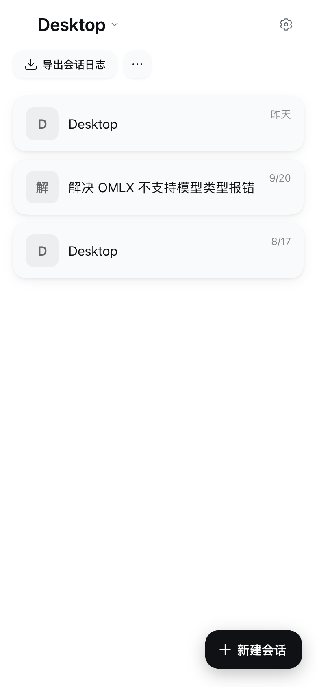 | 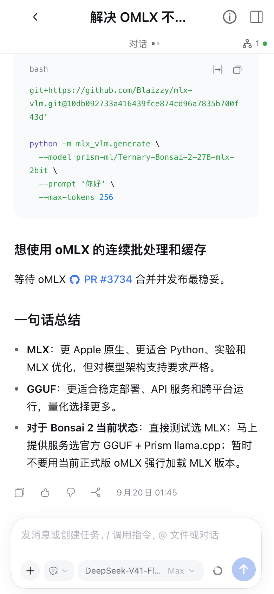 | 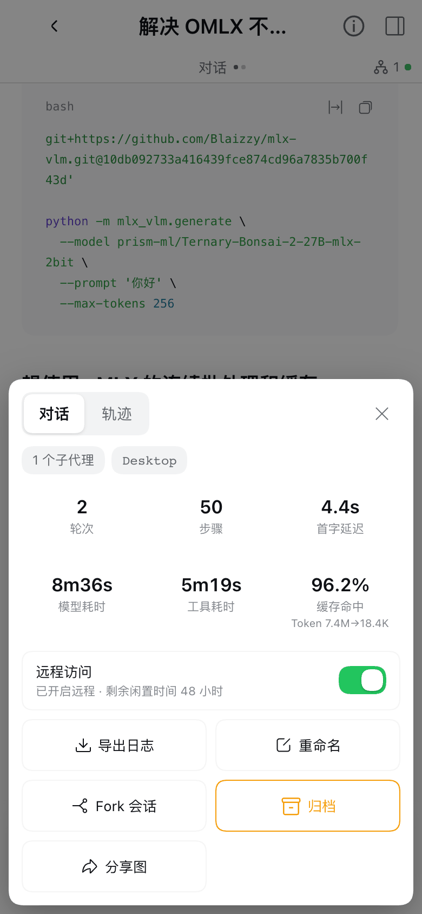 |

| Composer permission sheet | Pairing page a public visitor sees |
| --- | --- |
| 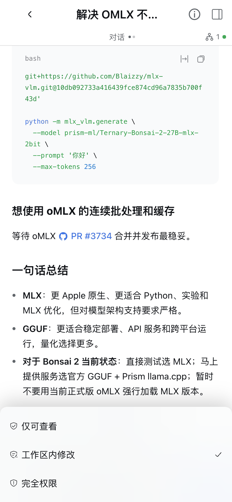 | 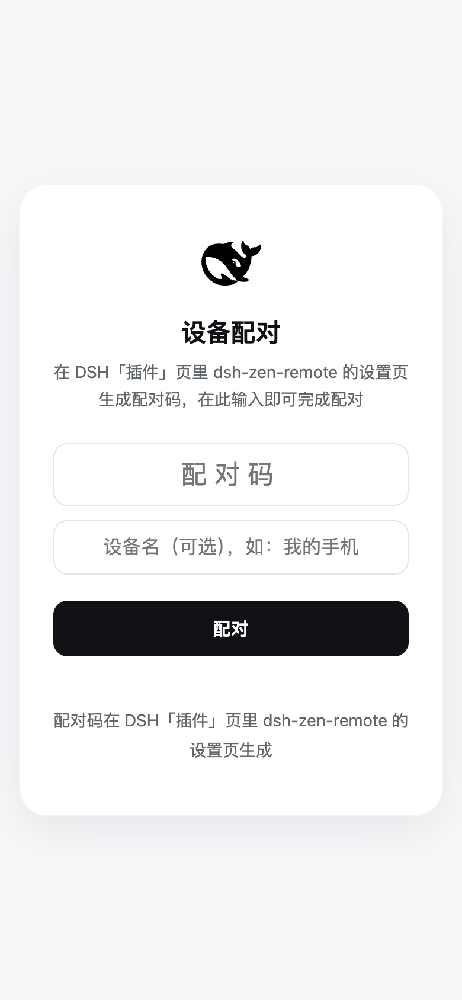 |

> Screenshots are a 390×844 phone viewport in the light theme; both themes are supported. The pairing page is drawn by the gateway in DSH's official style, following the system light / dark appearance.

---

## Contents

1. [Install](#1-install)
2. [Quick Start (Unified Setup & Pairing Wizard)](#2-quick-start-unified-setup--pairing-wizard)
   - [Scenario A: Set up as Host (Phone & Desktop Access)](#scenario-a-set-up-as-host-phone--desktop-access)
   - [Scenario B: Set up another computer as Desktop Client](#scenario-b-set-up-another-computer-as-desktop-client)
3. [Daily Usage: Session Sharing & Cross-Device Workflow](#3-daily-usage-session-sharing--cross-device-workflow)
4. [Lock-Screen Push: When Notifications Fire](#4-lock-screen-push-when-notifications-fire)
5. [Features](#5-features)
6. [Advanced Settings & Field Reference](#6-advanced-settings--field-reference)
7. [Security Model, Version Tolerance & Known Notes](#7-security-model-version-tolerance--known-notes)

---

## 1. Install

### Install from the UI (Recommended, Desktop App & Web UI)

Open the **Plugins** page in the DSH sidebar → click **Add plugin** → type `dsh-zen-remote` → click **Enable now** when the install finishes, then restart the DSH desktop app (or `dsh web`).

### Install from the CLI (Headless `dsh web` server)

```sh
dsh plugin --profile web add dsh-zen-remote
# then restart dsh web
```

> `dsh plugin` requires `--profile` to name the target profile. The desktop app's `desktop` profile is managed exclusively by the app (`--profile desktop` is refused on the CLI), so use the UI install above on the desktop app.

<details>
<summary>Manual Profile Edit / Local Development (<code>link:</code>), Upgrading & Uninstall</summary>

**Editing the profile by hand** (local development, `link:` installs): add the dependency to the profile's `package.json` (`~/.dsh/profiles/desktop` for the desktop app, `~/.dsh/profiles/web` for the web service) and append `"dsh-zen-remote"` to the `dsh.profile.bundles` array:

```jsonc
// ~/.dsh/profiles/desktop/package.json
{
  "dependencies": {
    "dsh-zen-remote": "^2.3.5"        // for local development: "link:/path/to/dsh-zen-remote"
  }
}
```

```sh
cd ~/.dsh/profiles/desktop && pnpm install
# For a link: checkout, also run `npm install --omit=dev` inside the repository so the gateway subprocess can resolve `web-push`.
```

**Upgrading & migration notes**:
- **Upgrading with HMR on**: remove `dsh-zen-remote` first, then install the new version (`dsh plugin --profile <name> remove dsh-zen-remote` → `add dsh-zen-remote`, or Uninstall → Add in the Plugins page).
- **DSH 0.2.1-alpha.3+ profile reset**: `dsh --profile <name> --from-default-profile <template>` replaces an existing custom profile with a fresh copy; back up `~/.dsh/profiles/<name>` first.
- **Upgrading from 1.x**: since 2.0.0 the composition layer is a single row (`dsh-zen-remote`). Remove any legacy `dsh-zen-remote-gateway`, `dsh-zen-remote-push`, or manual `dsh-push.mjs` lines from `cordis.patch.yml`. Existing `~/.dsh/lan-gate.config.json` settings and paired devices carry over automatically.
- **Uninstalling**: click **Uninstall** on the `dsh-zen-remote` plugin page and restart. To also wipe pairing and share state, delete `~/.dsh/lan-gate-state.json`, `~/.dsh/lan-gate.config.json`, `~/.dsh/zen-remote-shares.json`, and `~/.dsh/zen-remote-server.json`.

</details>

---

## 2. Quick Start (Unified Setup & Pairing Wizard)

The same plugin supports two roles:
- **Server (`role: host`, default)**: runs your sessions, spawns the local security gateway and Web Push service, and lets your phone (PWA) or another computer connect.
- **Desktop Client (`role: client`)**: runs inside another computer's DSH desktop app, connects to the host, and mounts the host's shared sessions directly into its own sidebar (without spawning a local gateway or fighting for port 3088).

Open **Plugins → `dsh-zen-remote`** in DSH. The **Remote Access & Device Pairing** card sits right at the top of the page:

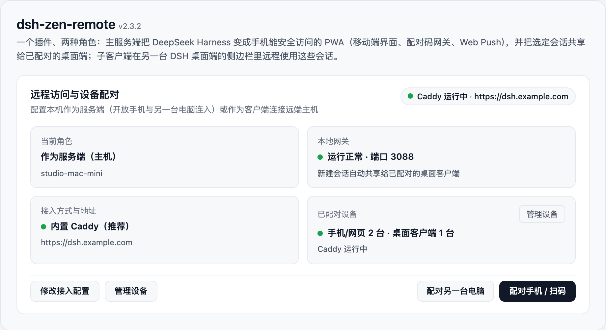

---

### Scenario A: Set up as Host (Phone & Desktop Access)

Click **Start Setup Wizard** (or **Reconfigure Wizard** if already configured) to complete setup in three guided steps:

#### Step 1: Choose "Act as Server (Host)" & an Access Method

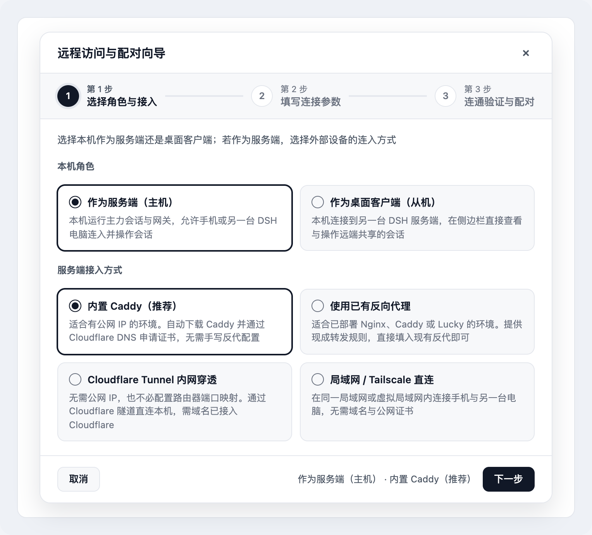

Pick one of the four access methods based on your network environment (switching methods automatically stops any managed process from the previous mode and updates the gateway bind address):

| Access method | Best for | What the wizard automates |
| --- | --- | --- |
| **Managed Caddy (Recommended)** | Public IP (or router port forwarding) + domain on Cloudflare | Automatically downloads a prebuilt `Caddy + caddy-dns/cloudflare` binary (auto-accelerated via mainland China mirrors when needed) and issues/renews TLS certificates via DNS-01; gateway listens only on `127.0.0.1:3088` |
| **Existing Reverse Proxy** | Already running Nginx, Caddy, or Lucky | Generates ready-to-paste proxy snippets with WebSocket and `X-Forwarded-*` headers, plus one-click `trustedProxies` registration (full manual guide: [docs/remote-access.en.md](docs/remote-access.en.md)) |
| **Cloudflare Tunnel** | No public IP / no router port forwarding + domain on Cloudflare | Automatically downloads `cloudflared` (with mainland China mirror failover), creates or reuses a tunnel via the Cloudflare API, writes the DNS CNAME record, and starts the tunnel; gateway listens only on `127.0.0.1:3088` |
| **LAN / Tailscale Direct** | Same Wi-Fi / LAN or shared Tailscale virtual network | No domain or TLS certificate needed; auto-detects the machine's LAN / Tailscale IPv4 address and binds `0.0.0.0:3088`, while the gateway's built-in **private-IP wall** rejects any unproxied direct connection from a public internet IP (`403 public-direct-forbidden`) |

#### Step 2: Fill in Connection Parameters
- **Managed Caddy / Cloudflare Tunnel**: enter your public domain (e.g. `dsh.example.com`) and paste your Cloudflare API Token (click *"How do I get an API token?"* for step-by-step instructions and required permissions, or *"Domain not on Cloudflare yet?"* for onboarding steps).
- **Existing Reverse Proxy**: enter the external `https://` URL of your proxy and copy the generated Nginx / Caddy / Lucky configuration snippet.
- **LAN / Tailscale Direct**: the wizard automatically detects and pre-fills `http://<your-LAN-or-Tailscale-IP>:3088`.

#### Step 3: Verify Connectivity & Pair Devices

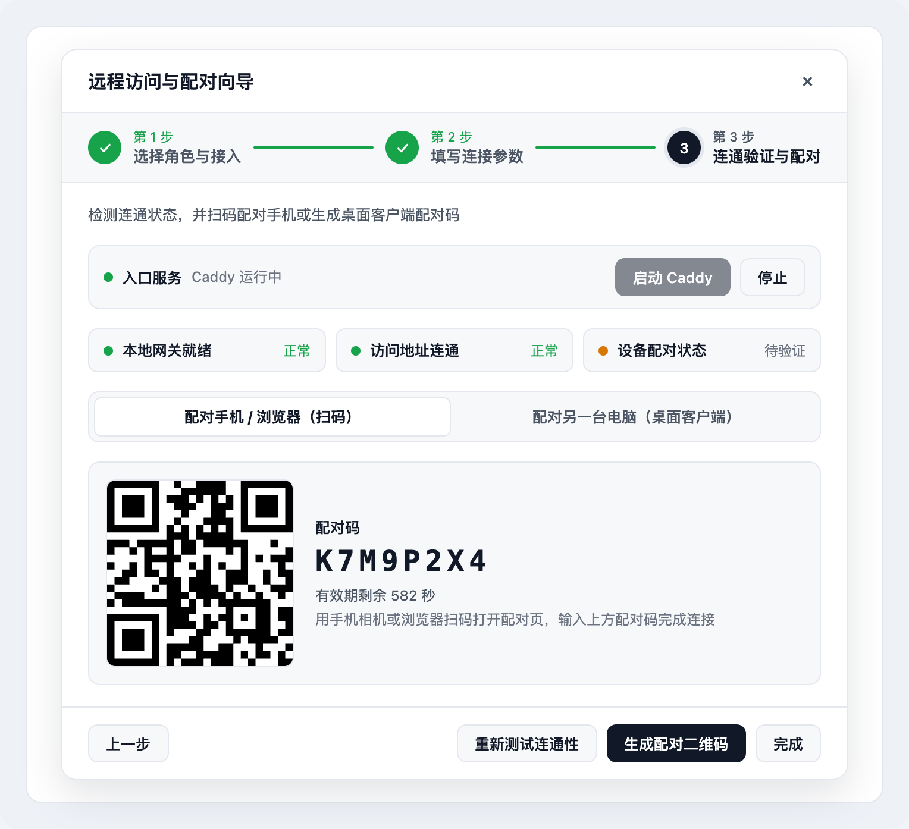

1. **Start Ingress Service & Auto-Probe**:
   - For Managed Caddy or Cloudflare Tunnel, click **Start Caddy** or **Create & Start Tunnel** in the service bar.
   - The wizard automatically probes **Local gateway ready** and **Access URL reachable** (verifying that `/` serves the `401` pairing page and `/lan-gate/admin` returns `403`).
2. **Pair Phone / Browser (Web App)**:
   - On the **Pair Phone / Browser (QR)** tab, click **Generate Pairing QR**.
   - Scan the QR code with your phone camera or browser, enter the 8-character pairing code, and use **"Add to Home Screen"** to install DSH as a standalone PWA with lock-screen push notifications.
3. **Pair Another Computer (Desktop Client)**:
   - Switch to the **Pair Desktop Client** tab, click **Generate Desktop Pairing Code**, and click **Copy Server URL & Code** to send to your other computer.

> **Quick actions after setup**: once configured, you can directly click **Pair Phone (QR)**, **Pair Desktop Client**, or **Manage Devices** (rename devices, switch device roles, revoke one or all devices, or send a test push) right from the overview card footer without re-running the wizard.

---

### Scenario B: Set up another computer as Desktop Client

On the second computer running the DSH desktop app:

1. Open **Plugins → `dsh-zen-remote`** and click **Start Setup Wizard**.
2. **Step 1**: select **Act as Desktop Client** and click **Next**.
3. **Step 2**: enter a name for this computer (e.g. `Living-Room-Mac`), the host's gateway URL (`https://` for public URLs, or `http://192.168.x.x:3088` / `http://100.x.x.x:3088` for LAN / Tailscale), and the 8-character desktop pairing code from the host, then click **Pair & Connect**.
4. **Step 3**: once all three status lights (**Pairing token**, **Server connection**, **Session & plugin sync**) turn green, the host's shared workspaces and sessions appear in your left sidebar immediately.

---

## 3. Daily Usage: Session Sharing & Cross-Device Workflow

| | **Web App Device (Phone / Tablet / Browser)** | **Desktop Client (Another DSH Desktop App)** |
| --- | --- | --- |
| Visible sessions | **All** sessions on the host | **Only** sessions with remote access enabled on the host (enforced server-side) |
| Credential | Long-lived HttpOnly cookie | Secret device token stored in the plugin config (`Bearer` token) |

### Enabling or Disabling Remote Access on a Session

Remote access is controlled per session (or automatically enabled for new sessions if you turn on *Auto-share new sessions* in Step 2 of the wizard). You can toggle it from four places:

1. **Host sidebar**: open a session's `"…"` menu and click **开启远程 / 关闭远程** (Enable / Disable remote);

   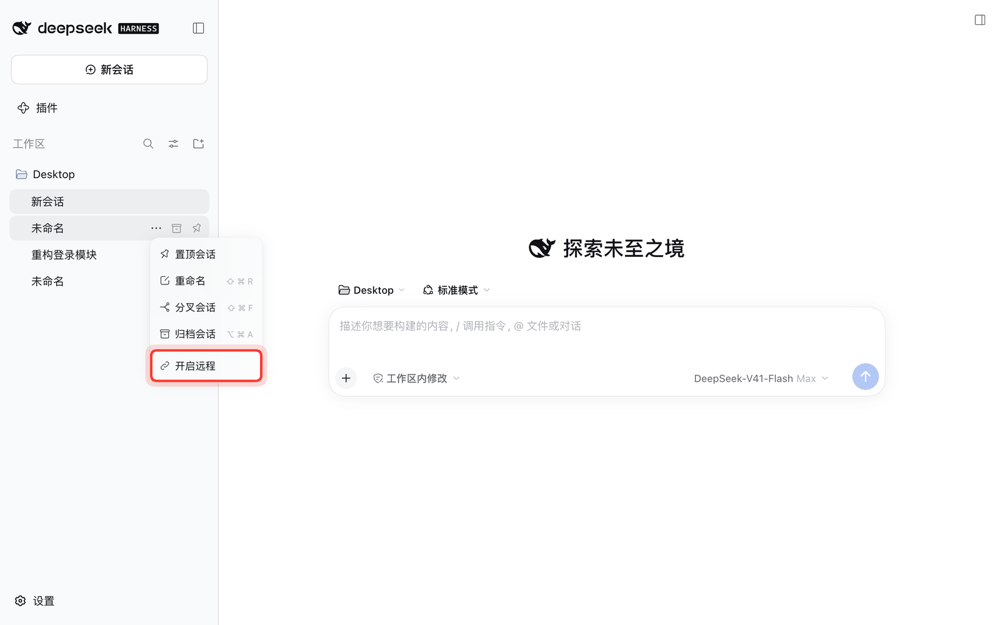

2. **Host session header**: click the globe icon in the session title row (hover to see remaining idle time; a dot indicates a desktop client is currently viewing it);
3. **Phone (Web App) session info card**: open the info card at the top right of a session and toggle **远程访问** (Remote access);

   <p align="center">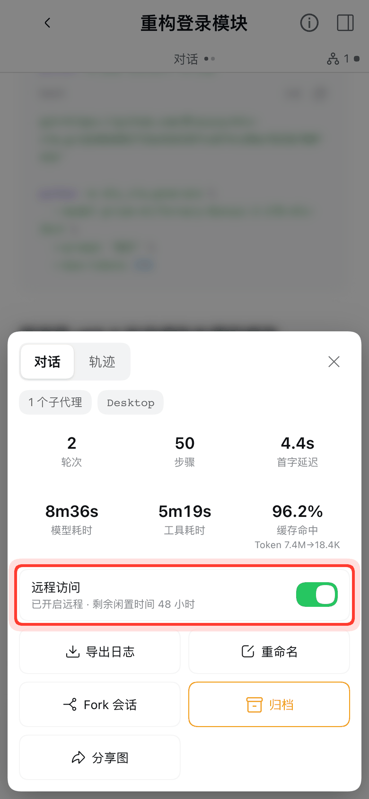</p>

4. **Host settings page**: view and close shared sessions individually or all at once under the shared sessions list.

### Working in Remote Sessions on a Desktop Client

- **Sidebar groups**: once a host workspace has at least one remote-enabled session, a **"Server Name · Workspace Name"** group appears in the client's sidebar. Click any session to view full history, stream responses, approve tools, use the server terminal, browse files and diffs, download deliverables, or drag-and-drop files to upload.

  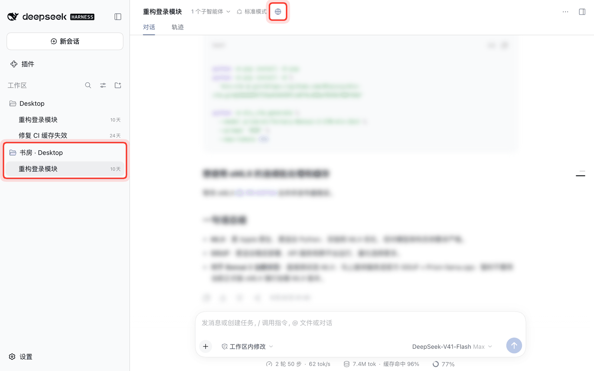

- **Closing & idle sleep**: a shared session automatically closes remote access after **48 hours** (`idleHours`) of inactivity (mid-turn sessions or sessions waiting on approvals/questions never sleep). When remote access is closed—or when the client unpairs or its token is revoked—remote sessions are automatically archived/hidden from the sidebar; an actively open session displays a "remote closed" banner and recovers automatically if re-shared.

  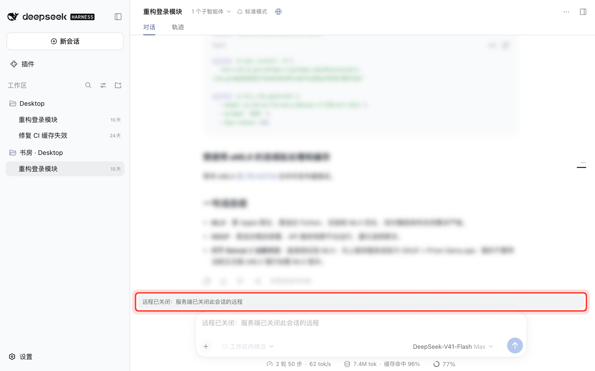

---

## 4. Lock-Screen Push: When Notifications Fire

Notifications fire only when **you are actually needed**, along two independent paths (all payloads are end-to-end encrypted with `aes128gcm`):

1. **System-triggered (always on, never suppressed by debounce)**:
   - **Tool waiting for approval**: pushes *"DSH needs your approval"* with the tool name. Waits `DSH_PUSH_APPROVAL_GRACE_MS` (default 5s) before sending so fast auto-approver plugins can answer first without buzzing your phone.
   - **`ask_user_question` waiting for your answer**: pushes *"DSH is waiting for your answer"*.
   - Works for both top-level sessions and subagent sessions across Web and Desktop hosts.
2. **Model-triggered (`push_notify` tool)**:
   - Called by the agent when you asked to be notified upon completion, or when it hits a blocker that requires your decision.
   - Ordinary turn completions do not push by default (enable `pushTurnEnd` in advanced settings if you want a push after every turn; enable `pushSummary` to include up to 120 characters of the final reply in the notification body).

---

## 5. Features

- **Mobile PWA UI (Host)**:
  - Two-level page stack (session list home + standalone session page with left-edge swipe back, Android back-gesture support, first-frame boot skeleton, and immutable asset caching)
  - Home-screen plugin entry chips (auto-discovered per installed plugin, individually toggleable)
  - Compact mobile composer with bottom sheets for permissions/models and direct phone attachment uploads
  - Session info card (6-tile stats, log export, rename, fork, archive, one-tap full-conversation PNG share image, and remote access switch)
- **Unified Setup & Pairing Wizard (2.3)**:
  - Top-of-page 2×2 live overview card and 3-step modal wizard covering all four host ingress modes (Managed Caddy, Existing Reverse Proxy, Cloudflare Tunnel, LAN / Tailscale Direct) and Desktop Client pairing
  - Automatic download of prebuilt `Caddy + caddy-dns/cloudflare` and `cloudflared` binaries with mainland China network auto-detection, mirror acceleration (`gh-proxy.com` / `ghfast.top`), connect/stall failover watchdogs, and daily upstream release tracking via GitHub Actions
  - Automatic LAN / Tailscale IPv4 discovery and local network probing, backed by the gateway's private-IP wall (`403 public-direct-forbidden`) against accidental public exposure
  - Dedicated **Manage Devices** modal and automatic sidebar cleanup on client unpair/revocation
- **Cross-Desktop Remote Sessions (Client)**:
  - Full-featured remote sessions in the sidebar: history, streaming, approvals/questions, server model catalog, file tree, changes summary/diff, server-side terminal, windowed artifact downloads, server-side LibreOffice PDF preview, up to 500 MiB file uploads, and drag-and-drop file upload interception
- **Plugin Bridge**:
  - Cooperative plugins and built-in adapters (such as `dsh-better-sidebar`) route their panel requests in remote sessions to the host machine (with explicit owner consent for whole-machine data). See [Plugin Bridge Guide](docs/plugin-bridge.md).

In depth: [Interface Design](docs/interface.md) · [Public Access & Relay Protocol](docs/remote-access.en.md)

---

## 6. Advanced Settings & Field Reference

Day-to-day setup and device management are handled entirely by the **Remote Access & Device Pairing Wizard** at the top of the `dsh-zen-remote` page. To fine-tune individual low-level fields, click `dsh-zen-remote` a second time under **Included components** on the plugin detail page.

<details>
<summary>View underlying component settings screenshots & full field reference table</summary>

Each field resolves in order: **environment variable > plugin row settings > `~/.dsh/lan-gate.config.json` > default**. Saving a field that requires a gateway/push restart reloads the plugin row automatically without restarting the app.

| Host Role & Pairing Cards | Shared Sessions List | Client Settings & Diagnostics |
| --- | --- | --- |
| 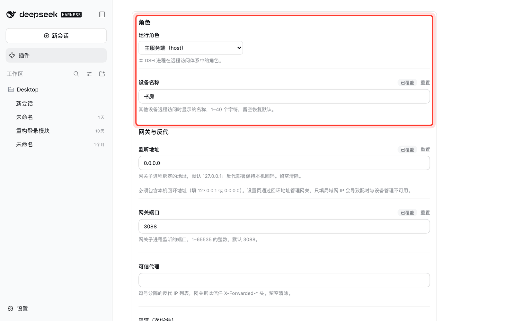 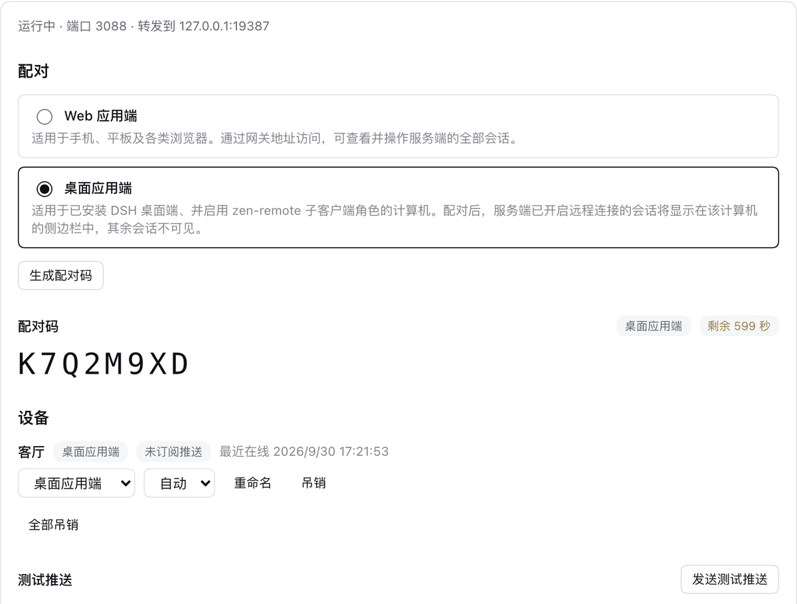 | 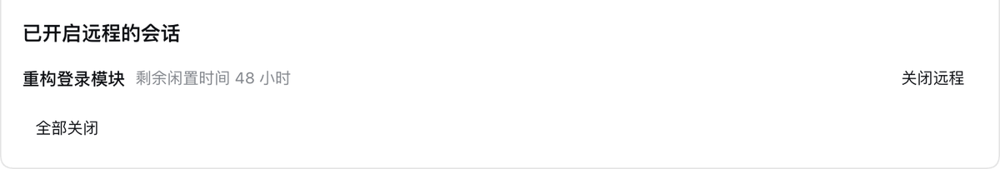 | 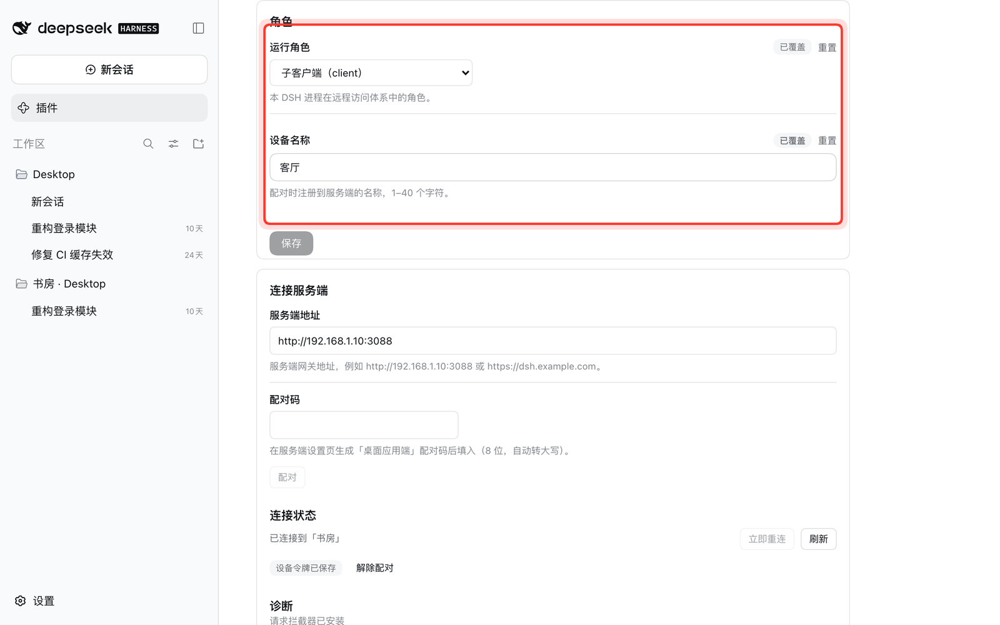 |

| Field | Default | What it does |
| --- | --- | --- |
| `role` | `host` | `host` runs gateway + push + sharing; `client` connects to a remote host |
| `serverName` | computer name | **Device name** (≤ 40 chars): sidebar group title on a host, registered device name on a client; syncs both ways automatically |
| `port` | `3088` | Gateway port; retries upward (up to +20) if occupied |
| `host` | `127.0.0.1` | Gateway bind address (`127.0.0.1` for local proxy/tunnel, `0.0.0.0` for LAN/Tailscale direct) |
| `targetPort` | *(auto)* | Local DSH Web UI port; leave empty to auto-discover the host's listening port |
| `rateLimit` | `120` | Per-minute cap on unpaired requests per client IP |
| `trustedProxies` | empty | Comma-separated trusted proxy IPs when the reverse proxy runs on another machine |
| `vapidSubject` | `mailto:admin@localhost` | Web Push contact (**must be a real `mailto:` or `https://` URL for iOS delivery**) |
| `lang` | `auto` | Gateway & notification language: `auto` (browser `Accept-Language`), `zh`, or `en` |
| `pushTurnEnd` | off | Also send a push when an ordinary turn finishes (approvals/questions always push) |
| `pushEvents` | `agent/turn-stopping` | Comma-separated events that count as turn end when `pushTurnEnd` is on |
| `pushDebounceMs` | `15000` | Minimum interval (ms) between automatic pushes |
| `pushSummary` | off | Include up to 120 chars of the final reply in notification bodies |
| `pushTool` | on | Register the model-callable `push_notify` tool |
| `idleHours` | `48` | Idle-sleep window in hours for shared sessions; range `(0, 8760]` |
| `autoShareNewSessions` | off | Automatically enable remote access on new sessions created on the host |
| `pluginBridgeConsent` | `{}` | Whole-machine data consent map (`pluginName -> boolean`) for the plugin bridge |
| `serverUrl` *(client)* | empty | Remote server gateway URL (`https://` required for public hosts; `http://` allowed on private LAN/Tailscale ranges) |
| `deviceToken` *(client)* | empty | Paired client token (secret field, redacted everywhere) |
| `turnFoldDesktop` | off | Enable turn-process folding on desktop widths as well as mobile |
| `keyboardLiftRatio` / `keyboardLiftMaxPx` / `keyboardSafetyPadPx` | `0.42` / `400` / `15` | Soft-keyboard lift calibration fallback for environments where the OS hides keyboard height |
| `maxUploadBytes` | 20 MB | Mobile attachment upload cap |

Legacy environment variables (outrank row settings): `LAN_GATE_PORT`, `LAN_GATE_HOST`, `LAN_GATE_TARGET_PORT`, `LAN_GATE_RATE_LIMIT`, `LAN_GATE_TRUSTED_PROXIES`, `LAN_GATE_VAPID_SUBJECT`, `LAN_GATE_LANG`, `DSH_PUSH_TURN_END`, `DSH_PUSH_EVENTS`, `DSH_PUSH_DEBOUNCE_MS`, `DSH_PUSH_SUMMARY`, `DSH_PUSH_TOOL`, `DSH_PUSH_LANG`, `DSH_PUSH_APPROVAL_GRACE_MS`.

</details>

---

## 7. Security Model, Version Tolerance & Known Notes

### Security Model

- **A paired desktop client is a trusted device**: the remote session terminal runs as the **host's OS user**, file-preview endpoints can read files accessible to the host process, and the client can create sessions in any host workspace.
- **Unshared sessions are strictly isolated at the relay**: list rows, history, live events, approvals/questions, and embedded `dsh-session:` references for unshared sessions are filtered or refused server-side.
- **Public direct-connection guard on `0.0.0.0`**: even when the gateway binds `0.0.0.0` for LAN / Tailscale mode, `isPrivateOrLoopbackIp` only admits direct connections from loopback, RFC1918 LAN ranges, link-local, and Tailscale (`100.64.0.0/10` / `fd7a:115c:a1e0::/48`); any unproxied direct connection from a public internet IP is rejected with `403 public-direct-forbidden`.
- **Admin actions are local-only**: minting pairing codes, changing device roles, running the setup wizard, and revoking devices are only permitted directly on the host machine.
- **Data & privacy**: the plugin reports nothing to any third party. Pairing state lives in `~/.dsh/lan-gate-state.json`, shared sessions in `~/.dsh/zen-remote-shares.json`, and Cloudflare tokens in `0600` files under `~/.dsh/zen-remote-ingress/`.

### Version Tolerance

1. **Relay protocol version**: both host and client must run the same `dsh-zen-remote` version.
2. **DSH host version**: DSH versions may differ between host and client. Normalized interface fingerprints are compared during handshake; any differing group is annotated `"（版本有差异）"` and degrades only the affected panel.

### Known Limitations & Third-Party Plugin Support

<details>
<summary>Expand known limitations, iOS PWA notes & adapted third-party plugins</summary>

**Known limitations**
- With multiple DSH windows open simultaneously on a client, active-session detection may occasionally dismiss a closed session early.
- Switching between different servers or recreating a workspace with the same ID requires reloading the client page once.
- "Export session" and server-local OS dialogs ("Reveal in Finder" / "Open in app") are hidden in remote sessions.
- DSH's own Settings RPCs are loopback-only by upstream design, so plugin settings must be edited on the machine running DSH rather than through a remote browser.

**iOS standalone PWA notes**
- **iOS 26.x viewport shrinkage**: home-screen PWAs may lose a status-bar height at the bottom (an iOS WebKit bug); three mitigation layers are built in, and restarting the PWA restores full height.
- **iOS 26+ top progressive blur**: opening from the home screen may show a system `WKScrollPocket` blur across the top ~95px; entering any session and navigating back to the list clears it.

**Third-party plugins with mobile & bridge adaptations**

| Plugin | Adaptation summary | Version tested |
| --- | --- | --- |
| [dsh-better-sidebar](https://github.com/omdsh-dev/DSH-better-sidebar) | Full-screen mobile right-sidebar drawer with notch safe-area padding and swipe-back; **Plugin Bridge** built-in adapter for `0.25.0` through `0.28.2` (seven versions) (reads/writes host file/Git/task panels in remote sessions with host owner consent) | 0.19.1 / adapter 0.25–0.28.2 |
| [@nanmicoder/dsh-agent-teams](https://github.com/NanmiCoder/dsh-agent-teams) | Repositions AgentTeams floating pill below session header and preserves parent session back-link | 0.1.9 |
| [@ychris12138/dsh-usage-stats](https://github.com/Ychris12138/dsh-usage-stats) | Moves usage & balance entry into the mobile home chips bar | 0.2.9 |
| [@opendsh/dsh-plugin-scheduled-tasks](https://github.com/Ceelog/dsh-plugins) | Moves scheduled tasks entry into the mobile home chips bar | 0.2.3 |
| dsh-at-file | Deduplicates `.dsh-uploads/` attachment rows on mobile | 0.6.7 |
| [@ace-zone/dsh-market](https://www.npmjs.com/package/@ace-zone/dsh-market) | Compacts marketplace modal header on mobile so the close button stays reachable | 0.1.66 |
| [dsh-vision-toolkit](https://www.npmjs.com/package/@anionex/dsh-vision-toolkit) | Works with mobile attachment uploads for image Q&A/OCR | — |
| [dsh-web-ui bundle](https://www.npmjs.com/package/@linxin666/dsh-web-ui-all) | Mobile width-constrained centered overlays for file tree / preview | — |

</details>

---

## Upstream credits

This plugin's interface layer derives from [mexiaosqwq/dsh-web-mobile](https://github.com/mexiaosqwq/dsh-web-mobile), and its channel layer from [zylzyqzz/dsh-mobile-pwa](https://github.com/zylzyqzz/dsh-mobile-pwa) (itself derived from [Bernardxu123/dsh-mobile-gate](https://github.com/Bernardxu123/dsh-mobile-gate)), both MIT. The original copyright lines are preserved in [LICENSE](LICENSE).

## License

[MIT](LICENSE)
