<h1 align="center">dsh-zen-remote</h1>
<p align="center">One DeepSeek Harness plugin, two roles. The <b>host</b> turns DSH into a phone-reachable PWA (mobile UI, pairing gateway, lock-screen push) and shares chosen sessions to paired desktops. The <b>client</b> runs inside another DSH desktop app and puts the host's shared sessions right into its own sidebar (up to <b>8 hosts</b> connected simultaneously) — full history, live progress, messages, approvals, terminal, everything executes on the host.</p>

<p align="center">
<a href="https://www.npmjs.com/package/dsh-zen-remote"></a>
<a href="https://www.npmjs.com/package/dsh-zen-remote"></a>
<a href="https://github.com/KyoMio/dsh-zen-remote/actions/workflows/publish.yml"></a>
<a href="LICENSE"></a>
<br>


<a href="https://www.npmjs.com/package/dsh-zen-remote#provenance"></a>


</p>

<p align="center"><a href="README.zh-CN.md">中文文档</a></p>

| Session list home | Session page | Session info card |
| --- | --- | --- |
| 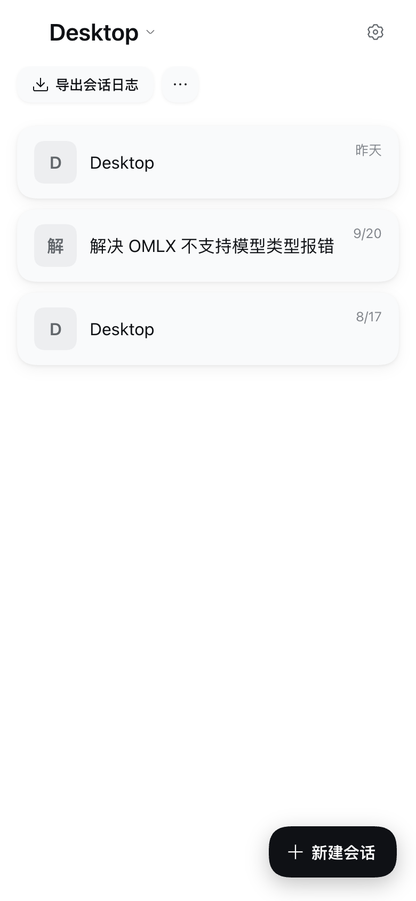 | 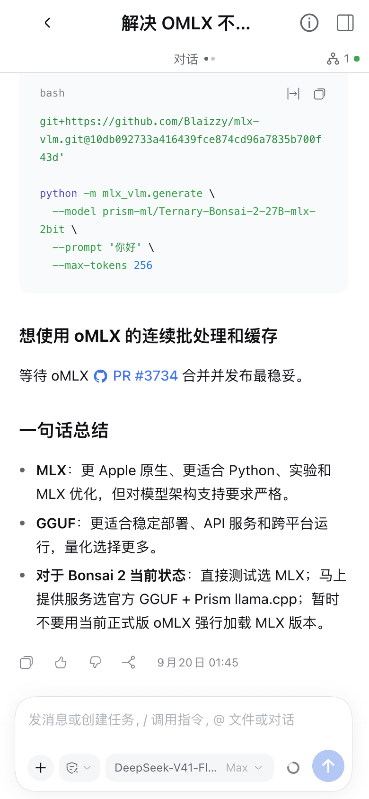 | 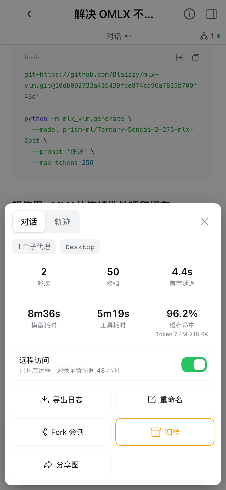 |

| Composer permission sheet | Pairing page a public visitor sees |
| --- | --- |
| 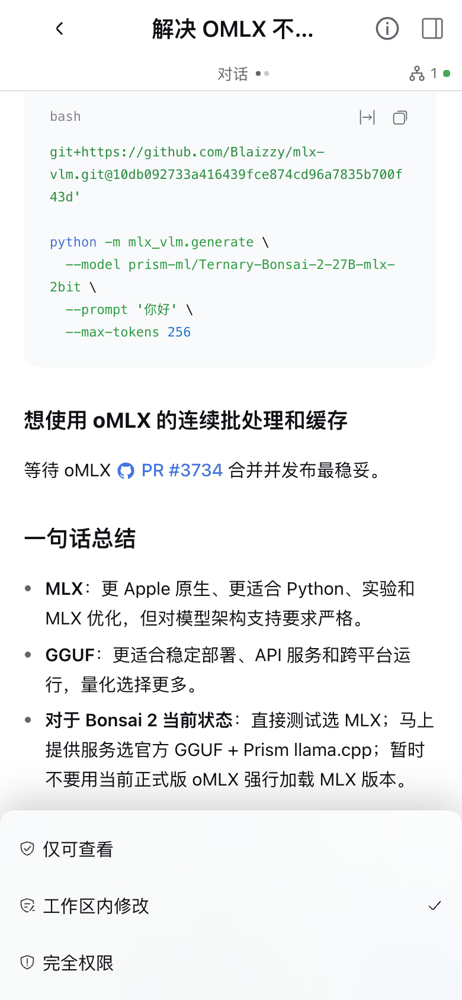 | 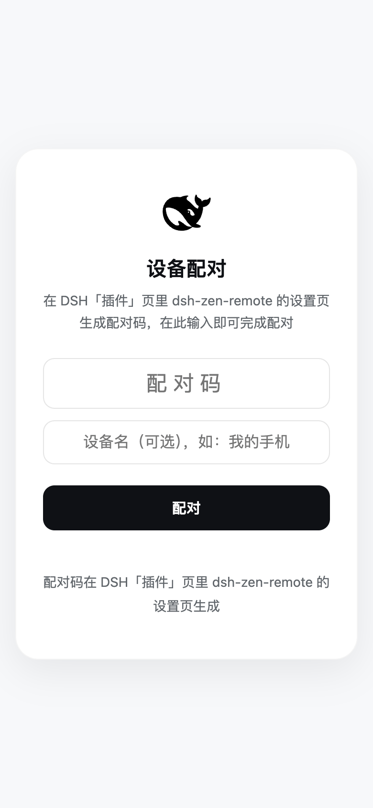 |

> Screenshots are a 390×844 phone viewport in the light theme; both themes are supported. The pairing page is drawn by the gateway in DSH's official style, following the system light / dark appearance.

---

## Contents

1. [Install](#1-install)
2. [Quick Start (Unified Setup & Pairing Wizard)](#2-quick-start-unified-setup--pairing-wizard)
   - [Scenario A: Set up as Host (Phone & Desktop Access)](#scenario-a-set-up-as-host-phone--desktop-access)
   - [Scenario B: Set up as Desktop Client (Connect up to 8 Hosts)](#scenario-b-set-up-as-desktop-client-connect-up-to-8-hosts)
3. [Daily Usage: Session Sharing & Cross-Device Workflow](#3-daily-usage-session-sharing--cross-device-workflow)
4. [Lock-Screen Push: When Notifications Fire](#4-lock-screen-push-when-notifications-fire)
5. [Features](#5-features)
6. [Advanced Settings & Field Reference](#6-advanced-settings--field-reference)
7. [Security Model, Version Tolerance & Known Notes](#7-security-model-version-tolerance--known-notes)

---

## 1. Install

### Install from the UI (Recommended, Desktop App & Web UI)

Open the **Plugins** page in the DSH sidebar → click **Add plugin** → type `dsh-zen-remote` → click **Enable now** when the install finishes, then restart the DSH desktop app (or `dsh web`).

### Install from the CLI (Headless `dsh web` server)

```sh
dsh plugin --profile web add dsh-zen-remote
# then restart dsh web (or run `npx dsh-zen-remote setup` to install, start, and configure in one go)
```

> `dsh plugin` requires `--profile` to name the target profile. The desktop app's `desktop` profile is managed exclusively by the app (`--profile desktop` is refused on the CLI), so use the UI install above on the desktop app.

### Headless Server CLI Wizard (`dsh-zen-remote`)

The plugin ships a bundled CLI tool so remote VPS / headless servers (`dsh web`) can complete the entire setup, ingress configuration, three-light verification, and QR / desktop pairing flow in a terminal without opening a browser:

```sh
npx dsh-zen-remote setup        # 3-step interactive wizard: role → ingress → verify + terminal QR & desktop pairing
dsh-zen-remote status           # current role, gateway & connection state (--json; --debug exports redacted diagnostics)
```

<details>
<summary>Expand full CLI subcommand reference (<code>host</code> / <code>client</code> / non-interactive flags)</summary>

```sh
# Host commands (when role is host)
dsh-zen-remote host device pair --device-role web              # mint a phone/browser pairing code + terminal QR (or desktop-client)
dsh-zen-remote host device list                                # list paired devices (--json supported)
dsh-zen-remote host device revoke <id|--all> [--yes]           # revoke one or all paired devices
dsh-zen-remote host ingress start --mode lan                   # configure & start ingress (caddy | cloudflared | external | lan)
dsh-zen-remote host ingress stop [--yes]                       # stop managed Caddy / Cloudflare Tunnel processes
dsh-zen-remote host ingress verify [--no-wait]                 # three-light check + mint web QR & desktop pairing codes
dsh-zen-remote host ingress snippet [--proxy nginx|caddy|lucky] # print reverse-proxy config snippets

# Client commands (when role is client, up to 8 paired hosts)
dsh-zen-remote client pair http://192.168.1.2:3088 --code 12345678 [--name My-Mac]
dsh-zen-remote client list                                     # list all paired hosts (up to 8) and connection states
dsh-zen-remote client unpair <hostUrl|entryId|--all> [--yes]   # remove one or all paired hosts
```

- **Preflight & non-interactive automation**: `setup` automatically scans candidate profiles for multi-select plugin installation (`desktop` is skipped) and launches the DSH daemon / app before starting the wizard. Pass `--yes` with the required flags (e.g. `setup --role host --ingress lan --no-wait --yes`) for unattended scripts.
- **Architecture**: the CLI communicates with the running plugin over a `0600` local IPC socket (`~/.dsh/zen-remote-cli.sock`); Caddy and `cloudflared` stay managed by the plugin process. Use `--lang zh|en` to switch output language.

</details>

<details>
<summary>Manual Profile Edit / Local Development (<code>link:</code>), Upgrading & Uninstall</summary>

**Editing the profile by hand** (local development, `link:` installs): add the dependency to the profile's `package.json` (`~/.dsh/profiles/desktop` for the desktop app, `~/.dsh/profiles/web` for the web service) and append `"dsh-zen-remote"` to the `dsh.profile.bundles` array:

```jsonc
// ~/.dsh/profiles/desktop/package.json
{
  "dependencies": {
    "dsh-zen-remote": "^2.4.3"        // for local development: "link:/path/to/dsh-zen-remote"
  }
}
```

```sh
cd ~/.dsh/profiles/desktop && pnpm install
# For a link: checkout, also run `npm install --omit=dev` inside the repository so the gateway subprocess can resolve `web-push`.
```

**Upgrading & migration notes**:
- **Upgrading with HMR on**: remove `dsh-zen-remote` first, then install the new version (`dsh plugin --profile <name> remove dsh-zen-remote` → `add dsh-zen-remote`, or Uninstall → Add in the Plugins page).
- **DSH 0.2.1-alpha.3+ profile reset**: `dsh --profile <name> --from-default-profile <template>` replaces an existing custom profile with a fresh copy; back up `~/.dsh/profiles/<name>` first.
- **Upgrading from 1.x**: since 2.0.0 the composition layer is a single row (`dsh-zen-remote`). Remove any legacy `dsh-zen-remote-gateway`, `dsh-zen-remote-push`, or manual `dsh-push.mjs` lines from `cordis.patch.yml`. Existing `~/.dsh/lan-gate.config.json` settings and paired devices carry over automatically.
- **Uninstalling**: click **Uninstall** on the `dsh-zen-remote` plugin page and restart. To also wipe pairing and share state, delete `~/.dsh/lan-gate-state.json`, `~/.dsh/lan-gate.config.json`, and `~/.dsh/zen-remote-state.json` (older versions also kept `~/.dsh/zen-remote-shares.json` and `~/.dsh/zen-remote-server.json` — they migrate into the state file automatically on first start and are then deleted).

</details>

---

## 2. Quick Start (Unified Setup & Pairing Wizard)

The same plugin supports two roles:
- **Server (`role: host`, default)**: runs your sessions, spawns the local security gateway and Web Push service, and lets your phone (PWA) or another computer connect.
- **Desktop Client (`role: client`)**: runs inside another computer's DSH desktop app, connects to **up to 8 hosts simultaneously**, and mounts their shared sessions directly into its own sidebar (without spawning a local gateway or fighting for port 3088).

Open **Plugins → `dsh-zen-remote`** in DSH. The **Remote Access & Device Pairing** card sits right at the top of the page (or run `npx dsh-zen-remote setup` on a headless server):

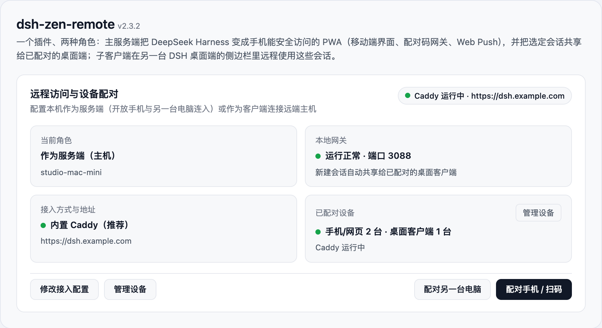

---

### Scenario A: Set up as Host (Phone & Desktop Access)

Click **Start Setup Wizard** (or **Reconfigure Wizard**) to complete setup in three guided steps:

#### Step 1: Choose "Act as Server (Host)" & an Access Method

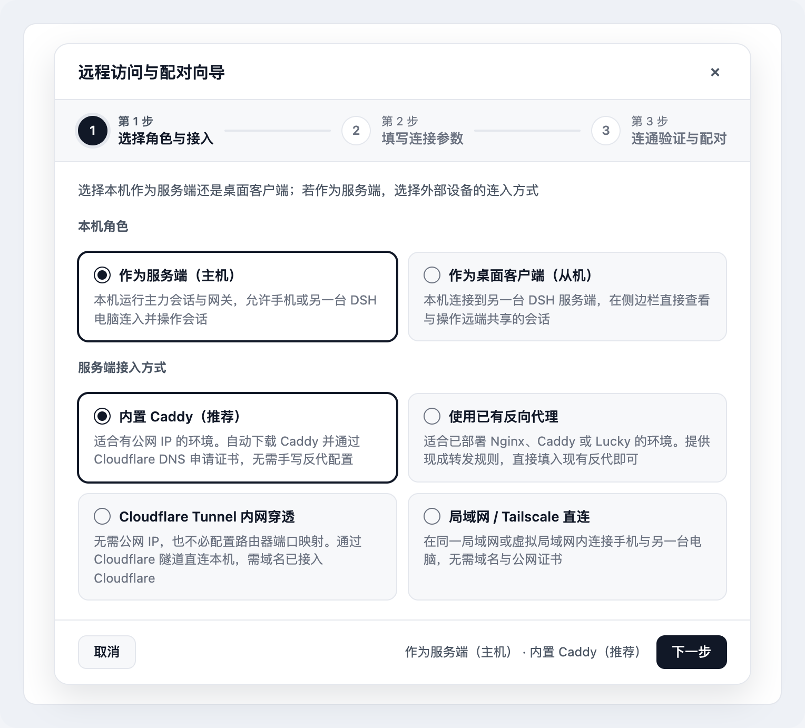

| Access method | Best for | What the wizard automates |
| --- | --- | --- |
| **Managed Caddy (Recommended)** | Public IP (or router port forwarding) + domain on Cloudflare | Downloads prebuilt `Caddy + caddy-dns/cloudflare` and issues/renews TLS certificates via DNS-01 (`127.0.0.1:3088`) |
| **Existing Reverse Proxy** | Already running Nginx, Caddy, or Lucky | Generates ready-to-paste proxy snippets + one-click `trustedProxies` registration ([manual guide](docs/remote-access.en.md)) |
| **Cloudflare Tunnel** | No public IP / no port forwarding + domain on Cloudflare | Downloads `cloudflared`, creates/reuses a tunnel, configures CNAME, and starts the tunnel (`127.0.0.1:3088`) |
| **LAN / Tailscale Direct** | Same Wi-Fi / LAN or shared Tailscale network | Auto-detects LAN / Tailscale IPv4 and binds `0.0.0.0:3088` behind the built-in **private-IP wall** (`403 public-direct-forbidden`) |

#### Step 2: Fill in Connection Parameters
- **Managed Caddy / Cloudflare Tunnel**: enter your public domain (e.g. `dsh.example.com`) and paste your Cloudflare API Token.
- **Existing Reverse Proxy**: enter the external `https://` URL and copy the generated Nginx / Caddy / Lucky configuration snippet.
- **LAN / Tailscale Direct**: confirm the auto-detected `http://<your-LAN-or-Tailscale-IP>:3088` address.

#### Step 3: Verify Connectivity & Pair Devices

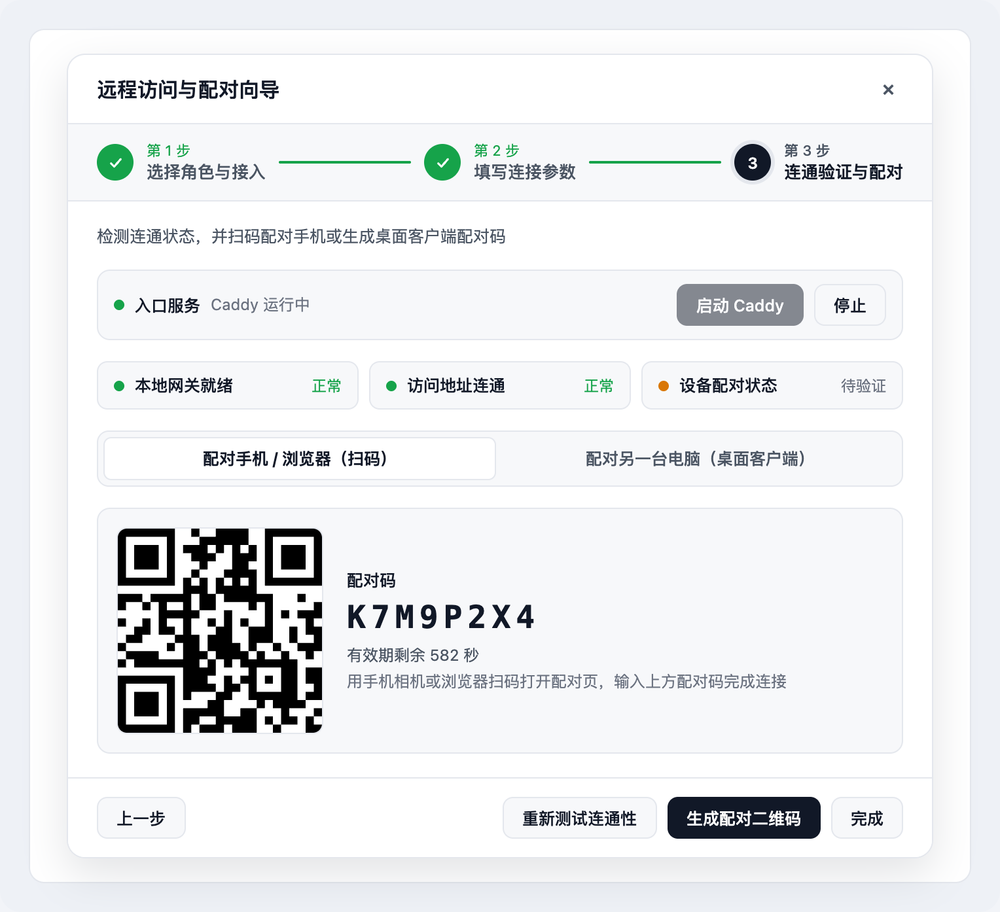

1. **Start Ingress Service & Auto-Probe**: click **Start Caddy** or **Create & Start Tunnel** if applicable; the wizard automatically checks **Local gateway ready** and **Access URL reachable**.
2. **Pair Phone / Browser (Web App)**: on the **Pair Phone / Browser (QR)** tab, click **Generate Pairing QR**, scan with your phone, enter the 8-character code, and use **"Add to Home Screen"** to install DSH as a standalone PWA with lock-screen push.
3. **Pair Another Computer (Desktop Client)**: switch to the **Pair Desktop Client** tab, click **Generate Desktop Pairing Code**, and click **Copy Server URL & Code**.

> **Quick actions after setup**: once configured, you can directly click **Pair Phone (QR)**, **Pair Desktop Client**, or **Manage Devices** right from the overview card footer without re-running the wizard.

---

### Scenario B: Set up as Desktop Client (Connect up to 8 Hosts)

On another computer running the DSH desktop app (or via `dsh-zen-remote client pair <hostUrl> --code <8-char-code>` on the CLI):

1. Open **Plugins → `dsh-zen-remote`** and click **Start Setup Wizard** (or **+ Add Server** if already in client mode).
2. **Step 1**: select **Desktop Client** and click **Next**.
3. **Step 2**: enter this computer's display name (e.g. `Living-Room-Mac`), the host's gateway URL (`https://` for public URLs, or `http://192.168.x.x:3088` / `http://100.x.x.x:3088` for LAN / Tailscale), and the 8-character desktop pairing code from the host, then click **Pair & Connect**.
4. **Step 3**: once all three status lights (**Pairing token**, **Server connection**, **Session & plugin sync**) turn green, the host's shared workspaces and sessions appear in your left sidebar immediately.
5. **Multi-Server Management (up to 8 hosts)**:
   - Click **+ Add Another Server** in Step 3, **+ Add Server** on the overview card, or **Manage Servers** to view per-server status, **Reconnect**, **Re-pair**, **Remove**, or **Remove All** (when all `8 / 8` slots are full, a red limit notice appears; re-pairing an existing URL still overwrites in place).
   - Sidebar groups from all paired hosts merge **in pairing order** after your local workspaces. Duplicate host names are automatically numbered `Name-1`, `Name-2`; model pickers, connection status icons, read-only banners, plugin bridges, and file uploads are strictly isolated per host `serverId`.

---

## 3. Daily Usage: Session Sharing & Cross-Device Workflow

| | **Web App Device (Phone / Tablet / Browser)** | **Desktop Client (Another DSH Desktop App)** |
| --- | --- | --- |
| Visible sessions | **All** sessions on the host | **Only** sessions with remote access enabled on the host (enforced server-side) |
| Credential | Long-lived HttpOnly cookie | Secret device token stored in `~/.dsh/zen-remote-state.json` (`Bearer` token) |

### Enabling or Disabling Remote Access on a Session

Remote access is controlled per session (or automatically enabled for new sessions if you turn on *Auto-share new sessions*). You can toggle it from four places:

1. **Host sidebar**: open a session's `"…"` menu and click **开启远程 / 关闭远程** (Enable / Disable remote);

   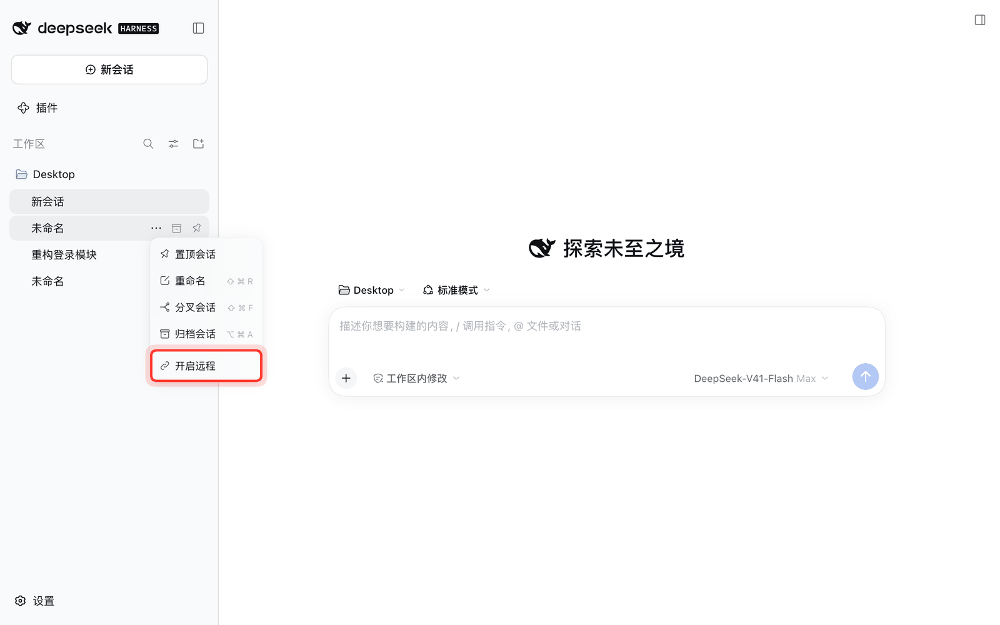

2. **Host session header**: click the globe icon in the session title row (hover to see remaining idle time; a green dot indicates a desktop client is currently viewing it);
3. **Phone (Web App) session info card**: open the `ⓘ` info card at the top right of a session and toggle **远程访问** (Remote access);

   <p align="center">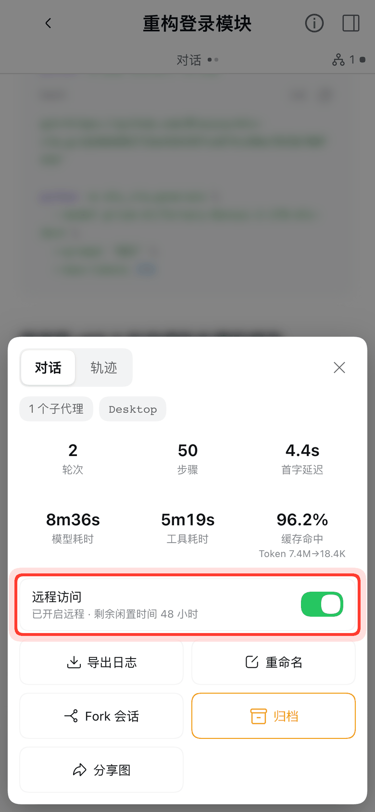</p>

4. **Host settings page**: view and close shared sessions individually or all at once under the shared sessions list.

### Working in Remote Sessions on a Desktop Client

- **Sidebar groups**: once a host workspace has at least one remote-enabled session, a **"Server Name · Workspace Name"** group appears in the client's sidebar (up to 8 paired hosts, stacked in pairing order). Click any session to view full history, stream responses, approve tools, use the server terminal, browse files and diffs, preview inline images, download deliverables, or drag/paste/pick files to upload.

  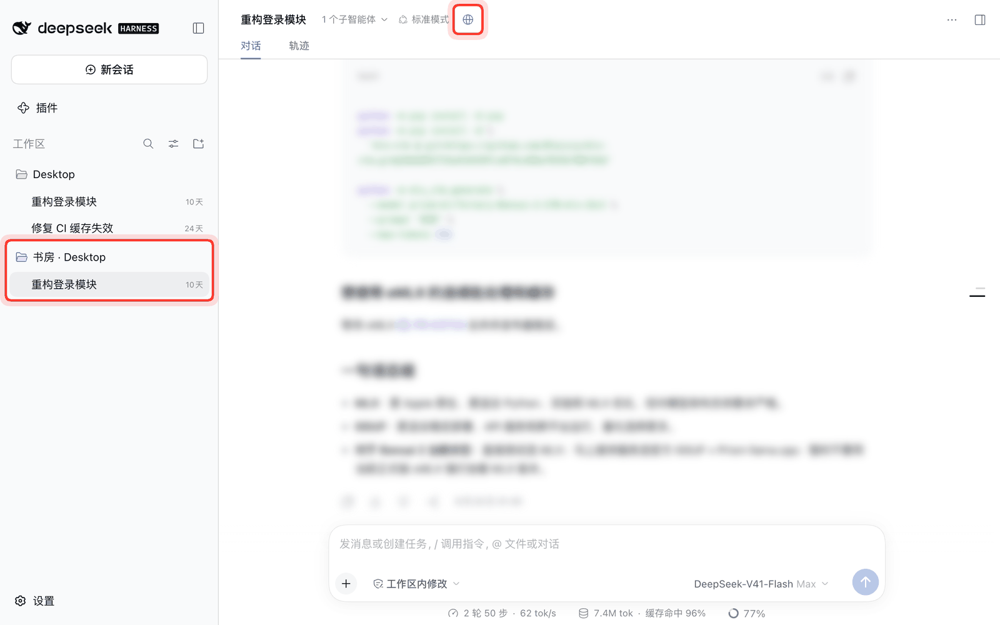

- **Closing & idle sleep**: a shared session automatically closes remote access after **48 hours** (`idleHours`) of inactivity (running or waiting sessions never sleep). Closed or unpaired sessions are automatically archived/hidden from the sidebar; an actively open session displays a "remote closed" banner and recovers automatically if re-shared.

  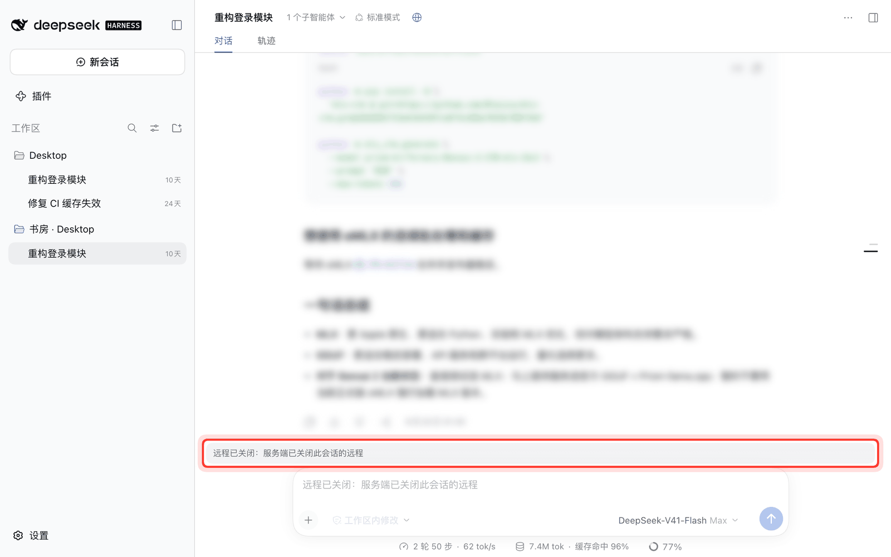

---

## 4. Lock-Screen Push: When Notifications Fire

Notifications fire only when **you are actually needed**, along two independent paths (all payloads are end-to-end encrypted with `aes128gcm`; toggle `pushEnabled` to disable all notifications and unregister `push_notify`, or enable `pushSessionName` to show `Session: <name>` on the first line of the notification body):

1. **System-triggered (always on when `pushEnabled` is on, never suppressed by debounce)**:
   - **Tool waiting for approval**: pushes *"DSH needs your approval"* with the tool name after `DSH_PUSH_APPROVAL_GRACE_MS` (default 5s, so fast auto-approvers can answer first without buzzing your phone).
   - **`ask_user_question` waiting for your answer**: pushes *"DSH is waiting for your answer"*.
2. **Model-triggered (`push_notify` tool)**:
   - Called by the agent when you asked to be notified upon completion, or when it hits a blocker that requires your decision. Ordinary turn completions do not push by default (enable `pushTurnEnd` if wanted; enable `pushSummary` to include up to 120 characters of the final reply).

---

## 5. Features

- **Mobile PWA UI (Host)**: two-level page stack (session list home + session page with swipe-back and Android back-gesture support, first-frame boot skeleton, immutable asset caching), auto-discovered plugin entry chips, compact mobile composer with bottom sheets and phone attachment uploads, and a session info card (6-tile stats with `tok/s` output speed, log export, rename, fork, archive, one-tap full-conversation PNG share image, and remote access switch).
- **Unified Setup Wizard & Headless CLI (`dsh-zen-remote`)**: top-of-page 2×2 live overview card, 3-step modal wizard, and a full-featured terminal CLI (`setup` / `status` / `host` / `client`) covering all four host ingress modes (Managed Caddy, Existing Reverse Proxy, Cloudflare Tunnel, LAN / Tailscale Direct with private-IP wall) and client pairing.
- **Cross-Desktop Remote Sessions & Multi-Server Pool (Client)**: connect up to **8 main servers** simultaneously in pairing order; supports full history & live streaming, approval/question sync, per-server isolated model catalog, file tree & Git diffs, duplex server-side terminal (`terminal/attach`), inline Markdown image & media forwarding, windowed artifact downloads, server-side LibreOffice PDF preview, up to 500 MiB file uploads (drag-and-drop, paperclip picker, and paste), and one-click redacted diagnostics export.
- **Plugin Bridge**: cooperative plugins and built-in adapters (such as `dsh-better-sidebar` `0.25.0`–`0.30.1`) route their panel HTTP and WebSocket requests in remote sessions to the host machine (with explicit owner consent for whole-machine data). See [Plugin Bridge Guide](docs/plugin-bridge.md).

In depth: [Interface Design](docs/interface.md) · [Public Access & Relay Protocol](docs/remote-access.en.md)

---

## 6. Advanced Settings & Field Reference

Day-to-day setup and device management are handled entirely by the **Remote Access & Device Pairing Wizard** (or `npx dsh-zen-remote setup`). To fine-tune individual low-level fields, click `dsh-zen-remote` a second time under **Included components** on the plugin detail page.

| Host Role & Pairing Cards | Shared Sessions List | Client Settings & Diagnostics |
| --- | --- | --- |
| 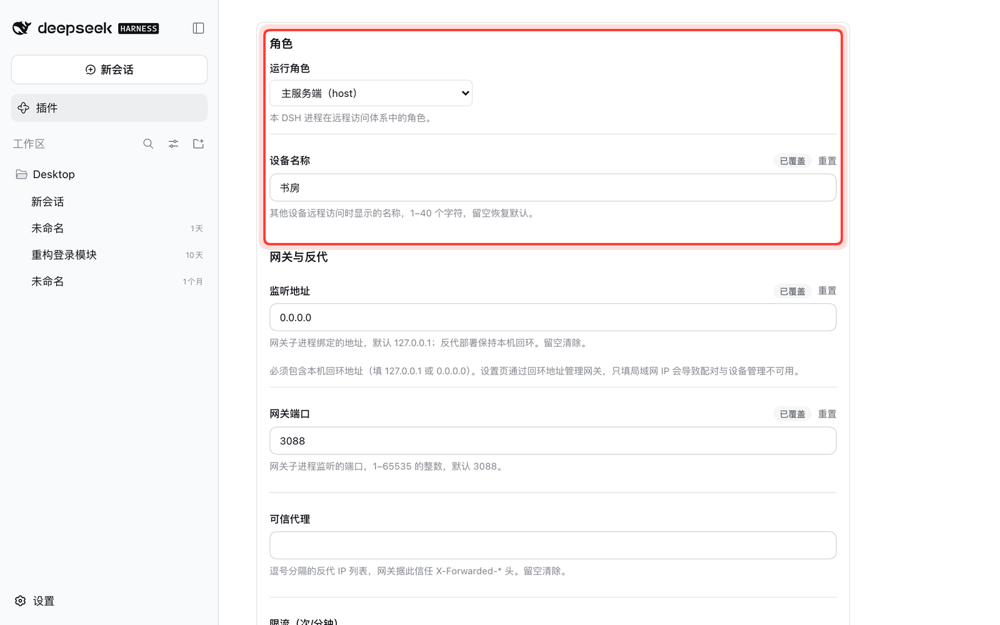 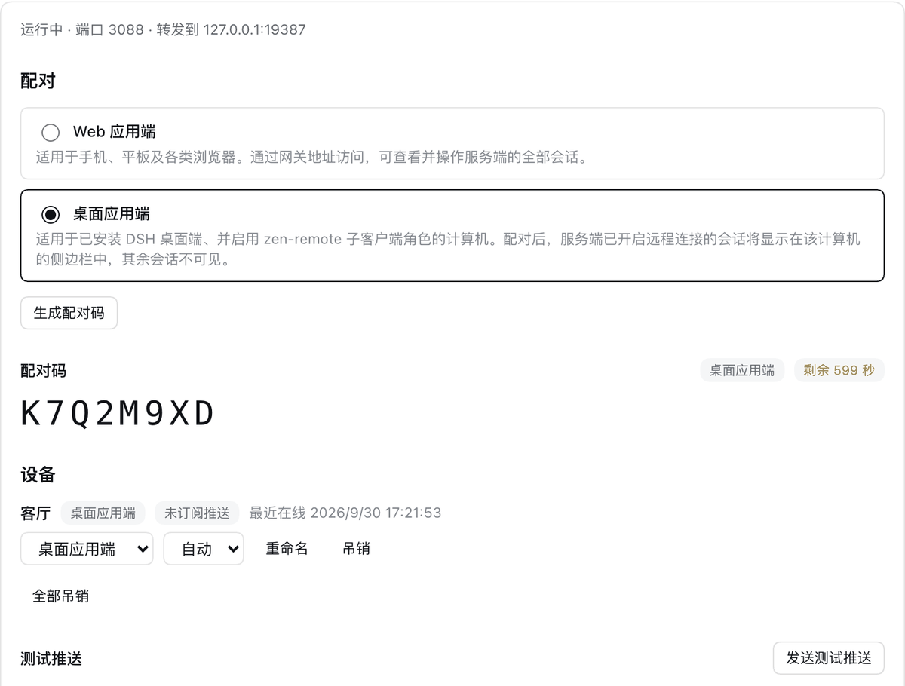 | 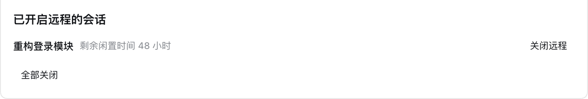 | 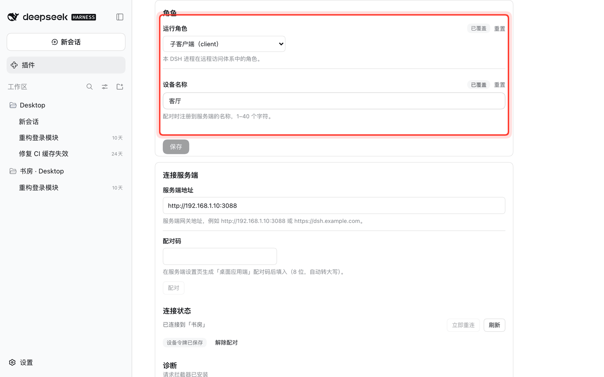 |

<details>
<summary>Expand full configuration field reference table & environment variables</summary>

Each field resolves in order: **environment variable > plugin row settings > `~/.dsh/lan-gate.config.json` > default**. Saving a field that requires a gateway/push restart reloads the plugin row automatically without restarting the app.

| Field | Default | What it does |
| --- | --- | --- |
| `role` | `host` | `host` runs gateway + push + sharing; `client` connects to a remote host |
| `serverName` | computer name | **Device name** (≤ 40 chars): sidebar group title on a host, registered device name on a client; renaming on a client broadcasts the new name to all its paired servers (one-way — the server never rewrites it) |
| `port` | `3088` | Gateway port; retries upward (up to +20) if occupied |
| `host` | `127.0.0.1` | Gateway bind address (`127.0.0.1` for local proxy/tunnel, `0.0.0.0` for LAN/Tailscale direct) |
| `targetPort` | *(auto)* | Local DSH Web UI port; leave empty to auto-discover the host's listening port |
| `rateLimit` | `120` | Per-minute cap on unpaired requests per client IP |
| `trustedProxies` | empty | Comma-separated trusted proxy IPs when the reverse proxy runs on another machine |
| `vapidSubject` | `mailto:admin@localhost` | Web Push contact (**must be a real `mailto:` or `https://` URL for iOS delivery**) |
| `lang` | `auto` | Gateway & notification language: `auto` (browser `Accept-Language`), `zh`, or `en` |
| `pushEnabled` | on | Master switch for session notifications; off stops every automatic push and unregisters the `push_notify` tool and its system-prompt hint |
| `pushSessionName` | off | Open the notification body with `Session: <name>` (the source session's name; the title keeps the fixed event heading) |
| `pushTurnEnd` | off | Also send a push when an ordinary turn finishes (approvals/questions always push) |
| `pushEvents` | `agent/turn-stopping` | Comma-separated events that count as turn end when `pushTurnEnd` is on |
| `pushDebounceMs` | `15000` | Minimum interval (ms) between automatic pushes |
| `pushSummary` | off | Include up to 120 chars of the final reply in notification bodies |
| `pushTool` | on | Register the model-callable `push_notify` tool |
| `idleHours` | `48` | Idle-sleep window in hours for shared sessions; range `(0, 8760]` |
| `autoShareNewSessions` | off | Automatically enable remote access on new sessions created on the host |
| `pluginBridgeConsent` | `{}` | Whole-machine data consent map (`pluginName -> boolean`) for the plugin bridge |
| `serverUrl` *(client)* | empty | Remote server gateway URL (`https://` required for public hosts; `http://` allowed on private LAN/Tailscale ranges). Legacy single-server field: the paired list now lives in `~/.dsh/zen-remote-state.json` (up to 8 servers) and these row credentials migrate into it automatically on first start |
| `deviceToken` *(client)* | empty | Paired client token (secret field, redacted everywhere). Legacy single-server field, migrated into `~/.dsh/zen-remote-state.json` like `serverUrl`; new pairings go through the settings card / wizard and never echo the token back to the browser |
| `turnFoldDesktop` | off | Enable turn-process folding on desktop widths as well as mobile |
| `keyboardLiftRatio` / `keyboardLiftMaxPx` / `keyboardSafetyPadPx` | `0.42` / `400` / `15` | Soft-keyboard lift calibration fallback for environments where the OS hides keyboard height |
| `maxUploadBytes` | 20 MB | Mobile attachment upload cap |

Legacy environment variables (outrank row settings): `LAN_GATE_PORT`, `LAN_GATE_HOST`, `LAN_GATE_TARGET_PORT`, `LAN_GATE_RATE_LIMIT`, `LAN_GATE_TRUSTED_PROXIES`, `LAN_GATE_VAPID_SUBJECT`, `LAN_GATE_LANG`, `DSH_PUSH_ENABLED`, `DSH_PUSH_SESSION_NAME`, `DSH_PUSH_TURN_END`, `DSH_PUSH_EVENTS`, `DSH_PUSH_DEBOUNCE_MS`, `DSH_PUSH_SUMMARY`, `DSH_PUSH_TOOL`, `DSH_PUSH_LANG`, `DSH_PUSH_APPROVAL_GRACE_MS`.

</details>

---

## 7. Security Model, Version Tolerance & Known Notes

- **Trusted client & strict session isolation**: a paired desktop client runs terminals and file previews as the host's OS user, while unshared sessions are strictly filtered and refused at the relay layer. Even when binding `0.0.0.0` for LAN/Tailscale, the gateway's private-IP wall rejects any unproxied public internet IP (`403 public-direct-forbidden`), and all admin/wizard mutations are restricted to the host machine itself.
- **Version tolerance**: both ends must run the same `dsh-zen-remote` version; DSH host versions may differ (interface fingerprints are compared at handshake and degrade only mismatched panels).

<details>
<summary>Expand security & state-file details, known limitations, iOS PWA notes & adapted third-party plugins</summary>

**Data & state files**
- The plugin reports nothing to any third party. Pairing state lives in `~/.dsh/lan-gate-state.json`; the unified state file `~/.dsh/zen-remote-state.json` (`0600`) carries the local `serverId`, the shared-session table `sessions`, and the client's paired servers list `servers` (up to 8 servers, tokens included); Cloudflare tokens live in `0600` files under `~/.dsh/zen-remote-ingress/`.

**Known limitations**
- With multiple DSH windows open simultaneously on a client, active-session detection may occasionally dismiss a closed session early.
- Switching between different servers or recreating a workspace with the same ID requires reloading the client page once.
- "Export session" and server-local OS dialogs ("Reveal in Finder" / "Open in app") are hidden in remote sessions.
- DSH's own Settings RPCs are loopback-only by upstream design, so plugin settings must be edited on the machine running DSH rather than through a remote browser.

**iOS standalone PWA notes**
- **iOS 26.x viewport shrinkage**: home-screen PWAs may lose a status-bar height at the bottom (an iOS WebKit bug); three mitigation layers are built in, and restarting the PWA restores full height.
- **iOS 26+ top progressive blur**: opening from the home screen may show a system `WKScrollPocket` blur across the top ~95px; entering any session and navigating back to the list clears it.

**Third-party plugins with mobile & bridge adaptations**

| Plugin | Adaptation summary | Version tested |
| --- | --- | --- |
| [dsh-better-sidebar](https://github.com/omdsh-dev/DSH-better-sidebar) | Full-screen mobile right-sidebar drawer with notch safe-area padding and swipe-back; **Plugin Bridge** built-in adapter for `0.25.0` through `0.30.1` (nine versions) (reads/writes host file/Git/task panels in remote sessions with host owner consent) | 0.19.1 / adapter 0.25–0.30.1 |
| [@nanmicoder/dsh-agent-teams](https://github.com/NanmiCoder/dsh-agent-teams) | Repositions AgentTeams floating pill below session header and preserves parent session back-link | 0.1.9 |
| [@ychris12138/dsh-usage-stats](https://github.com/Ychris12138/dsh-usage-stats) | Moves usage & balance entry into the mobile home chips bar | 0.2.9 |
| [@opendsh/dsh-plugin-scheduled-tasks](https://github.com/Ceelog/dsh-plugins) | Moves scheduled tasks entry into the mobile home chips bar | 0.2.3 |
| dsh-at-file | Deduplicates `.dsh-uploads/` attachment rows on mobile | 0.6.7 |
| [@ace-zone/dsh-market](https://www.npmjs.com/package/@ace-zone/dsh-market) | Compacts marketplace modal header on mobile so the close button stays reachable | 0.1.66 |
| [dsh-vision-toolkit](https://www.npmjs.com/package/@anionex/dsh-vision-toolkit) | Works with mobile attachment uploads for image Q&A/OCR | — |
| [dsh-web-ui bundle](https://www.npmjs.com/package/@linxin666/dsh-web-ui-all) | Mobile width-constrained centered overlays for file tree / preview | — |

</details>

---

## Upstream credits

This plugin's interface layer derives from [mexiaosqwq/dsh-web-mobile](https://github.com/mexiaosqwq/dsh-web-mobile), and its channel layer from [zylzyqzz/dsh-mobile-pwa](https://github.com/zylzyqzz/dsh-mobile-pwa) (itself derived from [Bernardxu123/dsh-mobile-gate](https://github.com/Bernardxu123/dsh-mobile-gate)), both MIT. The original copyright lines are preserved in [LICENSE](LICENSE).

## License

[MIT](LICENSE)
