<p align="center">
  <picture>
    <source media="(prefers-color-scheme: dark)" srcset="assets/logo/dsh-zen-remote-horizontal-dark.svg">
    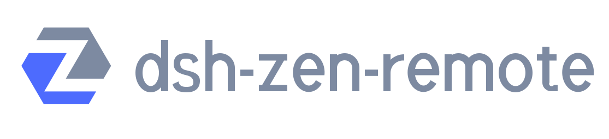
  </picture>
</p>

<p align="center">
  <b>One DeepSeek Harness plugin, three roles — built for cross-machine peer mesh.</b><br>
  Link computers into an end-to-end encrypted virtual mesh with zero public IPs, keep phone PWA &amp; lock-screen push active, or pair specific hosts and desktop clients.
</p>

<p align="center">
<a href="https://www.npmjs.com/package/dsh-zen-remote"></a>
<a href="https://www.npmjs.com/package/dsh-zen-remote"></a>
<a href="https://github.com/KyoMio/dsh-zen-remote/actions/workflows/publish.yml"></a>
<a href="LICENSE"></a>
<br>


</p>

<p align="center"><a href="README.zh-CN.md">中文文档</a></p>

<p align="center">
  <picture>
    <source media="(prefers-color-scheme: dark)" srcset="docs/images/arch-mesh-dark.png">
    <source media="(prefers-color-scheme: light)" srcset="docs/images/arch-mesh-light.png">
    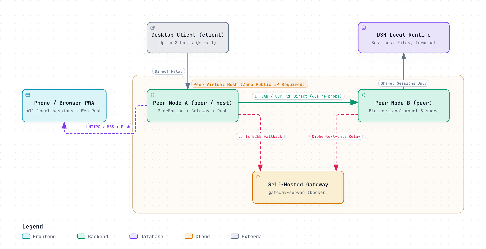
  </picture>
</p>

| Role | Best for | Session sharing | Phone PWA &amp; Push | Needs public IP? |
| --- | --- | --- | --- | --- |
| **Peer Node (`peer`)** | Multiple computers forming a two-way mesh across LANs / NATs | **Bidirectional** — mounts peers' shared sessions &amp; shares yours | **Yes** — full PWA &amp; push stay active | **No** (LAN / UDP hole-punch + E2EE relay) |
| **Host (`host`, default)** | Always-on workstation / server accessed from phone &amp; paired desktops | Shares chosen sessions outbound (`1 → N`) | Yes (gateway + Web Push) | Optional (Caddy / Tunnel / Proxy / LAN) |
| **Desktop Client (`client`)** | Secondary computer mounting sessions from specific hosts | Connects inbound to up to **8 hosts** (`N → 1`) | No (doesn't bind port `3088`) | No |

| Gateway Web Console (`Studio-Mesh`) | Peer Network Device Manager |
| --- | --- |
| <picture><source media="(prefers-color-scheme: dark)" srcset="docs/images/gateway-console-dark.png"><source media="(prefers-color-scheme: light)" srcset="docs/images/gateway-console.png">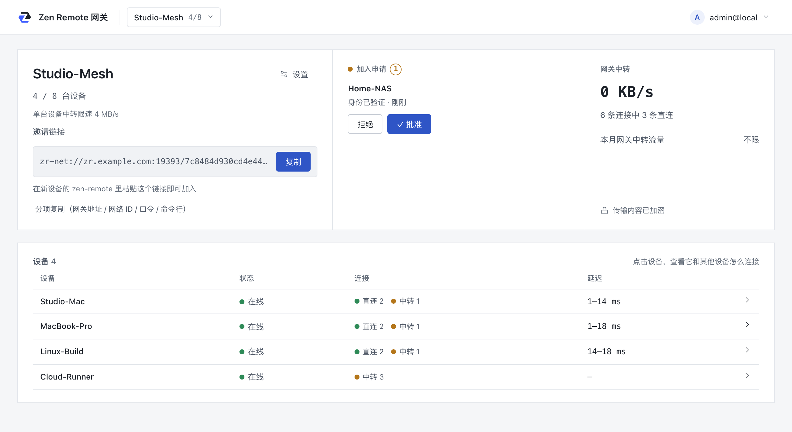</picture> | 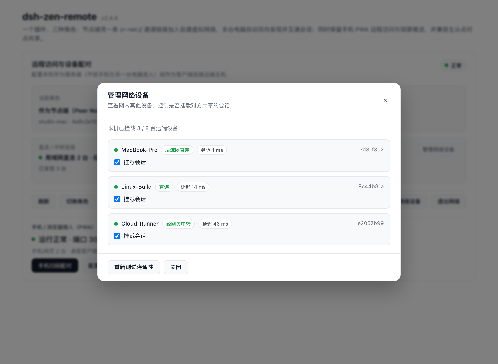 |

<details>
<summary>Watch Peer Mesh &amp; Setup Walkthrough (animated demo)</summary>

<p align="center">
  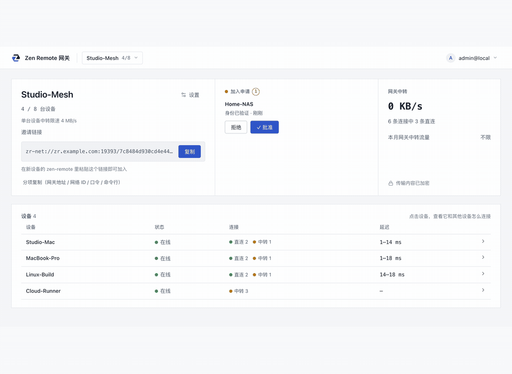
</p>

</details>

| Mobile session list | Mobile session view | Session info card | Pairing page |
| --- | --- | --- | --- |
| 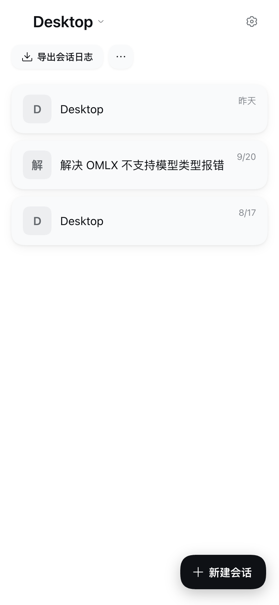 | 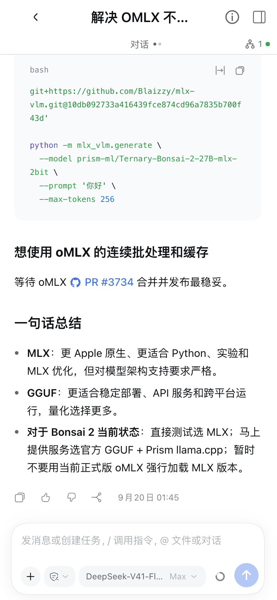 | 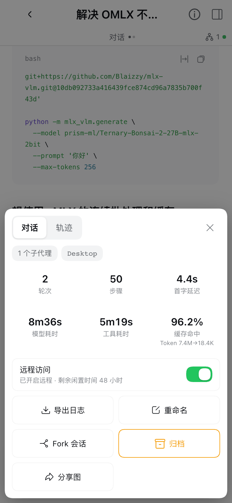 | 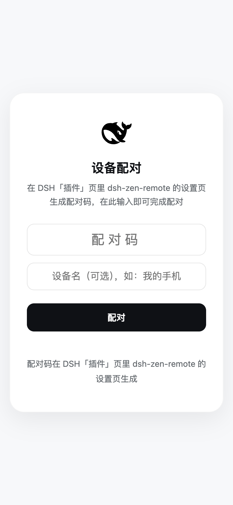 |

> Mobile screenshots show a 390×844 viewport in the light theme; both light and dark themes are supported across the gateway console, mobile UI, and pairing page.

---

## Contents

1. [Install](#1-install)
2. [Pairing &amp; Deployment Modes](#2-pairing--deployment-modes)
   - [Mode A: Peer Node Virtual Mesh (`peer`, Recommended)](#mode-a-peer-node-virtual-mesh-peer-recommended)
   - [Mode B: Standalone Host (`host`, Phone PWA &amp; Point-to-Point)](#mode-b-standalone-host-host-phone-pwa--point-to-point)
   - [Mode C: Desktop Client (`client`, Connect up to 8 Hosts)](#mode-c-desktop-client-client-connect-up-to-8-hosts)
3. [Cross-Device Usage, Official API Coverage &amp; Sidebar Compatibility](#3-cross-device-usage-official-api-coverage--sidebar-compatibility)
4. [Plugin Bridge Protocol](#4-plugin-bridge-protocol)
5. [Mobile PWA &amp; Lock-Screen Push](#5-mobile-pwa--lock-screen-push)
6. [Advanced Settings &amp; Field Reference](#6-advanced-settings--field-reference)
7. [Security Model, Version Tolerance &amp; Known Notes](#7-security-model-version-tolerance--known-notes)

---

## 1. Install

For instructions in Chinese, see [安装](README.zh-CN.md#1-安装).

### Install from the UI (Recommended, Desktop App &amp; Web UI)

Open **Plugins** in the DSH sidebar → click **Add plugin** → enter `dsh-zen-remote` → click **Enable now** after installation completes, then restart the DSH desktop app (or `dsh web`).

### Install from the CLI (Headless `dsh web` server)

```sh
dsh plugin --profile web add dsh-zen-remote
# or run the interactive CLI wizard directly (installs, starts DSH, and configures in one go):
npx dsh-zen-remote setup
dsh-zen-remote status
```

> `dsh plugin` requires `--profile` to name the target profile. The desktop app's `desktop` profile is managed exclusively by the app (`--profile desktop` is refused on the CLI), so use the UI install above on the desktop app.

<details>
<summary>Advanced: Full CLI subcommands (<code>peer</code> / <code>host</code> / <code>client</code>), manual <code>link:</code> profile setup, upgrading &amp; uninstall</summary>

#### Bundled Headless CLI (`dsh-zen-remote`)

The CLI communicates with the running plugin over a `0600` local IPC socket (`~/.dsh/zen-remote-cli.sock`); Caddy and `cloudflared` remain managed by the plugin process. Pass `--lang zh|en` to switch output language, or `--yes` with flags for unattended scripts.

```sh
# Peer commands (when role is peer, join a self-hosted virtual network)
npx dsh-zen-remote setup --role peer --invite "zr-net://gw.example.com/0123456789abcdef#join-key" [--yes]
dsh-zen-remote peer join "zr-net://gw.example.com/0123456789abcdef#join-key" [--name My-Mac] [--yes]
dsh-zen-remote peer status                                     # nodeId, admission state, peers, paths & RTT (--json)
dsh-zen-remote peer trust <nodeId>                             # explicitly trust a peer's new identity after a mismatch
dsh-zen-remote peer leave [--yes]                              # leave the network (phone/browser QR access stays intact)

# Host commands (when role is host)
dsh-zen-remote host device pair --device-role web              # mint a phone/browser pairing code + terminal QR (or desktop-client)
dsh-zen-remote host device list                                # list paired devices (--json supported)
dsh-zen-remote host device revoke <id|--all> [--yes]           # revoke one or all paired devices
dsh-zen-remote host ingress start --mode lan                   # configure & start ingress (caddy | cloudflared | external | lan)
dsh-zen-remote host ingress stop [--yes]                       # stop managed Caddy / Cloudflare Tunnel processes
dsh-zen-remote host ingress verify [--no-wait]                 # three-light check + mint web QR & desktop pairing codes
dsh-zen-remote host ingress snippet [--proxy nginx|caddy|lucky] # print reverse-proxy config snippets

# Client commands (when role is client, up to 8 paired hosts)
dsh-zen-remote client pair http://192.168.1.2:3088 --code 12345678 [--name My-Mac]
dsh-zen-remote client list                                     # list paired hosts (up to 8) and connection states
dsh-zen-remote client unpair <hostUrl|entryId|--all> [--yes]   # remove one or all paired hosts

# Diagnostics
dsh-zen-remote status --debug                                  # export redacted diagnostics report
```

#### Manual Profile Edit / Local Development (`link:`)

Add the dependency to the profile's `package.json` (`~/.dsh/profiles/desktop` for the desktop app, `~/.dsh/profiles/web` for the web service) and append `"dsh-zen-remote"` to the `dsh.profile.bundles` array:

```jsonc
// ~/.dsh/profiles/desktop/package.json
{
  "dependencies": {
    "dsh-zen-remote": "^2.5.4"        // for local development: "link:/path/to/dsh-zen-remote"
  },
  "dsh": {
    "profile": {
      "bundles": ["dsh-zen-remote"]
    }
  }
}
```

```sh
cd ~/.dsh/profiles/desktop && pnpm install
# For a link: checkout, also run `npm install --omit=dev` inside the repository so the gateway subprocess resolves `web-push`.
```

#### Upgrading &amp; Uninstall

- **Upgrading with HMR on**: remove `dsh-zen-remote` first, then install the new version (`dsh plugin --profile <name> remove dsh-zen-remote` → `add dsh-zen-remote`, or Uninstall → Add in the Plugins page).
- **DSH 0.2.1-alpha.3+ profile reset**: `dsh --profile <name> --from-default-profile <template>` replaces an existing custom profile with a fresh copy; back up `~/.dsh/profiles/<name>` first.
- **Upgrading from 1.x**: since 2.0.0 the composition layer is a single row (`dsh-zen-remote`). Remove legacy `dsh-zen-remote-gateway`, `dsh-zen-remote-push`, or manual `dsh-push.mjs` lines from `cordis.patch.yml`. Existing `~/.dsh/lan-gate.config.json` and paired devices carry over automatically.
- **Uninstalling**: click **Uninstall** on the `dsh-zen-remote` plugin page and restart. To wipe pairing and share state too, delete `~/.dsh/lan-gate-state.json`, `~/.dsh/lan-gate.config.json`, and `~/.dsh/zen-remote-state.json`.

</details>

---

## 2. Pairing &amp; Deployment Modes

Open **Plugins → `dsh-zen-remote`** in DSH. The **Remote Access &amp; Device Pairing** overview card sits at the top of the page (or run `npx dsh-zen-remote setup` on a headless server).

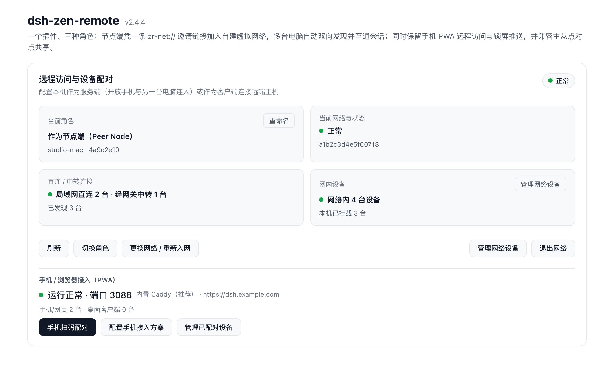

### Mode A: Peer Node Virtual Mesh (`peer`, Recommended)

Link multiple computers across LANs, home routers, and NATs into one bidirectional mesh — **zero public IPs on member computers** and **no per-machine pairing codes**, while keeping each computer's own Phone / Browser PWA and Web Push fully active.

#### 1. Deploy the Self-Hosted Relay Gateway (`gateway-server/`, Once per Team or Self)

> [!IMPORTANT]
> `gateway-server/` lives in this repository for source co-maintenance and is **excluded from the `dsh-zen-remote` npm package**. Deploying it is only needed for `peer` virtual networks (`host` and `client` modes work standalone without it).

```sh
docker build -t zr-gateway ./gateway-server

docker run -d --name zr-gateway \
  --restart unless-stopped \
  -p 19393:19393/tcp \
  -p 19393:19393/udp \
  -p 19394:19394/udp \
  -e ZR_GATEWAY_PUBLIC_URL=https://zr.example.com \
  -v zr-gateway-data:/data \
  -v $(pwd)/certs:/certs \
  zr-gateway
```

- **First boot**: check `docker logs zr-gateway` for the one-time initial password of `admin@local`, sign in at `http://<host>:19393/`, create a virtual network, and copy the `zr-net://…` invite link.
- **Native TLS &amp; full operations**: supports single-port built-in HTTPS/WSS on `19393/tcp`, five-state member admission (`pending` / `authorized` / `paused` / `mismatch` / `revoked`), dual-UDP STUN coordination (`19393/udp` + `19394/udp`), and gateway-pushed direct RTT caps (`peerDirectMaxRttMs`). See [`gateway-server/README.md`](gateway-server/README.md).

#### 2. Join from DSH UI or Headless CLI

In **Plugins → `dsh-zen-remote` → Start Setup Wizard → Step 1**, select **Peer Node (`peer`)**:

1. **Step 2 — Choose how to join**:
   - **Paste Invite Link (`zr-net://…`)**: paste the link from the gateway console (`?tls=0` for plaintext gateways; `#join-key` is optional when manual approval is enabled; legacy `zr-nets://` and `zr-net+insecure://` links still parse). Expand **Advanced split-fill** to enter Gateway URL, 16-hex Network ID, and optional join passphrase separately.
   - **Sign in with Gateway Account**: enter the gateway URL, email, and password (used strictly in memory to list permitted networks — never saved to disk), pick a network, and click **Sign In &amp; Join**.
   - **Manual Approval**: if required by the network, the wizard waits in *"pending approval"* and activates automatically once an admin approves the device.
2. **Step 3 — Verify &amp; Auto-Mount**: once all three lights (**Local identity ready**, **Network admission**, **Peer discovery &amp; session sync**) turn green, online peers' remote-enabled sessions mount automatically into your sidebar under `"Device Name · Workspace Name"` — and sessions you share appear in theirs.
3. **Day-to-Day Peer &amp; Dual-PWA Controls**:
   - The overview card shows **Network &amp; Peer Interop** (`Mounted X / M remote devices`, live `LAN Direct` vs `Gateway Relay` counts) alongside your **Phone / Browser Access (PWA)** section and **Plugin Bridge** toggles.
   - Click **Manage Network Devices** to inspect each peer's path (**LAN Direct**, **P2P Direct**, **Gateway Relay**, **Offline**, **Identity Anomaly**) and RTT (`ms`), toggle **Mount Sessions / Ignore** per peer, trigger a **Re-probe**, or explicitly **Trust New Identity** after a local TOFU `mismatch` block.

| Step 1: Choose Peer Node | Step 2: Paste `zr-net://` Invite | Step 3: Peer Readiness Lights |
| --- | --- | --- |
| 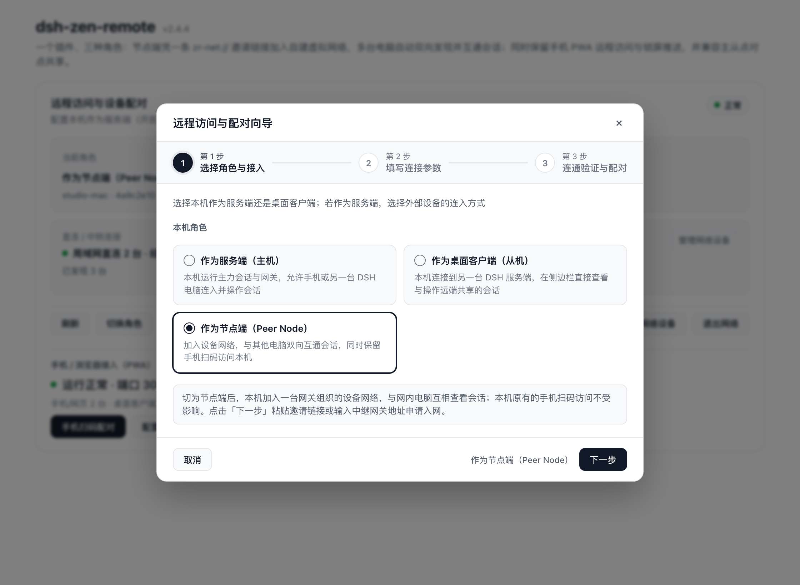 | 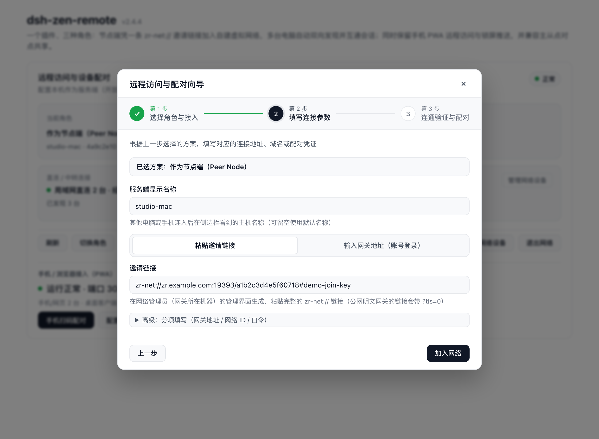 | 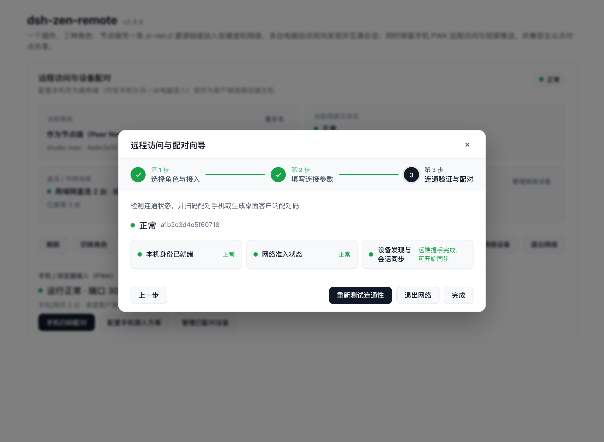 |

```sh
# Headless server one-liner
npx dsh-zen-remote setup --role peer --invite "zr-net://gw.example.com/0123456789abcdef#join-key"
dsh-zen-remote peer status         # nodeId, admission state, peer paths & RTT (--json)
```

#### 3. Transport Paths &amp; End-to-End Blind Relay

| Priority | Path | How it works |
| --- | --- | --- |
| **1st** | **LAN Direct (`lan`)** | Direct socket on shared local subnets (excludes CGNAT `100.64.0.0/10` tunnel ranges from misdetection as LAN) |
| **2nd** | **UDP Hole-Punch P2P (`p2p`)** | Coordinated via the gateway's dual UDP STUN ports (`19393/udp` + `19394/udp`) with adaptive sliding-window ARQ |
| **3rd** | **E2EE Gateway Relay (`relay`)** | **1-second seamless fallback** if direct setup doesn't land (or if measured direct RTT stays above the gateway's `peerDirectMaxRttMs` cap); background **5s → 15s → 60s** re-probe upgrades back automatically |

- **Ciphertext-only relay**: traffic between peers is sealed end-to-end with per-session ephemeral **X25519 + AES-256-GCM** bound to each machine's Ed25519 identity. The gateway only sees a 28-byte routing header and holds no decryption keys.

---

### Mode B: Standalone Host (`host`, Phone PWA &amp; Point-to-Point)

Choose **Act as Server (`host`)** in Step 1 if you only need phone/browser access or direct `1 → N` pairing without running a virtual-network gateway:

| Access method | Best for | What the wizard automates |
| --- | --- | --- |
| **Managed Caddy (Recommended)** | Public IP / port forwarding + domain on Cloudflare | Downloads prebuilt `Caddy + caddy-dns/cloudflare`, issues/renews TLS certs via DNS-01 (`127.0.0.1:3088`) |
| **Existing Reverse Proxy** | Already running Nginx, Caddy, or Lucky | Generates proxy snippets + one-click `trustedProxies` registration ([manual guide](docs/remote-access.en.md)) |
| **Cloudflare Tunnel** | No public IP / no port forwarding + domain on Cloudflare | Downloads `cloudflared`, creates/reuses tunnel, configures CNAME, and starts tunnel (`127.0.0.1:3088`) |
| **LAN / Tailscale Direct** | Same Wi-Fi / LAN or shared Tailscale network | Auto-detects LAN / Tailscale IPv4 and binds `0.0.0.0:3088` behind the built-in **private-IP wall** (`403 public-direct-forbidden`) |

In Step 3, verify connectivity and open **Pair Phone / Browser (QR)** to scan &amp; install the PWA, or switch to **Pair Desktop Client** to mint an 8-character pairing code.

---

### Mode C: Desktop Client (`client`, Connect up to 8 Hosts)

Choose **Desktop Client (`client`)** on a secondary DSH computer (or run `dsh-zen-remote client pair <hostUrl> --code <8-char-code>`) to mount remote-enabled sessions from specific hosts without exposing a local gateway:

- Pair up to **8 hosts** by default (adjustable via `maxServers` `1..64` or `LAN_GATE_MAX_SERVERS`).
- Remote workspace groups merge into the sidebar **in pairing order** after local workspaces; duplicate host names auto-number (`Name-1`, `Name-2`).
- Model catalogs, connection badges, read-only banners, plugin bridges, and file uploads stay strictly isolated per `serverId`.

---

## 3. Cross-Device Usage, Official API Coverage &amp; Sidebar Compatibility

| | **Web App Device (Phone / Tablet / Browser)** | **Peer Node / Desktop Client (Another DSH Computer)** |
| --- | --- | --- |
| Visible sessions | **All** sessions on the host | **Only** sessions with remote access enabled on the serving machine (enforced server-side) |
| Credential | Long-lived HttpOnly cookie | **Peer**: Ed25519 TOFU identity + ephemeral X25519 session key<br>**Client**: `Bearer` device token in `~/.dsh/zen-remote-state.json` |

### Session Sharing Controls &amp; Lifecycle

Remote access is toggled per session (or automatically for new sessions when `autoShareNewSessions` is enabled) from four places:
1. **Sidebar `"…"` menu** → **Enable / Disable remote**
2. **Session title bar** → globe icon (shows remaining idle time on hover; green dot = active remote viewer)
3. **Phone session info card (`ⓘ`)** → **Remote access** toggle
4. **Plugin settings page** → shared sessions list (close individually or all at once)

Shared sessions auto-close remote access after **48 hours** (`idleHours`) of inactivity (running or waiting sessions never sleep). Unshared or revoked sessions disappear from remote sidebars automatically, and any currently open tab displays a *"remote closed"* banner until re-enabled.

| Enable from sidebar menu | Remote-closed banner |
| --- | --- |
| 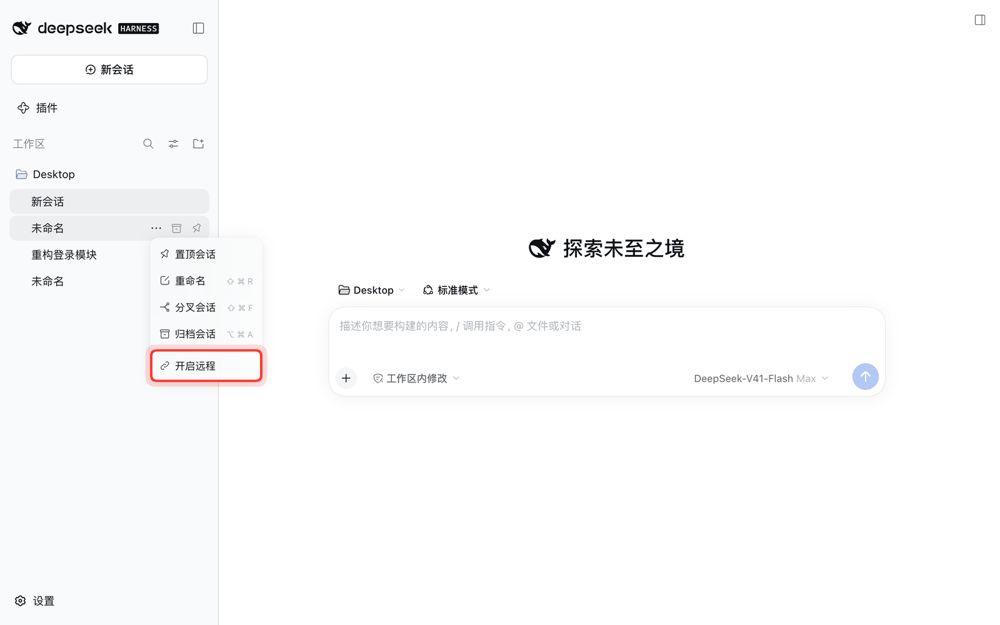 | 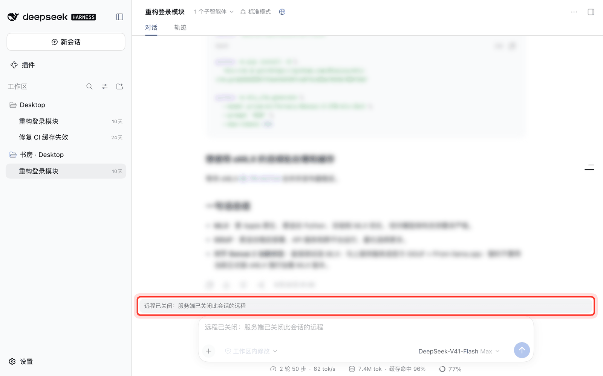 |

<p align="center">
  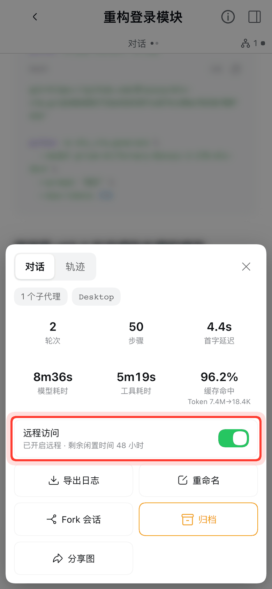<br>
  <sub>Remote access toggle inside the phone session info card (<code>ⓘ</code>)</sub>
</p>

### Supported Official DSH Interfaces

Every remote RPC/stream/HTTP route is guarded by a strict **per-method allowlist** (`src/relay-access.ts` + `src/fetch-route-intercept.ts`) rather than generic parameter scanning:

| Surface | Supported Official DSH Interfaces | Isolation &amp; Notes |
| --- | --- | --- |
| **Sessions, Queue &amp; Subagents** | `session/follow`, `page`, `projections`, `list`, `control`, `search`, `create`, `fork`, `rename`, `selectModel`, `modelCatalog`, `prompt`, `cancel`, `updateQueue`, `attachment`, `sessionFeedback/record`; `subagents/prompt`, `interruptByUser` / `interruptByParent`; `$zr/events` (approval &amp; question forwarding); `workspace/follow`, `pinSession`, `unpinSession`, `archiveSession`, `unarchiveSession`, `insertSessionBefore` | Global streams/lists (`list`, `search`, `follow`, `control`, `@` candidates) are row-filtered by the share table; `dsh-session:` references in prompts, queue edits, and slash commands are validated server-side; `modelCatalog` isolates per-server groups and clears host `failures` |
| **Workspace Files, Diffs &amp; Previews** | `workspaceFiles/list`, `changes`, `read`, `readBytes`, `stat`, `search`; `officeKit/render` &amp; `officeToPdf/render` (server-side LibreOffice PDF preview); HTTP `/api/changes.summary`, `/api/changes.diff`, `/api/session/uploadFileBinary`, `/api/file` (inline Markdown images/media) | Host-local OS actions (`/api/session.export`, `/api/changes.open`, `/api/present.open`, `/api/present.host`) are intentionally disabled/hidden in remote sessions |
| **Server Terminal** | `terminal/attach` (0.2.2+ full-duplex PTY), `watch`, `environment`, `shells`, `create`, `write`, `resize`, `rename`, `close`, `follow`, `list`, `retain` | Runs on the serving machine as its OS user; closing remote access on a session terminates its remote terminal streams immediately |
| **Forge Panel (Git / PR / Worktree)** *(DSH 0.2.2+)* | All 31 session-scoped `forgePanel/*` endpoints (`follow`, `branches`, `diffBases`, `localCommits`, `localDiff`, `localText`, `changeRequest*`, `*Worktree`, `review*`, `merge`, …) + global `forgePanel/changeRequestStates` stream | PR badge stream is filtered per workspace/session; older DSH hosts degrade gracefully without breaking core chat |
| **Goals, Commands, Presets &amp; Interactive Tools** | `goals/get\|create\|edit\|complete\|pause\|resume\|clear`; `commands/list\|execute`; `agentPresets/list\|read\|select`; `sessionReferenceResolver/candidates`; `userQuestions/answer\|attachWait`; `actionCards/act`; `toolResults/watch`; `agentTeams/setEnabled`; `pluginRecommendations/describe`; `job/list\|follow\|kill`; `skills/list`; `messageFeedback/*`; `schedule/list` | When at least one session is shared, `agentPresets` exposes the serving machine's preset roster/YAML; when zero sessions are shared, `agentPresets/list` returns empty and `read` refuses |

### `dsh-better-sidebar` Compatibility

`dsh-zen-remote` ships a dedicated built-in adapter (`src/adapters/dsh-better-sidebar/`) for **`dsh-better-sidebar`** with wire-surface digest matching, so compatible releases bridge automatically without requiring `dsh-zen-remote` updates on every minor patch:

- **Bridged surfaces**: `/sidebar/api/*` (file browser, editor, Git graph/history, tasks, sidechat), `/sidebar/file`, `/sidebar/sidechat-image`, `/sidebar/archive`, `/sidebar/upload`, `/sidebar/write`, `/sidebar/html` preview, plus all three WebSocket feeds (`/sidebar/ws/agent-opens`, `/sidebar/ws/fs-watch`, and frame-rewritten `/sidebar/ws/sidechat`).
- **Safety boundaries**: classified as whole-machine data (requires explicit per-plugin owner consent under **Plugin Bridge**, default **OFF**); strips client-supplied `cwd` server-side so paths always resolve from the verified session; blocks `open.external` in remote sessions; keeps `/sidebar/bundle` local.
- **Unbridged fallback**: if `dsh-better-sidebar` is on an unsupported version or consent is disabled, its host-file panels return fail-closed `503` rather than silently reading your local machine's disk.

---

## 4. Plugin Bridge Protocol

Third-party DSH plugins whose session panels query their own backend routes on DSH's `webServer` can work seamlessly across remote sessions via the **Plugin Bridge Protocol** — **without taking any runtime dependency on `dsh-zen-remote`**.

<p align="center">
  <picture>
    <source media="(prefers-color-scheme: dark)" srcset="docs/images/arch-bridge-dark.png">
    <source media="(prefers-color-scheme: light)" srcset="docs/images/arch-bridge-light.png">
    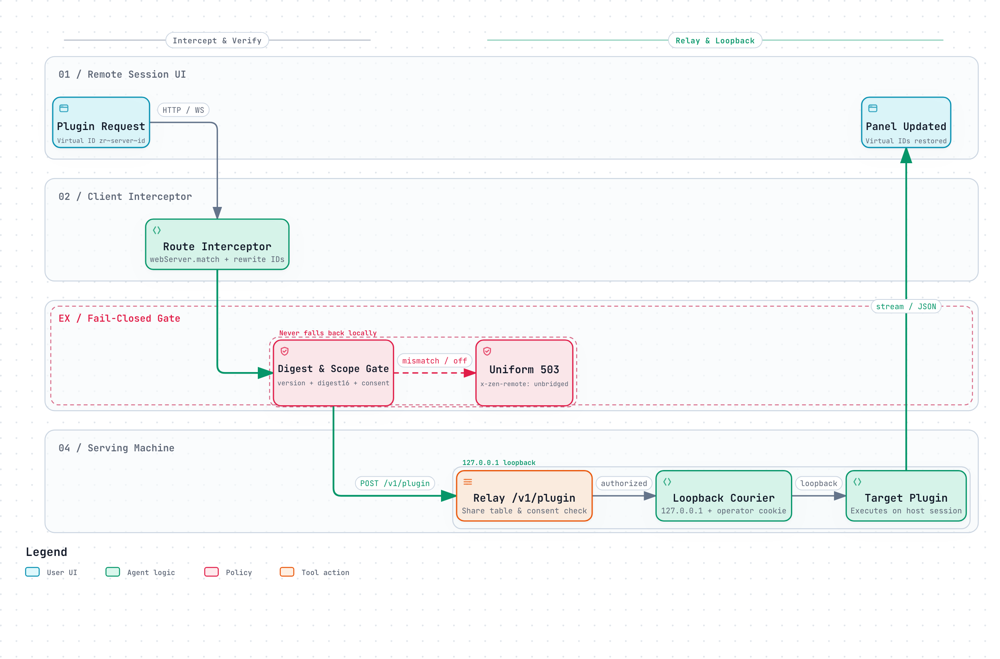
  </picture>
</p>

### How It Works

1. **Two Integration Paths**:
   - **Cooperative Declaration (Recommended for plugin authors)**: inject the optional `zenRemote` service (`ctx.inject(['zenRemote'], ...)`) and call `bridge.bridge({ plugin, version, routes })` with types imported from `dsh-zen-remote`. Supports `GET`/`HEAD`/`POST`/`PUT`/`PATCH`/`DELETE`, `stream`, `upgrade: true` (WebSocket byte or JSON-frame tunneling), `prefix: true`, `locator` (`query` / `path-segment` / `json-body`), `deny: true` (block local-only routes remotely), and `rewriteIds` (`true` or `{ fields }`). When `dsh-zen-remote` is not installed, `inject` simply never fires.
   - **Built-in Pluggable Adapters (`src/adapters/`)**: maintained inside `dsh-zen-remote` for existing uncooperative plugins (such as `dsh-better-sidebar`); cooperative declarations always take precedence over adapters.
2. **Handshake Digest Verification**: at connect time, both machines exchange `{ plugin, version, digest16 }` (a 16-hex SHA-256 of the normalized declaration). Both ends must match on plugin name, exact version, and declaration digest.
3. **Session vs. Whole-Machine Scope**:
   - `scope: 'session'` — authorized automatically per request against the share table.
   - `scope: 'server'` — requires explicit host-owner consent in **Settings → Plugin Bridge** (default **OFF**).
4. **Fail-Closed Guarantee**: any failure (`not-on-server`, `version-mismatch`, `declaration-mismatch`, `consent-off`, `route-denied`, `bad-query`, `offline`, etc.) returns a uniform `503` (`x-zen-remote: unbridged`) — remote panels **never** fall back to local machine data.

See the full specification in [Plugin Bridge Guide](docs/plugin-bridge.md).

---

## 5. Mobile PWA &amp; Lock-Screen Push

Both `peer` and `host` roles run the built-in mobile web experience and Web Push engine:

- **Mobile App Shell**: two-level page stack (session list home + session page with edge swipe-back and Android back-gesture support, inline boot skeleton, content-hashed asset caching), auto-discovered plugin home chips, compact mobile composer with bottom sheets &amp; camera/file attachment uploads, and a session info card (6-tile stats with `tok/s` output speed, log export, rename, fork, archive, one-tap full-conversation PNG share image, and remote access switch).
- **Lock-Screen Web Push** *(end-to-end encrypted `aes128gcm`; toggle `pushEnabled` globally or enable `pushSessionName` to prepend `Session: <name>`)*:
  1. **System-triggered (always active when `pushEnabled` is on, never suppressed by debounce)**:
     - **Tool waiting for approval**: pushes *"DSH needs your approval"* after `DSH_PUSH_APPROVAL_GRACE_MS` (default `5s` so fast auto-approvers handle it without buzzing your phone).
     - **`ask_user_question` waiting for input**: pushes *"DSH is waiting for your answer"*.
  2. **Model-triggered (`push_notify` tool)**: called by the agent when you asked to be notified on completion or when it hits a blocker requiring your decision (ordinary turn ends stay silent unless `pushTurnEnd` is turned on; `pushSummary` appends up to 120 chars of the final reply).

---

## 6. Advanced Settings &amp; Field Reference

Day-to-day setup and device management are handled in the **Remote Access &amp; Device Pairing Wizard** (or `npx dsh-zen-remote setup`). To fine-tune individual low-level fields, click `dsh-zen-remote` a second time under **Included components** on the plugin detail page.

<details>
<summary>Expand full configuration field reference table &amp; environment variables</summary>

Each field resolves in order: **environment variable &gt; plugin row settings &gt; `~/.dsh/lan-gate.config.json` &gt; default**. Saving a field that requires a gateway/push restart reloads the plugin row automatically without restarting DSH.

| Field | Default | What it does |
| --- | --- | --- |
| `role` | `host` | `peer` joins a self-hosted virtual network while keeping serving halves (gateway, push, sharing) mounted; `host` runs gateway + push + sharing; `client` connects to paired hosts only |
| `serverName` | computer name | **Device name** (≤ 40 chars): sidebar group title on a serving machine, registered name on a client (renaming on a client broadcasts one-way to paired servers) |
| `port` | `3088` | Gateway port; retries upward (up to `+20`) if occupied |
| `host` | `127.0.0.1` | Gateway bind address (`127.0.0.1` for local proxy/tunnel, `0.0.0.0` for LAN/Tailscale direct) |
| `targetPort` | *(auto)* | Local DSH Web UI port; leave empty to auto-discover |
| `rateLimit` | `120` | Per-minute cap on unpaired requests per client IP |
| `trustedProxies` | empty | Comma-separated trusted proxy IPs when the reverse proxy runs on another machine |
| `vapidSubject` | `mailto:admin@localhost` | Web Push contact (**must be a real `mailto:` or `https://` URL for iOS delivery**) |
| `lang` | `auto` | Gateway &amp; notification language: `auto` (browser `Accept-Language`), `zh`, or `en` |
| `pushEnabled` | on | Master switch for session notifications; off stops automatic pushes and unregisters `push_notify` |
| `pushSessionName` | off | Prepend `Session: <name>` to notification bodies |
| `pushTurnEnd` | off | Also push when ordinary turns finish (approvals/questions always push) |
| `pushEvents` | `agent/turn-stopping` | Comma-separated events treated as turn end when `pushTurnEnd` is on |
| `pushDebounceMs` | `15000` | Minimum interval (ms) between automatic pushes |
| `pushSummary` | off | Include up to 120 chars of the final reply in notification bodies |
| `pushTool` | on | Register the model-callable `push_notify` tool |
| `idleHours` | `48` | Idle-sleep window in hours for shared sessions; range `(0, 8760]` |
| `maxServers` | `8` | Paired host limit (`1..64`, live read; env `LAN_GATE_MAX_SERVERS` outranks). In `peer` mode, remote mounts are bounded by `min(maxPeers - 1, maxServers)` |
| `logLevel` | `info` | Logging threshold (`info` / `debug` / `warn`, live read; env `LAN_GATE_LOG_LEVEL` outranks) |
| `autoShareNewSessions` | off | Automatically enable remote access on newly created sessions |
| `pluginBridgeConsent` | `{}` | Whole-machine data consent map (`pluginName -> boolean`) for the Plugin Bridge |
| `serverUrl` / `deviceToken` | empty | Legacy single-server client fields, auto-migrated into `~/.dsh/zen-remote-state.json` on first start |
| `turnFoldDesktop` | off | Enable turn-process folding on desktop widths as well as mobile |
| `keyboardLiftRatio` / `keyboardLiftMaxPx` / `keyboardSafetyPadPx` | `0.42` / `400` / `15` | Soft-keyboard lift calibration fallback |
| `maxUploadBytes` | `20 MB` | Mobile attachment upload cap |

Legacy environment variables (outrank row settings): `LAN_GATE_PORT`, `LAN_GATE_HOST`, `LAN_GATE_TARGET_PORT`, `LAN_GATE_RATE_LIMIT`, `LAN_GATE_TRUSTED_PROXIES`, `LAN_GATE_VAPID_SUBJECT`, `LAN_GATE_LANG`, `LAN_GATE_LOG_LEVEL`, `LAN_GATE_MAX_SERVERS`, `DSH_PUSH_ENABLED`, `DSH_PUSH_SESSION_NAME`, `DSH_PUSH_TURN_END`, `DSH_PUSH_EVENTS`, `DSH_PUSH_DEBOUNCE_MS`, `DSH_PUSH_SUMMARY`, `DSH_PUSH_TOOL`, `DSH_PUSH_LANG`, `DSH_PUSH_APPROVAL_GRACE_MS`.

</details>

---

## 7. Security Model, Version Tolerance &amp; Known Notes

- **End-to-end encrypted peer mesh &amp; TOFU identity pinning**: peer-to-peer session traffic uses ephemeral **X25519 + AES-256-GCM** ciphers (forward-secret, bound to Ed25519 signatures); the relay gateway sees only 28-byte routing headers and holds no decryption keys. Each node derives a self-certifying `nodeId` from its public key and pins peers locally (`pinnedPeers`): even a gateway-side credential reset stays blocked (`mismatch`) until explicitly trusted on each peer machine.
- **Trusted client &amp; strict session isolation**: paired desktop clients/peers run remote terminals and file previews as the serving machine's OS user, while unshared sessions are filtered and refused at the relay layer. In LAN mode (`0.0.0.0`), the gateway's private-IP wall rejects unproxied public internet IPs (`403 public-direct-forbidden`), and admin/wizard mutations stay loopback-only.
- **Version tolerance**: both sides must run the same `dsh-zen-remote` version; DSH host versions may differ (interface fingerprints are compared at handshake and degrade only mismatched panels).

In depth: [Public Access &amp; Relay Protocol](docs/remote-access.en.md) · [Interface Design](docs/interface.md) · [Plugin Bridge Guide](docs/plugin-bridge.md) · [Self-Hosted Gateway](gateway-server/README.md)

<details>
<summary>Expand state files, known limitations, iOS PWA notes &amp; adapted third-party plugins</summary>

**Data &amp; state files**
- The plugin reports nothing to any third party. Pairing state lives in `~/.dsh/lan-gate-state.json`; the unified state file `~/.dsh/zen-remote-state.json` (`0600`) stores local `serverId`, `sessions` share table, `servers` list, and peer state (`peerIdentity`, `peerNetwork`, `pinnedPeers`); managed Cloudflare tokens live in `0600` files under `~/.dsh/zen-remote-ingress/`.

**Known limitations**
- With multiple DSH windows open simultaneously on a client, active-session detection may occasionally dismiss a closed session early.
- Switching between different servers or recreating a workspace with the same ID requires reloading the client page once.
- "Export session" and server-local OS dialogs ("Reveal in Finder" / "Open in app") are hidden in remote sessions.
- DSH's own Settings RPCs are loopback-only by upstream design, so plugin settings must be edited on the machine running DSH rather than through a remote browser.

**iOS standalone PWA notes**
- **iOS 26.x viewport shrinkage**: home-screen PWAs may lose a status-bar height at the bottom (an iOS WebKit bug); three mitigation layers are built in, and restarting the PWA restores full height.
- **iOS 26+ top progressive blur**: opening from the home screen may show a system `WKScrollPocket` blur across the top ~95px; entering any session and navigating back to the list clears it.

**Third-party plugins with mobile &amp; bridge adaptations**

| Plugin | Adaptation summary | Version tested |
| --- | --- | --- |
| [dsh-better-sidebar](https://github.com/omdsh-dev/DSH-better-sidebar) | Full-screen mobile right-sidebar drawer with notch safe-area padding and swipe-back; **Plugin Bridge** built-in adapter with wire-surface matching | Built-in adapter |
| [@nanmicoder/dsh-agent-teams](https://github.com/NanmiCoder/dsh-agent-teams) | Repositions AgentTeams floating pill below session header and preserves parent session back-link | 0.1.9 |
| [@ychris12138/dsh-usage-stats](https://github.com/Ychris12138/dsh-usage-stats) | Moves usage &amp; balance entry into the mobile home chips bar | 0.2.9 |
| [@opendsh/dsh-plugin-scheduled-tasks](https://github.com/Ceelog/dsh-plugins) | Moves scheduled tasks entry into the mobile home chips bar | 0.2.3 |
| dsh-at-file | Deduplicates `.dsh-uploads/` attachment rows on mobile | 0.6.7 |
| [@ace-zone/dsh-market](https://www.npmjs.com/package/@ace-zone/dsh-market) | Compacts marketplace modal header on mobile so the close button stays reachable | 0.1.66 |
| [dsh-vision-toolkit](https://www.npmjs.com/package/@anionex/dsh-vision-toolkit) | Works with mobile attachment uploads for image Q&amp;A/OCR | — |
| [dsh-web-ui bundle](https://www.npmjs.com/package/@linxin666/dsh-web-ui-all) | Mobile width-constrained centered overlays for file tree / preview | — |

</details>

---

## npm Downloads

<p align="center">
  <a href="https://www.npmjs.com/package/dsh-zen-remote"></a>
  <a href="https://www.npmjs.com/package/dsh-zen-remote"></a>
</p>

<p align="center">
  <a href="https://npm-history.com/#dsh-zen-remote">
    <picture>
      <source media="(prefers-color-scheme: dark)" srcset="https://npm-history.com/api/svg?packages=dsh-zen-remote&theme=dark" />
      <source media="(prefers-color-scheme: light)" srcset="https://npm-history.com/api/svg?packages=dsh-zen-remote" />
      
    </picture>
  </a>
</p>

## Documentation Index

| Document | Scope |
| --- | --- |
| [Public Access &amp; Relay Protocol](docs/remote-access.en.md) | Reverse proxy snippets, device roles &amp; pairing, relay methods, peer virtual networking, security boundaries |
| [Interface Design](docs/interface.md) | Responsive breakpoints, settings &amp; wizard components, mobile safe-area system, compatible plugins |
| [Plugin Bridge Guide](docs/plugin-bridge.md) | Bridge declaration API, WebSocket byte/JSON-frame tunneling, fail-closed `503` contract |
| [Self-Hosted Relay Gateway](gateway-server/README.md) | Docker / Node.js deployment, native TLS, environment variables, web console &amp; `zr-net://` links |

## Upstream credits

This plugin's interface layer derives from [mexiaosqwq/dsh-web-mobile](https://github.com/mexiaosqwq/dsh-web-mobile), and its channel layer from [zylzyqzz/dsh-mobile-pwa](https://github.com/zylzyqzz/dsh-mobile-pwa) (itself derived from [Bernardxu123/dsh-mobile-gate](https://github.com/Bernardxu123/dsh-mobile-gate)), both MIT. The original copyright lines are preserved in [LICENSE](LICENSE).

## License

[MIT](LICENSE)

<p align="right"><a href="#contents">⬆ Back to Top</a></p>
