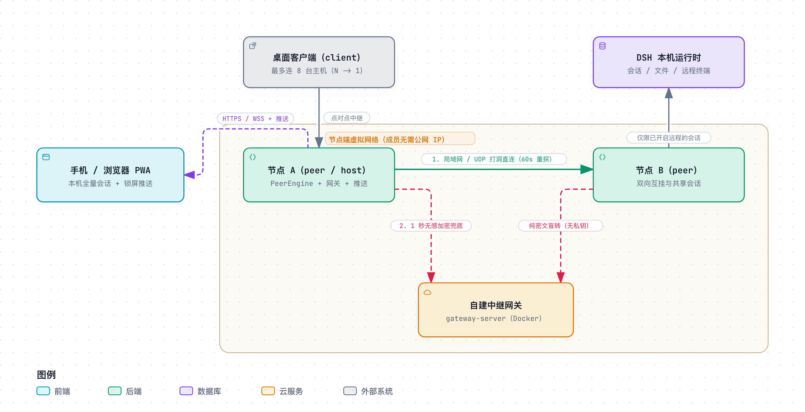
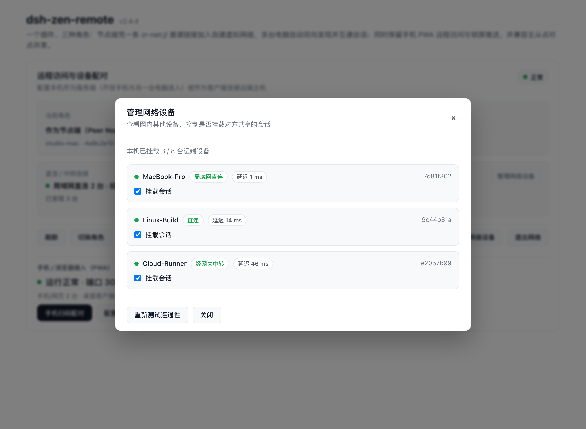
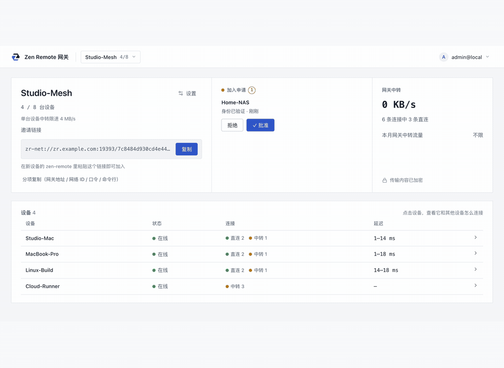
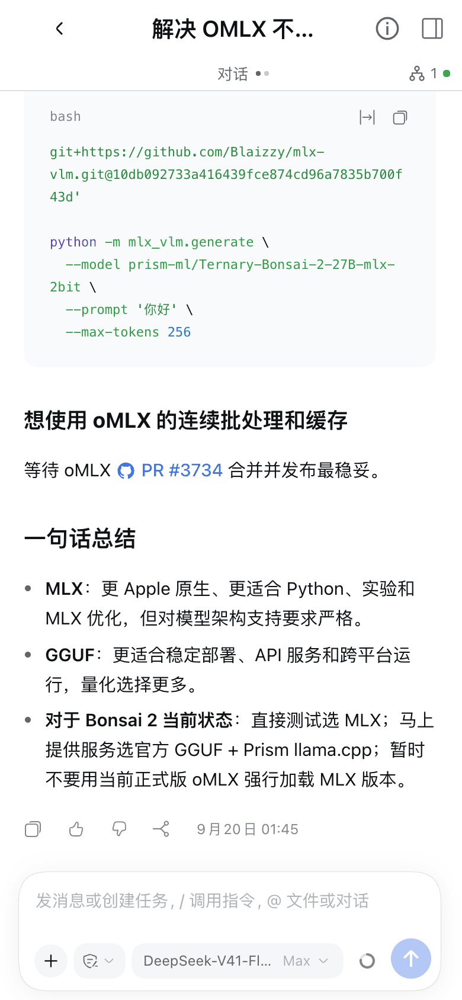
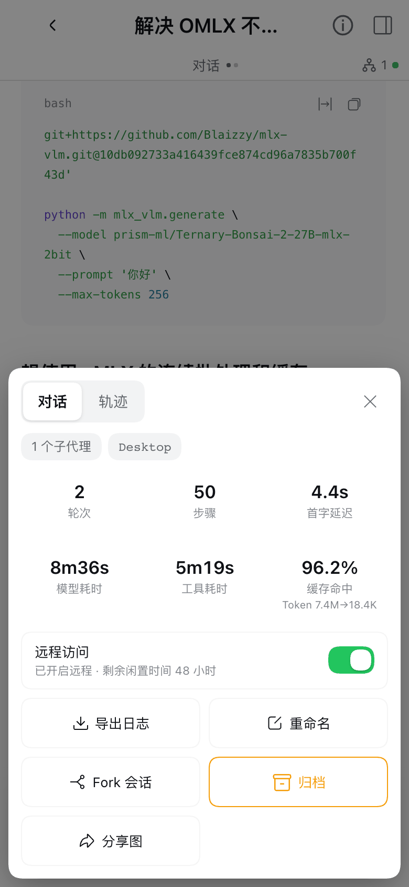
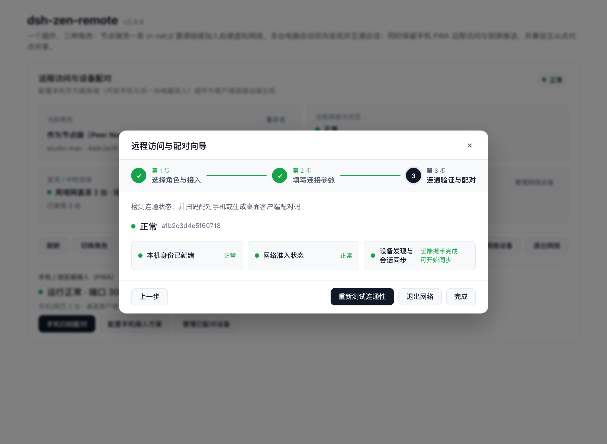
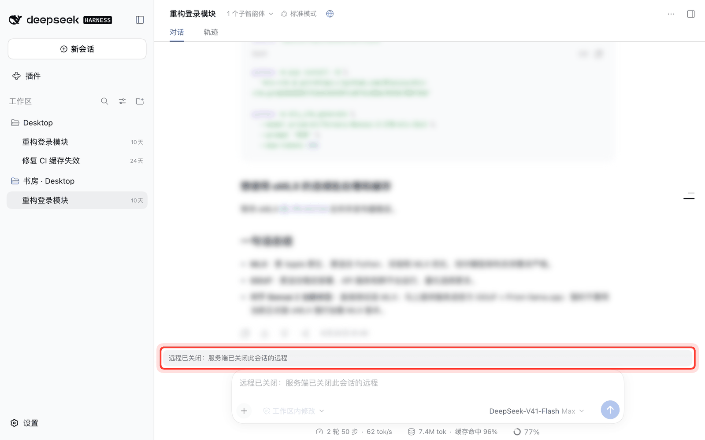
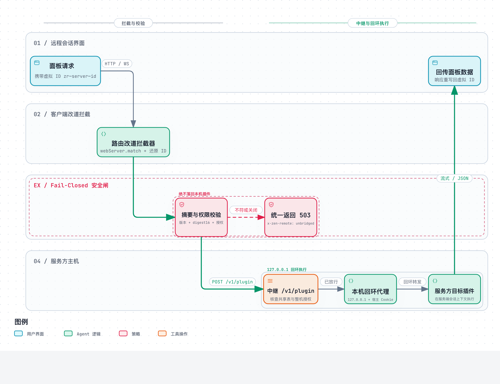

<p align="center">
  <picture>
    <source media="(prefers-color-scheme: dark)" srcset="assets/logo/dsh-zen-remote-horizontal-dark.svg">
    
  </picture>
</p>

<p align="center">
  <b>一个 DeepSeek Harness 插件、三种角色——以多机节点端互通互联为核心。</b><br>
  将多台电脑连成零公网 IP 的端到端加密虚拟网络，同时完整保留手机 PWA 远程操控与锁屏推送，并兼容传统主从点对点挂载。
</p>

<p align="center">
<a href="https://www.npmjs.com/package/dsh-zen-remote"></a>
<a href="https://www.npmjs.com/package/dsh-zen-remote"></a>
<a href="https://github.com/KyoMio/dsh-zen-remote/actions/workflows/publish.yml"></a>
<a href="LICENSE"></a>
<br>


</p>

<p align="center"><a href="README.md">English</a></p>

<p align="center">
  <picture>
    <source media="(prefers-color-scheme: dark)" srcset="docs/images/arch-mesh-zh-dark.png">
    <source media="(prefers-color-scheme: light)" srcset="docs/images/arch-mesh-zh-light.png">
    
  </picture>
</p>

| 角色 | 适用场景 | 会话共享方向 | 手机 PWA 与锁屏推送 | 需要公网 IP？ |
| --- | --- | --- | --- | --- |
| **节点端（`peer`）** | 多台电脑跨局域网 / NAT 双向互通 | **双向互通**（挂载对端 + 共享本机） | **完整保留**（扫码访问与推送照常可用） | **不需要**（直连打洞 + 端到端加密网关中转） |
| **主服务端（`host`，默认）** | 主力工作站 / 服务器，开放手机或指定桌面端接入 | 主动共享选定会话（`1 → N`） | 支持（本地网关 + Web Push） | 可选（Caddy / Tunnel / 反代 / 局域网） |
| **桌面客户端（`client`）** | 辅助电脑，把指定主机的会话挂进本机侧边栏 | 最多同时接入 **8 台主服务端**（`N → 1`） | 不启用（不监听 `3088` 端口） | 不需要 |

| 自建网关控制台（`Studio-Mesh`） | 节点网络设备管理 |
| --- | --- |
| <picture><source media="(prefers-color-scheme: dark)" srcset="docs/images/gateway-console-dark.png"><source media="(prefers-color-scheme: light)" srcset="docs/images/gateway-console.png"></picture> |  |

<details>
<summary>展开查看节点组网与向导操作演示（动图）</summary>

<p align="center">
  
</p>

</details>

| 手机会话列表 | 手机会话页 | 会话信息卡 | 配对页 |
| --- | --- | --- | --- |
|  |  |  |  |

> 手机端截图为 390×844 浅色视口；网关控制台、移动端界面与配对页均自适应深浅主题。

---

## 目录

1. [安装](#1-安装)
2. [配对与组网模式](#2-配对与组网模式)
   - [模式 A：节点端虚拟网络互通（`peer`，推荐主推）](#模式-a节点端虚拟网络互通peer推荐主推)
   - [模式 B：单机主服务端（`host`，手机 PWA 与点对点共享）](#模式-b单机主服务端host手机-pwa-与点对点共享)
   - [模式 C：桌面客户端（`client`，连接最多 8 台主机）](#模式-c桌面客户端client连接最多-8-台主机)
3. [跨端日常使用、已接入官方接口与插件兼容](#3-跨端日常使用已接入官方接口与插件兼容)
4. [插件桥协议（Plugin Bridge）](#4-插件桥协议plugin-bridge)
5. [手机 PWA 与锁屏推送](#5-手机-pwa-与锁屏推送)
6. [进阶配置与字段参考](#6-进阶配置与字段参考)
7. [架构、安全模型与已知说明](#7-架构安全模型与已知说明)

---

## 1. 安装

### 界面一键安装（推荐，桌面端 App 与 Web 端通用）

打开 DSH 左侧**「插件」**页 → 点击**「添加插件」**→ 输入 `dsh-zen-remote` → 安装完成后点击**「立即启用」**，然后重启 DSH 桌面端 App（或 `dsh web`）。

### Web 服务命令行安装（无头服务器 `dsh web`）

```sh
dsh plugin --profile web add dsh-zen-remote
# 或直接运行同包命令行向导，一键完成安装、拉起 DSH 与角色配置：
npx dsh-zen-remote setup
dsh-zen-remote status
```

> `dsh plugin` 必须带 `--profile` 指定目标 profile。桌面端的 `desktop` profile 由 App 独占管理，命令行会拒绝 `--profile desktop`，桌面端请直接使用上面的界面安装。

<details>
<summary>高级安装：完整 CLI 子命令（<code>peer</code> / <code>host</code> / <code>client</code>）、手动 <code>link:</code> 开发装法、升级与卸载</summary>

#### 无头服务器 CLI 工具（`dsh-zen-remote`）

CLI 通过本机 `0600` 权限的 IPC socket（`~/.dsh/zen-remote-cli.sock`）驱动运行中的插件进程，Caddy 与 `cloudflared` 始终由插件进程托管；支持 `--lang zh|en` 切换输出语言，非交互脚本可加 `--yes` 附带参数零提问完成。

```sh
# 节点端命令（role 为 peer 时可用，加入自建虚拟网络）
npx dsh-zen-remote setup --role peer --invite "zr-net://gw.example.com/0123456789abcdef#join-key" [--yes]
dsh-zen-remote peer join "zr-net://gw.example.com/0123456789abcdef#join-key" [--name My-Mac] [--yes]
dsh-zen-remote peer status                                     # 查看 nodeId、准入状态、网内设备、实时连接路径与 RTT（支持 --json）
dsh-zen-remote peer trust <nodeId>                             # 对端身份变更拦截后，在本机显式信任新身份
dsh-zen-remote peer leave [--yes]                              # 退出网络（不影响本机手机/浏览器扫码访问）

# 主服务端命令（role 为 host 时可用）
dsh-zen-remote host device pair --device-role web              # 生成手机/浏览器配对二维码与 8 位码（或 desktop-client）
dsh-zen-remote host device list                                # 列出全部已配对设备（支持 --json）
dsh-zen-remote host device revoke <id|--all> [--yes]           # 吊销单台或全部已配对设备
dsh-zen-remote host ingress start --mode lan                   # 配置并启动入口（caddy | cloudflared | external | lan）
dsh-zen-remote host ingress stop [--yes]                       # 停止托管的 Caddy / Cloudflare Tunnel 进程
dsh-zen-remote host ingress verify [--no-wait]                 # 三灯连通自检并同时打印手机二维码与桌面客户端配对码
dsh-zen-remote host ingress snippet [--proxy nginx|caddy|lucky] # 打印反向代理配置片段

# 子客户端命令（role 为 client 时可用，最多同时连接 8 台主服务端）
dsh-zen-remote client pair http://192.168.1.2:3088 --code 12345678 [--name My-Mac]
dsh-zen-remote client list                                     # 列出已配对的主服务端及在线状态
dsh-zen-remote client unpair <hostUrl|entryId|--all> [--yes]   # 移除单台或全部已配对的主服务端

# 诊断导出
dsh-zen-remote status --debug                                  # 导出脱敏诊断报告
```

#### 手动编辑 Profile / 本地开发（`link:` 安装）

把依赖写进 profile 的 `package.json`（桌面端在 `~/.dsh/profiles/desktop`，Web 端在 `~/.dsh/profiles/web`），并确保 `"dsh-zen-remote"` 已加入同文件 `dsh.profile.bundles` 数组末尾：

```jsonc
// ~/.dsh/profiles/desktop/package.json
{
  "dependencies": {
    "dsh-zen-remote": "^2.5.1"        // 本地开发换成 "link:/path/to/dsh-zen-remote"
  },
  "dsh": {
    "profile": {
      "bundles": ["dsh-zen-remote"]
    }
  }
}
```

```sh
cd ~/.dsh/profiles/desktop && pnpm install
# 若使用 link: 本地仓库，还需在仓库目录内执行一次 npm install --omit=dev 安装网关子进程的 web-push 依赖
```

#### 升级与卸载

- **开着 HMR 升级插件**：先卸载再添加（`dsh plugin --profile <name> remove dsh-zen-remote` 后再 `add`），直接在运行中的旧版上覆盖安装不会被干净接管。
- **DSH 0.2.1-alpha.3+ 模板重置**：`dsh --profile <name> --from-default-profile <模板>` 会用新副本覆盖自定义 profile，执行前请先备份 `~/.dsh/profiles/<name>`。
- **从 1.x 升级**：2.0 起挂载层合并为 `dsh-zen-remote` 单行，请删掉 `cordis.patch.yml` 里旧的 `dsh-zen-remote-gateway` / `dsh-zen-remote-push` / `dsh-push.mjs` 行。原有配置与已配对设备全部自动保留。
- **彻底卸载**：在「插件」页点「卸载」后重启。若需连同配对与共享记录一并清空，删除 `~/.dsh/lan-gate-state.json`、`~/.dsh/lan-gate.config.json` 与 `~/.dsh/zen-remote-state.json`。

</details>

---

## 2. 配对与组网模式

打开 DSH **「插件」页 → `dsh-zen-remote`**，页面顶部就是**「远程访问与设备配对」**总览卡片（无头服务器在终端运行 `npx dsh-zen-remote setup` 即可走完同一套流程）。


### 模式 A：节点端虚拟网络互通（`peer`，推荐主推）

多台电脑跨局域网 / 家宽 / NAT 连成一张双向互通网：**成员电脑无需公网 IP，也无需两两输入配对码**，并且本机原有的手机 PWA 扫码访问与锁屏推送完整保留。

#### 1. 部署自建中继网关（`gateway-server/`，个人或团队仅需部署一台）

> [!IMPORTANT]
> `gateway-server/` 与本仓库同仓维护，但**不会打入 `dsh-zen-remote` 的 npm 发布包**；仅在需要搭建 `peer` 虚拟网络时单独部署（`host` 与 `client` 模式无需此服务）。

```sh
docker build -t zr-gateway ./gateway-server

docker run -d --name zr-gateway \
  --restart unless-stopped \
  -p 19393:19393/tcp \
  -p 19393:19393/udp \
  -p 19394:19394/udp \
  -e ZR_GATEWAY_PUBLIC_URL=https://zr.example.com \
  -v zr-gateway-data:/data \
  -v $(pwd)/certs:/certs \
  zr-gateway
```

- **首次启动**：通过 `docker logs zr-gateway` 获取 `admin@local` 一次性初始密码，浏览器打开 `http://<主机>:19393/` 登录并创建虚拟网络，复制生成的 `zr-net://…` 邀请链接。
- **内置原生 TLS 与管理能力**：支持 `19393/tcp` 单端口内置 HTTPS/WSS、五态成员准入（`待审批` / `已授权` / `已暂停` / `身份变更` / `已吊销`）、双 UDP 口 STUN 协调（`19393/udp` + `19394/udp`）与网关统一下发直连延迟上限（`peerDirectMaxRttMs`）。详见 [`gateway-server/README.zh-CN.md`](gateway-server/README.zh-CN.md)。

#### 2. 在 DSH 界面或终端一键入网

打开**「插件」页 → `dsh-zen-remote` → 开始配置向导 → 第 1 步选择「作为节点端（Peer Node）」**：

1. **第 2 步——三种入网入口**：
   - **粘贴邀请链接（`zr-net://…`）**：粘贴在网关控制台生成的邀请链接（明文网关链接会带 `?tls=0`；人工审批模式下 `#入网口令` 可省略；老式 `zr-nets://` / `zr-net+insecure://` 链接仍兼容解析）。也可展开**「高级：分项填写」**分别填写网关地址、16 位网络 ID 与可选口令。
   - **输入网关地址（账号登录）**：填写网关地址并登录你的网关账号（密码仅在内存中用于拉取名下网络列表，绝不落盘），选择目标网络并加入。
   - **审批放行**：若网络开启了人工审批，向导显示「等待网络管理员批准」，管理员在控制台批准后自动上线。
2. **第 3 步——三灯连通与自动互挂**：三盏状态灯（**本机身份已就绪**、**网络准入状态**、**设备发现与会话同步**）全绿后，网内在线电脑已开启远程的会话会自动出现在侧边栏（格式为**「设备名 · 工作区名」**），你本机开启远程的会话也会同步出现在对端。
3. **日常节点控制与手机双栖能力**：
   - 总览卡实时显示**网络与设备互通**状态（`本机已挂载 X / M 台远端设备`、局域网直连 vs 经网关中转数量），同时保留**「手机 / 浏览器接入（PWA）」**入口与**插件桥开关**。
   - 点**「管理网络设备」**可查看每台设备的实时连接路径（**局域网直连** / **直连** / **经网关中转** / **离线** / **身份异常**）与延迟（`ms`），逐台切换**「挂载会话」/「忽略」**、触发**立即重探**，或在对端重装触发本地 TOFU `mismatch` 阻断时核对并点**「信任新身份」**。

| 第 1 步：选择节点端角色 | 第 2 步：粘贴 `zr-net://` 邀请链接 | 第 3 步：三灯连通验证 |
| --- | --- | --- |
|  |  |  |

```sh
# 无头服务器终端一步入网
npx dsh-zen-remote setup --role peer --invite "zr-net://gw.example.com/0123456789abcdef#join-key"
dsh-zen-remote peer status         # 查看 nodeId、准入状态、网内设备、实时路径与 RTT（支持 --json）
```

#### 3. 传输路径优先序与端到端加密（网关盲转密文）

| 优先级 | 路径 | 工作机制 |
| --- | --- | --- |
| **1** | **局域网直连（`lan`）** | 同网段内直接通信（已排除 CGNAT `100.64.0.0/10` 等慢隧道网段误判） |
| **2** | **UDP 打洞直连（`p2p`）** | 通过网关双 UDP STUN 端口（`19393/udp` + `19394/udp`）协调穿透，带自适应平滑 RTT 的滑动窗 ARQ 流控 |
| **3** | **端到端加密网关中转（`relay`）** | **1 秒无感兜底**（或实测直连 RTT 持续高于网关 `peerDirectMaxRttMs` 上限时自动降级）；后台按 **5s → 15s → 60s** 退避静默重探，满足条件自动升回直连 |

- **纯密文中转（网关无私钥、不可读内容）**：节点之间会话流量使用每会话临时 **X25519 + AES-256-GCM** 密封，并由节点 Ed25519 长期身份签名绑定。网关只看到 28 字节明文路由头，不持有任何解密密钥，无法读取会话正文。

---

### 模式 B：单机主服务端（`host`，手机 PWA 与点对点共享）

只需要单机开放手机访问或点对点向特定桌面端共享会话时，第 1 步选择**「作为服务端（主机）」**并选一种接入方式：

| 接入方式 | 适合什么环境 | 向导自动为你做什么 |
| --- | --- | --- |
| **内置 Caddy（推荐）** | 有公网 IP（或端口映射）+ 域名在 Cloudflare | 自动下载预编译 `Caddy + caddy-dns/cloudflare`，通过 DNS-01 自动签发续期证书（仅监听 `127.0.0.1:3088`） |
| **使用已有反向代理** | 已运行 Nginx、Caddy 或 Lucky | 生成反代配置片段 + 一键注册 `trustedProxies`（[手配指南](docs/remote-access.md)） |
| **Cloudflare Tunnel 内网穿透** | 无公网 IP / 不做端口映射 + 域名在 Cloudflare | 自动下载 `cloudflared`、创建/复用隧道、写入 CNAME 并启动隧道（仅监听 `127.0.0.1:3088`） |
| **局域网 / Tailscale 直连** | 同一 Wi-Fi / 局域网或共用 Tailscale | 自动检测 LAN / Tailscale IPv4 并监听 `0.0.0.0:3088`，内置**私网源 IP 铁闸**拦截公网未代理直连（`403 public-direct-forbidden`） |

在第 3 步完成连通自检后，可在**「配对手机 / 浏览器（扫码）」**中扫码安装 PWA，或切到**「配对另一台电脑（桌面客户端）」**生成 8 位桌面配对码。

---

### 模式 C：桌面客户端（`client`，连接最多 8 台主机）

在另一台只消费远端会话、无需对外服务的电脑上选择**「作为桌面客户端（从机）」**（或运行 `dsh-zen-remote client pair <hostUrl> --code <8位码>`）：

- 默认支持同时配对连接**最多 8 台主服务端**（可通过 `maxServers` `1..64` 或环境变量 `LAN_GATE_MAX_SERVERS` 调整）。
- 各主服务端工作区严格按**配对添加顺序**合并在本地工作区之后；同名服务端自动编号「名称-1」「名称-2」。
- 模型目录、标题栏状态图标、只读横幅、插件桥与文件上传按各会话所属 `serverId` 严格隔离。

---

## 3. 跨端日常使用、已接入官方接口与插件兼容

| | **Web 应用端（手机 / 平板 / 浏览器）** | **节点端 / 桌面客户端（另一台 DSH 电脑）** |
| --- | --- | --- |
| 可见范围 | 本机上的**全部**会话 | **仅**共享方已开启「远程访问」的会话（服务端中继层强制隔离） |
| 配对凭证 | 浏览器长期 HttpOnly Cookie | **节点端**：Ed25519 TOFU 身份 + 临时 X25519 会话密钥<br>**客户端**：`~/.dsh/zen-remote-state.json` 中的设备令牌 |

### 会话远程开关与生命周期

开启/关闭单个会话的远程共享（也可开启 `autoShareNewSessions` 让新建会话自动共享）有四个入口：
1. **侧边栏会话「…」菜单** → **「开启远程 / 关闭远程」**
2. **会话页标题栏** → 右侧地球图标（悬停可看剩余闲置休眠时间；绿点代表有远端设备正在查看）
3. **手机端会话信息卡（`ⓘ`）** → **「远程访问」**开关
4. **插件设置页** → 「已开启远程的会话」列表（逐个或一键全部关闭）

开启远程的会话连续 **48 小时**（`idleHours` 可调）无回合活动后会自动休眠关闭（运行中或等待审批/回答的会话不休眠）。关闭或吊销后，侧边栏会自动隐藏该会话，已打开标签页显示「远程已关闭」横幅并在恢复共享后自动重连。

| 从侧边栏开启远程 | 远程已关闭横幅 |
| --- | --- |
|  |  |

<p align="center">
  <br>
  <sub>手机端会话信息卡（<code>ⓘ</code>）内的「远程访问」快捷开关</sub>
</p>

### 已接入的 DSH 官方接口一览

所有跨端 RPC / 流 / HTTP 路由均受逐方法白名单严格把关（`src/relay-access.ts` + `src/fetch-route-intercept.ts`），不依赖通用参数扫描：

| 功能面 | 已接入的 DSH 官方接口 | 隔离与边界说明 |
| --- | --- | --- |
| **会话、队列与子智能体** | `session/follow`, `page`, `projections`, `list`, `control`, `search`, `create`, `fork`, `rename`, `selectModel`, `modelCatalog`, `prompt`, `cancel`, `updateQueue`, `attachment`, `sessionFeedback/record`；`subagents/prompt`, `interruptByUser` / `interruptByParent`；`$zr/events`（审批与提问转发）；`workspace/follow`, `pinSession`, `unpinSession`, `archiveSession`, `unarchiveSession`, `insertSessionBefore` | 全局流/列表（`list`、`search`、`follow`、`control`、`@` 引用候选）按共享表逐行过滤；`dsh-session:` 正文/排队/斜杠命令引用在服务端逐一校验；`modelCatalog` 按 `serverId` 隔离且清空服务端 `failures` |
| **工作区文件、Diff 与预览** | `workspaceFiles/list`, `changes`, `read`, `readBytes`, `stat`, `search`；`officeKit/render` 与 `officeToPdf/render`（服务端 LibreOffice PDF 预览）；HTTP `/api/changes.summary`、`/api/changes.diff`、`/api/session/uploadFileBinary`、`/api/file`（正文内联图片与媒体） | 涉及服务端本机弹窗或导出日志的路由（`/api/session.export`、`/api/changes.open`、`/api/present.open`、`/api/present.host`）在远程会话中刻意禁用/隐藏 |
| **服务端远程终端** | `terminal/attach`（0.2.2+ 全双工 PTY 流）、`watch`、`environment`、`shells`、`create`、`write`、`resize`、`rename`、`close`、`follow`、`list`、`retain` | 在服务方机器以宿主系统用户运行；关闭会话远程访问时立即终止其远程终端流 |
| **Forge 面板（Git / PR / Worktree）** *(DSH 0.2.2+)* | 全部 31 个会话级 `forgePanel/*` 接口（`follow`, `branches`, `diffBases`, `localCommits`, `localDiff`, `localText`, `changeRequest*`, `*Worktree`, `review*`, `merge` 等）+ 全局 PR 状态流 `forgePanel/changeRequestStates` | 全局 PR 状态流按工作区/会话过滤；较旧版本 DSH 自动降级而不影响核心对话 |
| **目标、命令、预设与交互工具** | `goals/get\|create\|edit\|complete\|pause\|resume\|clear`；`commands/list\|execute`；`agentPresets/list\|read\|select`；`sessionReferenceResolver/candidates`；`userQuestions/answer\|attachWait`；`actionCards/act`；`toolResults/watch`；`agentTeams/setEnabled`；`pluginRecommendations/describe`；`job/list\|follow\|kill`；`skills/list`；`messageFeedback/*`；`schedule/list` | 服务端没有任何共享会话时，`agentPresets/list` 返回空、`read` 拒绝；共享任意会话后可读取全机预设名册与 YAML（不含按会话的细分过滤） |

### `dsh-better-sidebar` 兼容说明

`dsh-zen-remote` 内置针对 **`dsh-better-sidebar`** 的专用适配器（`src/adapters/dsh-better-sidebar/`），并通过接口表面摘要（wire-surface SHA-256）自动匹配，接口不变的补丁更新无需等待 `zen-remote` 发版即可直接适配：

- **远程可用能力**：`/sidebar/api/*`（文件树、编辑器、Git 提交图与历史、任务面板、旁聊）、`/sidebar/file`、`/sidebar/sidechat-image`、`/sidebar/archive`、`/sidebar/upload`、`/sidebar/write`、`/sidebar/html` 预览，以及全部三条 WebSocket 流（`/sidebar/ws/agent-opens`、`/sidebar/ws/fs-watch` 和按帧改写会话 ID 的 `/sidebar/ws/sidechat`）。
- **安全边界**：归类为整机数据（需服务方在设置页「插件桥」显式打开同意开关，默认**关闭**）；服务端钩子自动剥离客户端传入的 `cwd`，强制按已校验的会话 ID 解析目录；远程会话中禁止 `open.external`；静态资源 `/sidebar/bundle` 留在本机加载。
- **未桥接保护**：若 `dsh-better-sidebar` 版本不在适配范围内或未开启同意开关，远程面板请求会统一返回 `503`，不会误读你本地电脑的文件。

---

## 4. 插件桥协议（Plugin Bridge）

第三方 DSH 插件若在会话页内渲染自定义面板并请求自己在 DSH `webServer` 上注册的路由，可通过**插件桥协议**在远程会话中透明读取**服务方机器**的数据——且**完全无需把 `dsh-zen-remote` 列为运行时依赖**。

<p align="center">
  <picture>
    <source media="(prefers-color-scheme: dark)" srcset="docs/images/arch-bridge-zh-dark.png">
    <source media="(prefers-color-scheme: light)" srcset="docs/images/arch-bridge-zh-light.png">
    
  </picture>
</p>

### 协议机制

1. **两条接入路径**：
   - **协作声明（推荐插件作者使用）**：在插件里可选注入服务 `ctx.inject(['zenRemote'], ...)`，调用 `bridge.bridge({ plugin, version, routes })`（类型从 `dsh-zen-remote` 引入）。支持 `GET`/`HEAD`/`POST`/`PUT`/`PATCH`/`DELETE`、`stream` 流式响应、`upgrade: true`（WebSocket 字节/JSON 帧隧道）、`prefix: true` 前缀匹配、`locator`（`query` / `path-segment` / `json-body`）、`deny: true`（远程禁用本地专属接口）与 `rewriteIds`（`true` 或 `{ fields }`）。未安装 `dsh-zen-remote` 时 `inject` 不触发，零侵入。
   - **内置可插拔适配器（`src/adapters/`）**：针对尚未接入声明的第三方插件（如 `dsh-better-sidebar`）提供内置适配器，整体可插拔；若插件自己登记了协作声明，协作声明永远优先让位。
2. **握手摘要一致性校验**：建立连接时两端交换 `{ plugin, version, digest16 }`（规范化声明的 16 位 SHA-256 摘要），必须插件名、精确版本号、声明摘要三者完全一致才放行。
3. **会话级 vs 整机级授权**：
   - `scope: 'session'`：按每条请求的会话 ID 核验共享表自动放行。
   - `scope: 'server'`：属于整机数据，还需服务方主人在「插件桥」设置中逐插件开启授权（默认关闭）。
4. **Fail-Closed 隔离**：任何校验不通过（`not-on-server`、`version-mismatch`、`declaration-mismatch`、`consent-off`、`route-denied`、`bad-query`、`offline` 等）一律返回统一的 `503`（`x-zen-remote: unbridged`），绝不静默落回本机数据。

完整接入与字段规范见 [插件桥开发文档](docs/plugin-bridge.md)。

---

## 5. 手机 PWA 与锁屏推送

`peer` 与 `host` 两种角色均默认挂载完整的移动端 Web 界面与锁屏推送能力：

- **移动端 PWA 界面**：会话列表主屏 + 独立会话页两级页面栈（左缘右滑返回、安卓返回手势接管、首帧骨架屏与内容哈希长缓存）、主屏插件 chips 自动发现、底部重排 composer 与附件上传、会话信息卡（六格统计含 `tok/s`、导出日志、重命名、Fork、归档、一键导出 PNG 分享长图、远程访问开关）。
- **锁屏推送通知** *（载荷全程 `aes128gcm` 端到端加密；可通过 `pushEnabled` 一键总开关停用，或开启 `pushSessionName` 在正文首行显示 `来源会话：<会话名>`）*：
  1. **系统自动触发（`pushEnabled` 开启时恒开，不受最小间隔压制）**：
     - **工具等待授权**：超过 `DSH_PUSH_APPROVAL_GRACE_MS`（默认 5 秒，留给自动审批插件先处理）仍未决时推送「DSH 等你授权」。
     - **模型提问等待回答（`ask_user_question`）**：推送「DSH 等你回答」。
  2. **模型主动调用（`push_notify` 工具）**：模型在收到交代或遇到需你拍板的阻塞时主动推送；普通回合结束默认静默（如需每轮结束都推，打开 `pushTurnEnd`，可配合 `pushSummary` 附带 120 字以内摘要）。

---

## 6. 进阶配置与字段参考

日常配对与组网均可在顶部**「远程访问与设备配对」向导**（或 `npx dsh-zen-remote setup`）完成；如需微调底层字段，在插件详情页的**「包含的组件」**下再次点击 `dsh-zen-remote` 展开配置。

<details>
<summary>展开查看全部配置字段参考表与环境变量</summary>

每个字段按此顺序取第一个合法值：**环境变量 &gt; 插件行设置 &gt; `~/.dsh/lan-gate.config.json` &gt; 默认值**。修改需要重启网关/推送的字段后插件会自动重载，无需重启 App。

| 字段 | 默认值 | 说明 |
| --- | --- | --- |
| `role` | `host` | `peer` 加入自建虚拟网络并保留本机网关/推送/共享能力；`host` 运行单机网关 + 推送 + 共享；`client` 仅作为桌面客户端连接远端 |
| `serverName` | 电脑名 | **设备名称**（≤ 40 字），作工作区侧边栏前缀或登记名（客户端改名会向已配对服务端单向广播） |
| `port` | `3088` | 本地网关端口；被占用时自动向上递增重试（最多 `+20`） |
| `host` | `127.0.0.1` | 网关监听地址；本机反代/隧道保持 `127.0.0.1`，局域网/Tailscale 直连设为 `0.0.0.0` |
| `targetPort` | （自动） | 本机 DSH Web UI 端口，留空自动探测宿主实际监听端口 |
| `rateLimit` | `120` | 未配对请求每分钟速率上限（按真实客户端 IP 计数） |
| `trustedProxies` | 空 | 逗号分隔的受信任反代 IP（反代不在本机时配置） |
| `vapidSubject` | `mailto:admin@localhost` | Web Push 联系标识（**iOS 必须为真实邮箱或 `https://` 网址**） |
| `lang` | `auto` | 网关页面与通知语言：`auto`（跟随浏览器）、`zh`、`en` |
| `pushEnabled` | 开 | 会话通知总开关；关闭后停用全部自动推送及 `push_notify` 工具 |
| `pushSessionName` | 关 | 推送正文第一行加「来源会话：<会话名>」 |
| `pushTurnEnd` | 关 | 普通回合结束时是否也发送推送 |
| `pushEvents` | `agent/turn-stopping` | 触发回合结束推送的事件名（逗号分隔） |
| `pushDebounceMs` | `15000` | 两条自动推送之间的最小间隔毫秒数 |
| `pushSummary` | 关 | 推送正文是否附带 120 字以内的最终回复摘要 |
| `pushTool` | 开 | 是否向模型注册 `push_notify` 工具 |
| `idleHours` | `48` | 远程共享会话的闲置自动休眠时长（小时，范围 `(0, 8760]`） |
| `maxServers` | `8` | 最多同时挂载几台服务端（`1..64`，现场读取；环境变量 `LAN_GATE_MAX_SERVERS` 优先）。`peer` 模式下远端挂载上限为 `min(maxPeers - 1, maxServers)` |
| `logLevel` | `info` | `ctx.logger` 与诊断日志环级别：`info` / `debug` / `warn`（现场读取；环境变量 `LAN_GATE_LOG_LEVEL` 优先） |
| `autoShareNewSessions` | 关 | 新建会话是否自动开启远程共享 |
| `pluginBridgeConsent` | `{}` | 插件桥整机数据授权表（插件名 → 布尔值） |
| `serverUrl` / `deviceToken` | 空 | 旧版单服务端客户端字段，首次启动时自动迁入 `~/.dsh/zen-remote-state.json` |
| `turnFoldDesktop` | 关 | 是否在桌面端宽度也默认折叠回合中间过程 |
| `keyboardLiftRatio` / `keyboardLiftMaxPx` / `keyboardSafetyPadPx` | `0.42` / `400` / `15` | 软键盘高度不可见环境下的输入框抬升校准参数 |
| `maxUploadBytes` | `20 MB` | 手机端单次附件上传大小上限 |

历史环境变量（优先级高于插件行）：`LAN_GATE_PORT`、`LAN_GATE_HOST`、`LAN_GATE_TARGET_PORT`、`LAN_GATE_RATE_LIMIT`、`LAN_GATE_TRUSTED_PROXIES`、`LAN_GATE_VAPID_SUBJECT`、`LAN_GATE_LANG`、`LAN_GATE_LOG_LEVEL`、`LAN_GATE_MAX_SERVERS`、`DSH_PUSH_ENABLED`、`DSH_PUSH_SESSION_NAME`、`DSH_PUSH_TURN_END`、`DSH_PUSH_EVENTS`、`DSH_PUSH_DEBOUNCE_MS`、`DSH_PUSH_SUMMARY`、`DSH_PUSH_TOOL`、`DSH_PUSH_LANG`、`DSH_PUSH_APPROVAL_GRACE_MS`。

</details>

---

## 7. 架构、安全模型与已知说明

- **节点组网端到端加密（网关盲转密文）与 TOFU 锚定**：网内节点间会话流量采用会话级临时 **X25519 + AES-256-GCM** 密封（前向保密，由长期 Ed25519 身份签名绑定）；网关仅转发 28 字节路由头、不持有任何解密密钥，无法窥探会话正文。节点身份自证明（`nodeId` = 公钥哈希），各机独立本地锚定对端公钥（`pinnedPeers`）：即便网关侧重置设备身份，其他节点仍会拦截（`mismatch`），直到人工在本机显式信任新身份。
- **受信任设备与严格会话隔离**：已配对桌面端 / 节点端在远程会话中以服务方系统用户权限运行终端与文件预览，未开启远程的会话在中继层强制隔离拒绝；局域网模式（`0.0.0.0`）内置私网源 IP 铁闸拒绝公网未代理直连（`403 public-direct-forbidden`），管理与配对操作仅限服务方本机执行。
- **版本容错**：连接两端需保持 `dsh-zen-remote` 版本一致；两侧 DSH 宿主版本可不同（握手比对接口规范化指纹，存在差异时仅受影响单面板降级）。

深度说明：[公网接入与中继协议](docs/remote-access.md) · [界面设计文档](docs/interface.md) · [插件桥文档](docs/plugin-bridge.md) · [自建网关部署文档](gateway-server/README.zh-CN.md)

<details>
<summary>展开查看状态文件与隐私说明、已知限制、iOS PWA 适配与已适配第三方插件列表</summary>

**状态文件与数据隐私**
- 插件自身不向任何第三方收集或上报数据。网关配对状态存于 `~/.dsh/lan-gate-state.json`；主进程三合一状态文件 `~/.dsh/zen-remote-state.json`（`0600`）统一保存本机 `serverId`、共享会话表 `sessions`、客户端列表 `servers` 以及节点端状态（`peerIdentity`、`peerNetwork`、`pinnedPeers`）；托管的 Cloudflare 令牌以 `0600` 权限存于 `~/.dsh/zen-remote-ingress/`。

**已知限制**
- 同时打开多个 DSH 窗口时，客户端对「当前正打开哪个会话」的判断可能存在偏差。
- 切换服务端或服务端重建同 ID 工作区后，需刷新一次客户端页面以重新加载侧边栏分组。
- 远程会话禁用「导出会话」，并隐藏会在服务方本机弹窗的「在访达中显示 / 在应用中打开」按钮。
- 经反向代理在外部浏览器访问时，DSH 宿主自身的「设置」页不可修改（DSH 官方设计将设置 RPC 限制为本机回环连接），修改插件配置请直接在服务方本机操作。

**iOS 独立 PWA 已知系统问题**
- **iOS 26.x 独立 PWA 视口缩水**：添加到主屏幕后底部可能少一条状态栏高度（iOS WebKit 缺陷），插件已内置三层缓解，彻底恢复需划掉 App 重开。
- **iOS 26+ 顶部系统渐进模糊**：从主屏幕打开时顶部约 95px 区域可能出现系统合成层模糊遮罩（`WKScrollPocket`），点进任意会话再返回列表页即可消除。

**已适配的第三方插件**

| 插件 | 移动端与远程适配内容 | 实测版本 |
| --- | --- | --- |
| [dsh-better-sidebar](https://github.com/omdsh-dev/DSH-better-sidebar) | 移动端右栏全屏抽屉、左缘滑回与安全区避让；**插件桥**内置适配（含 surface 摘要自动匹配，授权后远程可直接读写文件/Git/任务/旁聊面板） | 内置适配器 |
| [@nanmicoder/dsh-agent-teams](https://github.com/NanmiCoder/dsh-agent-teams) | AgentTeams 活动浮层避让会话顶栏、子代理头部保留父会话一键返回 | 0.1.9 |
| [@ychris12138/dsh-usage-stats](https://github.com/Ychris12138/dsh-usage-stats) | 用量与余额入口收进手机主屏 chips 行 | 0.2.9 |
| [@opendsh/dsh-plugin-scheduled-tasks](https://github.com/Ceelog/dsh-plugins) | 定时任务入口收进手机主屏 chips 行 | 0.2.3 |
| dsh-at-file | 手机端去重 `.dsh-uploads/` 附件引用行 | 0.6.7 |
| [@ace-zone/dsh-market](https://www.npmjs.com/package/@ace-zone/dsh-market) | 插件市场弹窗顶栏移动端紧凑化，保留关闭按钮与语言切换 | 0.1.66 |
| [dsh-vision-toolkit](https://www.npmjs.com/package/@anionex/dsh-vision-toolkit) | 配合手机端附件上传进行图像问答/OCR | — |
| [dsh-web-ui 全家桶](https://www.npmjs.com/package/@linxin666/dsh-web-ui-all) | 沿用文件树与预览浮层移动端限宽居中规则 | — |

</details>

---

## npm 下载统计

<p align="center">
  <a href="https://www.npmjs.com/package/dsh-zen-remote"></a>
  <a href="https://www.npmjs.com/package/dsh-zen-remote"></a>
</p>

<p align="center">
  <a href="https://npm-history.com/#dsh-zen-remote">
    <picture>
      <source media="(prefers-color-scheme: dark)" srcset="https://npm-history.com/api/svg?packages=dsh-zen-remote&theme=dark" />
      <source media="(prefers-color-scheme: light)" srcset="https://npm-history.com/api/svg?packages=dsh-zen-remote" />
      
    </picture>
  </a>
</p>

## 深度文档索引

| 文档 | 内容范围 |
| --- | --- |
| [公网接入与中继协议](docs/remote-access.md) | 反向代理配置、设备角色与配对、中继方法表、节点虚拟组网、安全边界 |
| [界面设计文档](docs/interface.md) | 响应式断点、设置与向导部件、移动端安全区体系、兼容插件清单 |
| [插件桥开发文档](docs/plugin-bridge.md) | 协作声明接口、WebSocket 字节/JSON 帧隧道、Fail-Closed `503` 约定 |
| [自建中继网关文档](gateway-server/README.zh-CN.md) | Docker / Node.js 部署、单端口原生 TLS、环境变量表、控制台与 `zr-net://` 邀请格式 |

## 上游致谢

本插件的界面层衍生自 [mexiaosqwq/dsh-web-mobile](https://github.com/mexiaosqwq/dsh-web-mobile)，通道层衍生自 [zylzyqzz/dsh-mobile-pwa](https://github.com/zylzyqzz/dsh-mobile-pwa)（其自身衍生自 [Bernardxu123/dsh-mobile-gate](https://github.com/Bernardxu123/dsh-mobile-gate)），均为 MIT，原始版权行保留在 [LICENSE](LICENSE)。

## License

[MIT](LICENSE)

<p align="right"><a href="#目录">⬆ 回到顶部</a></p>
