<h1 align="center">dsh-zen-remote</h1>
<p align="center">一个 DeepSeek Harness 插件、两种角色。<b>主服务端</b>把 DSH 变成手机能安全访问的 PWA（手机界面、配对网关、锁屏推送），并把选定的会话共享给已配对的桌面端；<b>子客户端</b>跑在另一台 DSH 桌面端里，可同时连接<b>最多 8 台主服务端</b>，把服务端共享的会话直接摆进自己的侧边栏——完整历史、实时进度、发消息、审批、终端，全部在服务端执行。</p>

<p align="center">
<a href="https://www.npmjs.com/package/dsh-zen-remote"></a>
<a href="https://www.npmjs.com/package/dsh-zen-remote"></a>
<a href="https://github.com/KyoMio/dsh-zen-remote/actions/workflows/publish.yml"></a>
<a href="LICENSE"></a>
<br>


<a href="https://www.npmjs.com/package/dsh-zen-remote#provenance"></a>


</p>

<p align="center"><a href="README.md">English</a></p>

| 会话列表主屏 | 会话页 | 会话信息卡 |
| --- | --- | --- |
| 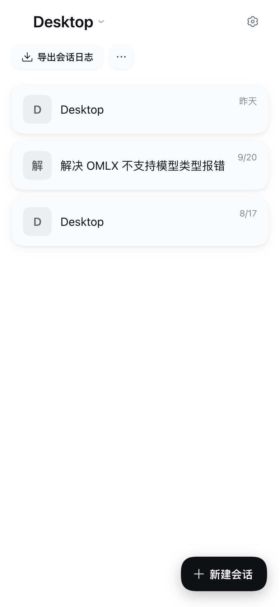 | 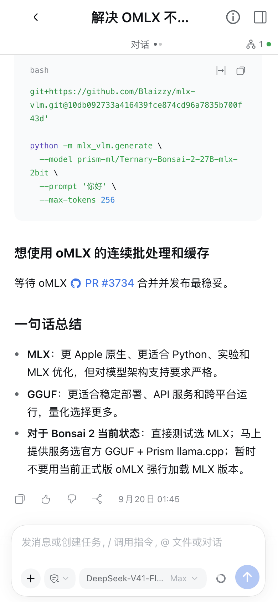 | 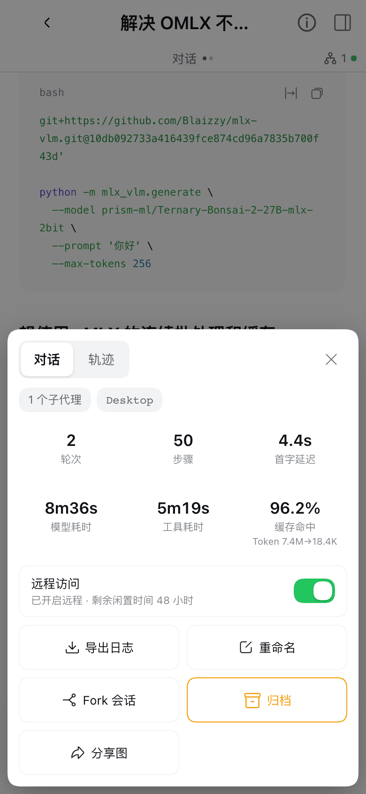 |

| composer 权限 sheet | 公网设备看到的配对页 |
| --- | --- | --- |
| 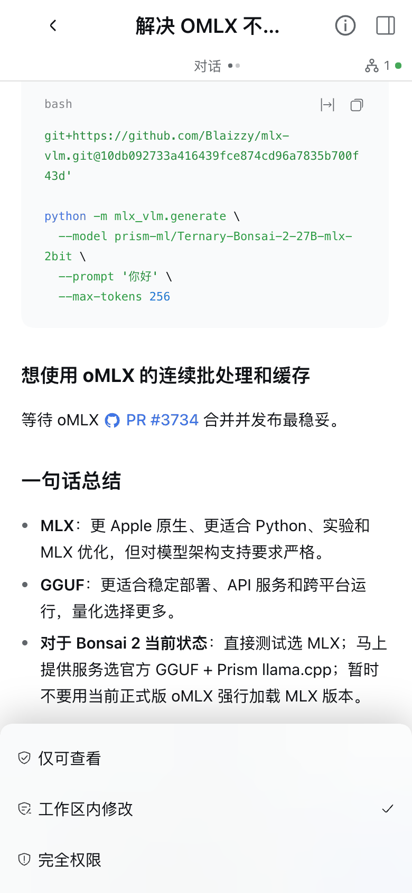 | 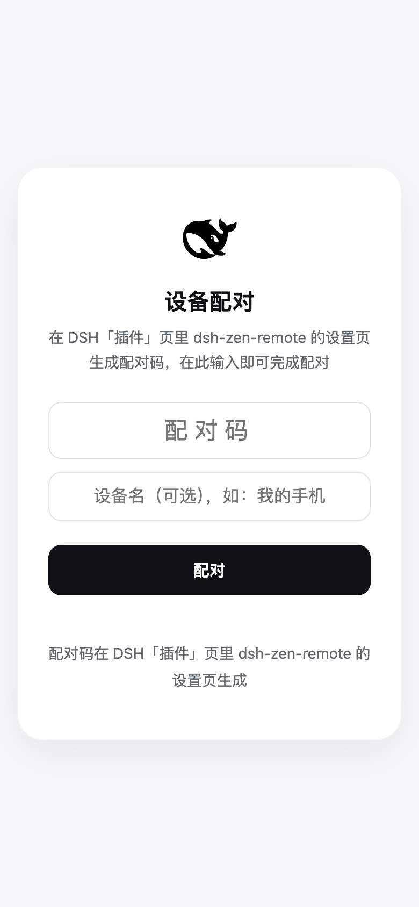 |

> 截图为 390×844 手机视口、浅色主题；深浅主题均适配。配对页由网关绘制，按 DSH 官方风格、跟随系统浅色 / 深色。

---

## 目录

1. [安装](#1-安装)
2. [快速上手（一体化配置与配对向导）](#2-快速上手一体化配置与配对向导)
   - [场景 A：作为主服务端（开放手机与另一台电脑连入）](#场景-a作为主服务端开放手机与另一台电脑连入)
   - [场景 B：作为桌面客户端（连接最多 8 台远端服务端）](#场景-b作为桌面客户端连接最多-8-台远端服务端)
3. [日常使用：会话共享与跨端协作](#3-日常使用会话共享与跨端协作)
4. [锁屏推送：通知什么时候会响](#4-锁屏推送通知什么时候会响)
5. [功能一览](#5-功能一览)
6. [进阶配置与字段参考](#6-进阶配置与字段参考)
7. [架构、安全模型与已知说明](#7-架构安全模型与已知说明)

---

## 1. 安装

### 界面一键安装（推荐，桌面端 App 与 Web 端通用）

打开 DSH 左侧**「插件」**页 → 点击**「添加插件」**→ 输入 `dsh-zen-remote` → 安装完成后点击**「立即启用」**，然后重启 DSH 桌面端 App（或 `dsh web`）。

### Web 服务命令行安装（无头服务器 `dsh web`）

```sh
dsh plugin --profile web add dsh-zen-remote
# 然后重启 dsh web（或直接运行 npx dsh-zen-remote setup 一键完成安装、拉起与向导配置）
```

> `dsh plugin` 必须带 `--profile` 指定目标 profile。桌面端的 `desktop` profile 由 App 独占管理，命令行会拒绝 `--profile desktop`，桌面端请直接使用上面的界面安装。

### 无头服务器 CLI 一键向导（`dsh-zen-remote`）

插件自带同包分发的命令行工具，远程 VPS 与无头环境（`dsh web`）无需打开浏览器插件页，在终端即可完成全部接入配置、三灯连通验证与扫码 / 配对码配对：

```sh
npx dsh-zen-remote setup        # 三步交互向导：选角色 → 选接入方式 → 三灯验证 + 终端二维码 / 桌面配对码
dsh-zen-remote status           # 查看当前角色、网关与连接状态（--json 机器可读；--debug 导出脱敏诊断报告）
```

<details>
<summary>展开查看完整 CLI 子命令清单（<code>host</code> / <code>client</code> / 非交互参数）</summary>

```sh
# 主服务端命令（role 为 host 时可用）
dsh-zen-remote host device pair --device-role web              # 生成手机/浏览器配对二维码与 8 位码（或 desktop-client）
dsh-zen-remote host device list                                # 列出全部已配对设备（支持 --json）
dsh-zen-remote host device revoke <id|--all> [--yes]           # 吊销单台或全部已配对设备
dsh-zen-remote host ingress start --mode lan                   # 配置并启动公网入口（caddy | cloudflared | external | lan）
dsh-zen-remote host ingress stop [--yes]                       # 停止托管的 Caddy / Cloudflare Tunnel 进程
dsh-zen-remote host ingress verify [--no-wait]                 # 三灯连通自检并同时打印手机二维码与桌面客户端配对码
dsh-zen-remote host ingress snippet [--proxy nginx|caddy|lucky] # 打印反向代理配置片段

# 子客户端命令（role 为 client 时可用，最多同时连接 8 台主服务端）
dsh-zen-remote client pair http://192.168.1.2:3088 --code 12345678 [--name My-Mac]
dsh-zen-remote client list                                     # 列出已配对的主服务端（最多 8 台）及在线状态
dsh-zen-remote client unpair <hostUrl|entryId|--all> [--yes]   # 移除单台或全部已配对的主服务端
```

- **自动预检与脚本化**：`setup` 会先自动扫描候选 profile 多选安装插件（自动跳过 `desktop`）并拉起 DSH 守护进程 / 应用，再进入三步向导；非交互脚本加 `--yes` 并附上参数（如 `setup --role host --ingress lan --no-wait --yes`）即可零提问跑完。
- **进程与权限安全**：CLI 通过本机 `0600` 权限的 IPC socket（`~/.dsh/zen-remote-cli.sock`）驱动插件进程，Caddy / Cloudflare Tunnel 始终由插件进程托管，CLI 绝不另起进程；支持 `--lang zh|en` 切换输出语言。

</details>

<details>
<summary>手动编辑 Profile / 本地开发（<code>link:</code> 安装）与升级、卸载说明</summary>

**手工改 profile**（本地开发、`link:` 装法）：把依赖写进 profile 的 `package.json`（桌面端在 `~/.dsh/profiles/desktop`，Web 端在 `~/.dsh/profiles/web`），并确保 `"dsh-zen-remote"` 已加入同文件 `dsh.profile.bundles` 数组末尾：

```jsonc
// ~/.dsh/profiles/desktop/package.json
{
  "dependencies": {
    "dsh-zen-remote": "^2.4.0"        // 本地开发换成 "link:/path/to/dsh-zen-remote"
  }
}
```

```sh
cd ~/.dsh/profiles/desktop && pnpm install
# 若使用 link: 本地仓库，还需在仓库目录内执行一次 npm install --omit=dev 安装网关子进程的 web-push 依赖
```

**升级与迁移注意**：
- **开着 HMR 升级插件**：先卸载再添加（`dsh plugin --profile <name> remove dsh-zen-remote` 后再 `add`），直接在运行中的旧版上覆盖安装不会被干净接管。
- **DSH 0.2.1-alpha.3+ 模板重置**：`dsh --profile <name> --from-default-profile <模板>` 会用新副本覆盖自定义 profile，执行前请先备份 `~/.dsh/profiles/<name>`。
- **从 1.x 升级**：2.0 起挂载层合并为 `dsh-zen-remote` 单行，主入口按角色自动加载网关与推送，请删掉 `cordis.patch.yml` 里旧的 `dsh-zen-remote-gateway` / `dsh-zen-remote-push` / `dsh-push.mjs` 行。原有 `~/.dsh/lan-gate.config.json` 与已配对设备全部自动保留，无需重配。
- **彻底卸载**：在「插件」页点「卸载」后重启。若需连同配对与共享记录一并清空，删除 `~/.dsh/lan-gate-state.json`、`~/.dsh/lan-gate.config.json` 与 `~/.dsh/zen-remote-state.json`（旧版本另有 `~/.dsh/zen-remote-shares.json` 与 `~/.dsh/zen-remote-server.json`——两者会在首次启动时自动迁入状态文件并被删除）。

</details>

---

## 2. 快速上手（一体化配置与配对向导）

同一个插件包含两种运行角色：
- **作为服务端（主机，`role: host`）**：运行主力会话、启动本地安全网关与锁屏推送，允许手机浏览器/PWA 或另一台电脑连入。
- **作为桌面客户端（从机，`role: client`）**：不启动网关也不抢端口，可**同时连接最多 8 台远端主服务端**，把它们共享的会话直接挂载到本机侧边栏。

打开 DSH **「插件」页 → 点击 `dsh-zen-remote`**，页面顶部就是**「远程访问与设备配对」**向导卡片（无头服务器在终端运行 `npx dsh-zen-remote setup` 即可走完同一套三步流程）：

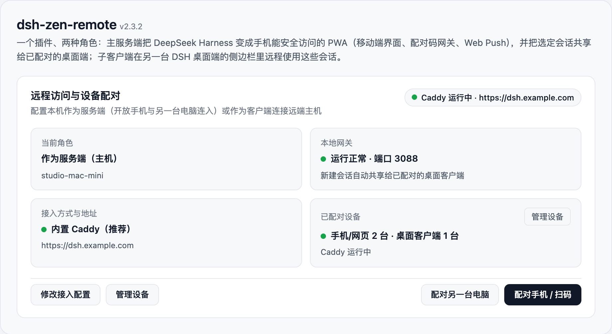

---

### 场景 A：作为主服务端（开放手机与另一台电脑连入）

点击卡片上的**「开始配置向导」**（已配置过则点**「修改接入配置」**），三步完成：

#### 第 1 步：选择「作为服务端（主机）」与接入方式

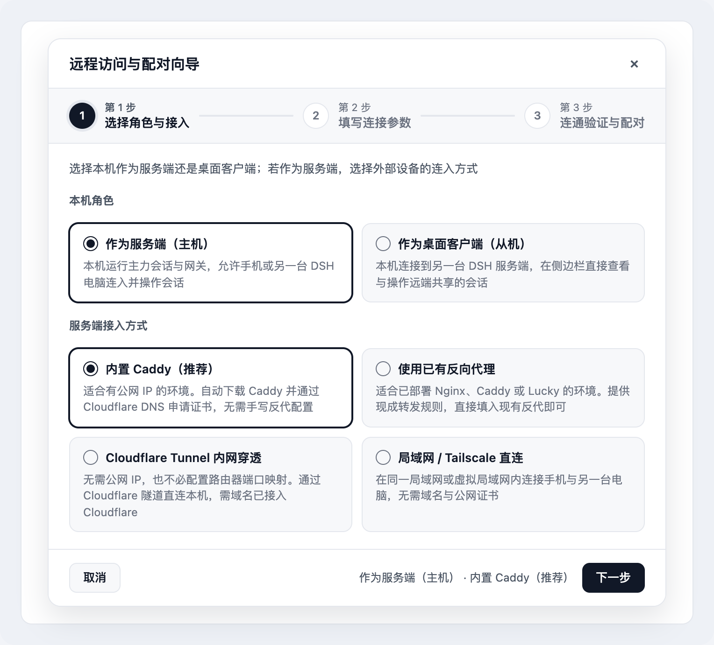

| 接入方式 | 适合什么环境 | 向导自动为你做什么 |
| --- | --- | --- |
| **内置 Caddy（推荐）** | 有公网 IP（或已做端口映射）+ 域名在 Cloudflare | 自动下载预编译 `Caddy + caddy-dns/cloudflare`（国内网络镜像加速），通过 DNS-01 自动申请并续期证书（仅监听 `127.0.0.1:3088`） |
| **使用已有反向代理** | 已跑着 Nginx、Caddy 或 Lucky | 自动生成反代配置片段，支持一键将反代源 IP 写入受信任列表（[手配指南](docs/remote-access.md)） |
| **Cloudflare Tunnel 内网穿透** | 无公网 IP / 不做端口映射 + 域名在 Cloudflare | 自动下载 `cloudflared`、创建或复用隧道、写入 DNS CNAME 并拉起隧道（仅监听 `127.0.0.1:3088`） |
| **局域网 / Tailscale 直连** | 同一 Wi-Fi / 局域网，或共用 Tailscale 虚拟网 | 自动识别本机局域网 / Tailscale IPv4 并监听 `0.0.0.0:3088`，内置**私网源 IP 铁闸**直接拒绝公网 IP 未代理直连（`403 public-direct-forbidden`） |

#### 第 2 步：填写连接参数
- **内置 Caddy / Cloudflare Tunnel**：填写公开域名（如 `dsh.example.com`）并粘贴 Cloudflare API 令牌。
- **使用已有反向代理**：填写外部 `https://` 地址，复制生成的 Nginx / Caddy / Lucky 配置片段。
- **局域网 / Tailscale 直连**：直接确认向导自动检测并预填的 `http://<本机局域网或Tailscale IP>:3088`。

#### 第 3 步：连通验证与扫码 / 配对码配对

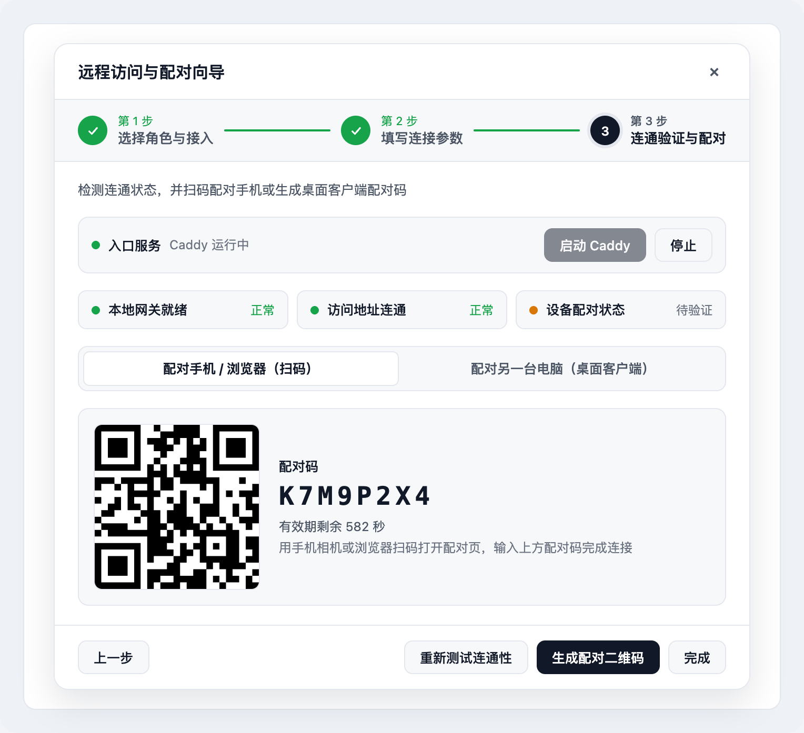

1. **启动入口服务 & 自动连通自检**：点击顶部状态栏**「启动 Caddy」**或**「创建并启动隧道」**（如适用），向导自动探测「本地网关就绪」与「访问地址连通」。
2. **配对手机 / 浏览器（Web 应用端）**：在「配对手机 / 浏览器（扫码）」标签页点**「生成配对二维码」**，手机扫码并输入 8 位配对码进入 DSH，随后点浏览器菜单**「添加到主屏幕」**安装为独立 PWA。
3. **配对另一台电脑（桌面客户端）**：切到**「配对另一台电脑（桌面客户端）」**标签页，点**「生成桌面配对码」**并**「复制地址与配对码」**。

> **日常快捷操作**：配置完成后无需再进向导——直接在总览卡片底部点**「配对手机 / 扫码」**、**「配对另一台电脑」**或**「管理设备」**。

---

### 场景 B：作为桌面客户端（连接最多 8 台远端服务端）

在另一台装了 DSH 桌面端的电脑上（或通过命令行 `dsh-zen-remote client pair <hostUrl> --code <8位码>`）：

1. 打开「插件」页 → `dsh-zen-remote` → 点击**「开始配置向导」**（若已是客户端角色，可直接点**「+ 添加服务端」**）。
2. **第 1 步**：选择**「作为桌面客户端（从机）」**，点击「下一步」。
3. **第 2 步**：填写本机显示名称（如 `MacBook-Pro`）、主服务端的访问地址（公网必须为 `https://`，局域网 / Tailscale 可为 `http://192.168.x.x:3088` 或 `http://100.x.x.x:3088`）以及从主服务端复制来的 8 位桌面配对码，点击**「配对并连接」**。
4. **第 3 步**：三盏状态灯（「本地配对凭证」「服务端连接」「会话与插件同步」）全绿即表示连接成功，左侧边栏会立即出现主服务端共享的工作区与会话分组。
5. **多服务端管理（最多同时连接 8 台主服务端）**：
   - 在向导第 3 步点**「+ 继续添加另一台」**、顶栏总览卡点**「+ 添加服务端」**，或打开**「管理服务端」**弹窗（及底层设置卡片）即可逐台查看在线状态、**立即重连**、**重新配对**、**移除**或**全部移除**（配满 `8 / 8` 台时会有显眼红字提醒上限，已有地址仍可覆盖重配）。
   - 各台主服务端的远程分组严格按**配对添加顺序**合并在本地工作区之后；多台同名主服务端自动编号「名称-1」「名称-2」；模型选单、标题栏连接图标、只读横幅、插件桥与附件上传均按各会话所属 `serverId` 独立隔离。

---

## 3. 日常使用：会话共享与跨端协作

| | **Web 应用端（手机 / 平板 / 浏览器）** | **桌面应用端（另一台 DSH 桌面客户端）** |
| --- | --- | --- |
| 可见范围 | 主服务端上的**全部**会话 | **仅**主服务端已开启「远程访问」的会话（服务端中继强制隔离） |
| 配对凭证 | 浏览器长期 HttpOnly Cookie | 状态文件 `~/.dsh/zen-remote-state.json` 中的设备令牌（Bearer Token） |

### 如何开启或关闭单个会话的远程共享

服务端默认只将你选定的会话暴露给桌面客户端（也可在向导第 2 步勾选「新建会话自动开启远程共享」）。有四个开关入口：

1. **主服务端侧边栏**：在会话行的「…」菜单里点**「开启远程 / 关闭远程」**；

   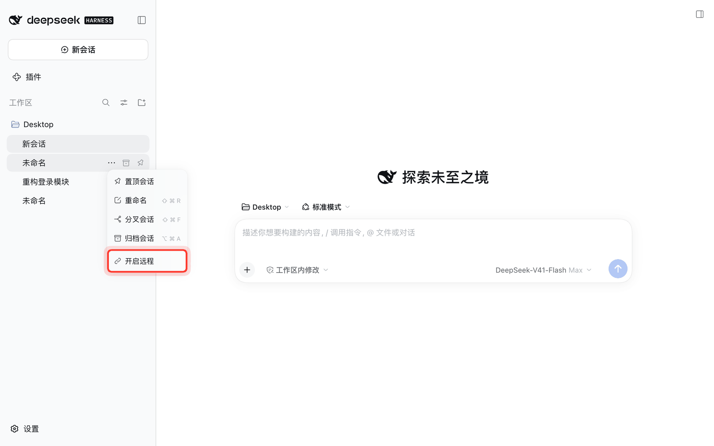

2. **主服务端会话页标题栏**：点击标题右侧的地球图标（悬停可查看剩余闲置休眠时间；图标带绿点代表此刻有桌面客户端正在查看）；
3. **手机端（Web 应用端）会话页**：打开右上角 `ⓘ` 会话信息卡片，切换**「远程访问」**开关；

   <p align="center">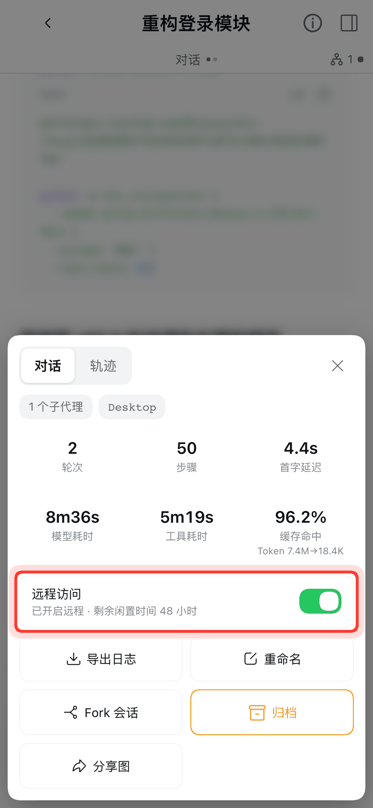</p>

4. **主服务端设置页**：「已开启远程的会话」列表支持逐个关闭或一键全部关闭。

### 在子客户端上使用远程会话

- **侧边栏分组**：服务端至少有一个会话开启远程后，子客户端侧边栏底部会出现**「服务端名 · 工作区名」**分组（最多同时接入 8 台主服务端，按配对顺序排列）。点开即可像本地会话一样查看历史、流式对话、审批工具、使用服务端终端、查看文件树与 Git diff、加载正文图片、下载交付物或拖拽/粘贴/选择文件上传。

  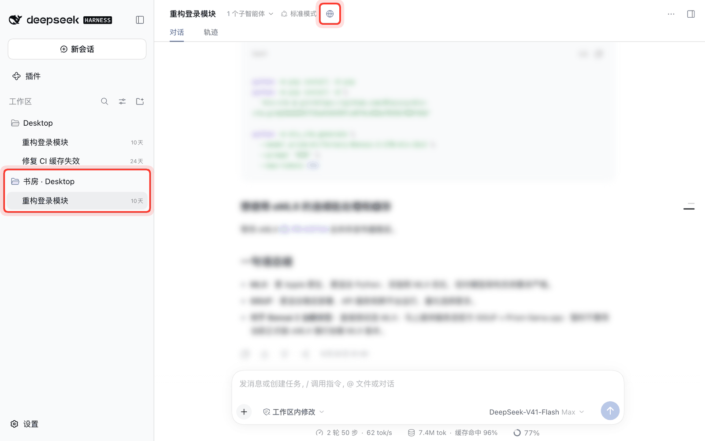

- **关闭与自动休眠**：开启远程的会话若连续 **48 小时**（`idleHours` 可调）无任何回合活动，会自动休眠关闭远程（正在运行或等待审批/回答的会话绝不休眠）。当会话关闭远程、或客户端移除配对/被服务端吊销时，侧边栏会自动将其归档隐藏；正在查看的会话页会展示「远程已关闭」横幅并禁用输入，重新开启后自动恢复。

  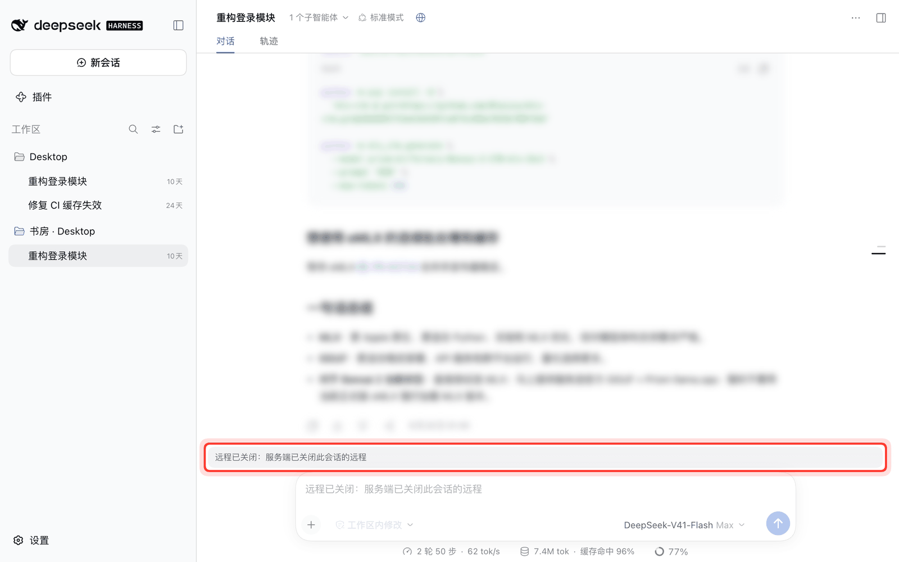

---

## 4. 锁屏推送：通知什么时候会响

默认只在**真正需要你介入**的时候响，分为两条独立通道（推送载荷全程 `aes128gcm` 端到端加密；可通过总开关 `pushEnabled` 一键停用全部通知与 `push_notify` 工具，或开启 `pushSessionName` 在通知正文首行显示 `来源会话：<会话名>`）：

1. **系统自动触发（`pushEnabled` 开启时恒开，不受最小间隔压制）**：
   - **工具等待授权**：等待 `DSH_PUSH_APPROVAL_GRACE_MS`（默认 5 秒，让自动审批插件先行处理）后仍未决时，推送「DSH 等你授权」（附带工具名）。
   - **模型调用 `ask_user_question` 等待回答**：推送「DSH 等你回答」。
2. **模型主动调用（`push_notify` 工具）**：
   - 当你交代「做完告诉我」、或模型遇到阻塞必须你拍板时，模型会主动调用 `push_notify` 推送到手机锁屏。普通回合结束默认不推送（如需每轮结束都推，可打开 `pushTurnEnd`；开启 `pushSummary` 可附带 120 字以内的最终回复摘要）。

---

## 5. 功能一览

- **移动端 PWA 界面（主服务端）**：会话列表主屏 + 独立会话页两级页面栈（左缘右滑返回、安卓返回手势接管、冷启动首帧骨架屏与内容哈希长缓存）、主屏插件入口 chips 自动发现、底部重排 composer（图标化按钮、底部权限/模型 Sheet、手机拍照/文件上传）、会话信息卡（六格统计含 `tok/s` 输出速度、导出日志、重命名、Fork、归档、一键导出 PNG 分享长图、远程访问开关）。
- **一体化配置向导与无头 CLI（`dsh-zen-remote`）**：插件详情页顶部 2×2 实时状态总览、三步向导弹窗，以及同包命令行工具（`setup` / `status` / `host` / `client`），统一覆盖服务端四路接入（内置 Caddy 自动证书、已有反代、Cloudflare Tunnel、局域网/Tailscale 直连 + 私网源 IP 铁闸）与客户端配对。
- **跨桌面端远程会话与多服务端连接池（桌面客户端）**：支持同时连接**最多 8 台主服务端**（按配对顺序合并分组、同名自动编号），提供完整历史与流式对话、审批/提问同步、按 `serverId` 隔离的服务端模型选单、文件树与改动 diff、双工服务端远程终端（`terminal/attach`）、正文内联图片转发、交付物分段下载、服务端 LibreOffice PDF 预览、最大 500 MiB 非图片大文件流式上传（拖拽、回形针选择、粘贴全覆盖）及一键导出脱敏诊断报告。
- **第三方插件桥（Plugin Bridge）**：协作插件登记桥接声明或通过内置适配器（如 `dsh-better-sidebar` `0.25.0`–`0.30.1`），即可在远程会话中直接读写主服务端的数据面板（整机数据需服务端主人逐插件授权）。详见 [插件桥文档](docs/plugin-bridge.md)。

深度说明：[界面设计文档](docs/interface.md) · [公网接入与中继协议](docs/remote-access.md)

---

## 6. 进阶配置与字段参考

日常使用只需通过插件详情页顶部的**「远程访问与设备配对」向导**（或终端 `npx dsh-zen-remote setup`）即可完成全部配置。若需微调底层参数，可在 `dsh-zen-remote` 插件详情页的**「包含的组件」**下再次点击 `dsh-zen-remote` 展开底层配置卡片。

| 主服务端角色与配对卡片 | 已开启远程的会话列表 | 子客户端配置与诊断卡片 |
| --- | --- | --- |
| 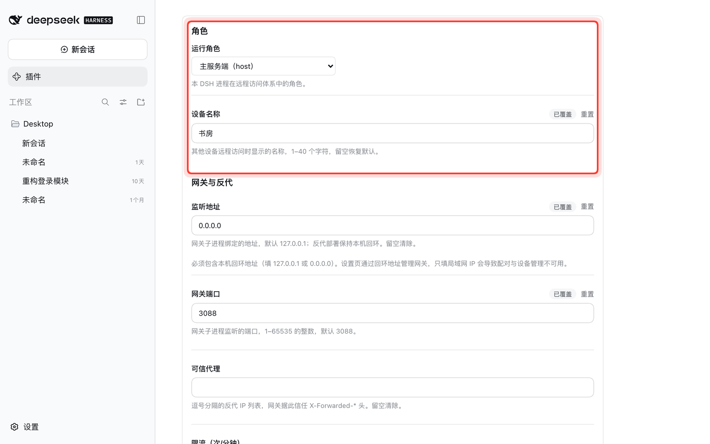 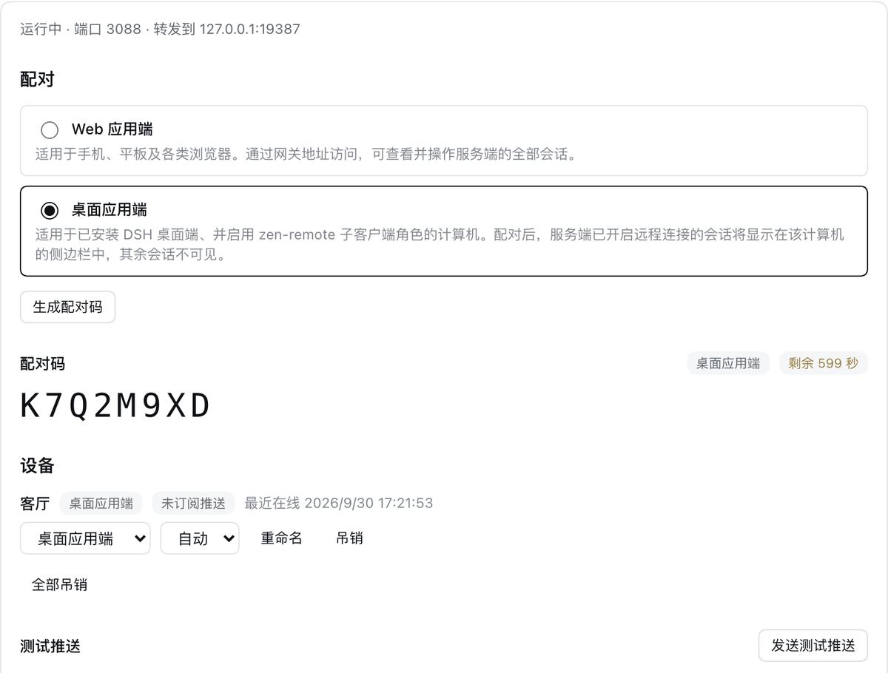 | 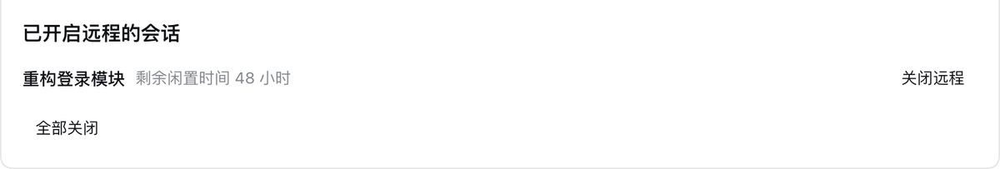 | 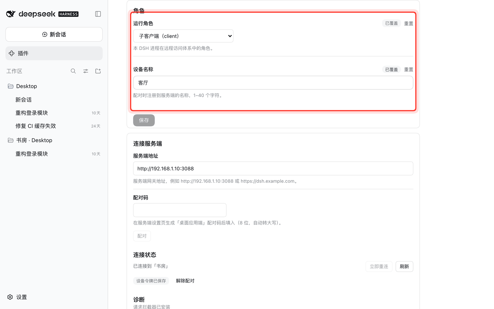 |

<details>
<summary>展开查看全部配置字段参考表与环境变量</summary>

每个字段按此顺序取第一个合法值：**环境变量 > 插件行设置 > `~/.dsh/lan-gate.config.json` > 默认值**。修改需要重启网关/推送的字段后插件会自动重载，无需重启 App。

| 字段 | 默认值 | 说明 |
| --- | --- | --- |
| `role` | `host` | `host` 运行网关 + 推送 + 共享；`client` 作为桌面客户端连接远端服务端 |
| `serverName` | 电脑名 | **设备名称**（≤ 40 字），主服务端作侧边栏分组标题，子客户端作配对登记名；子客户端改名后向其已配对的各主服务端单向广播（服务端不再反写） |
| `port` | `3088` | 本地网关端口；被占用时自动向上递增重试（最多 +20） |
| `host` | `127.0.0.1` | 网关监听地址；本机反代/隧道保持 `127.0.0.1`，局域网/Tailscale 直连设为 `0.0.0.0` |
| `targetPort` | （自动） | 本机 DSH Web UI 端口，留空自动探测宿主实际监听端口 |
| `rateLimit` | `120` | 未配对请求每分钟速率上限（按真实客户端 IP 计数） |
| `trustedProxies` | 空 | 逗号分隔的受信任反代 IP（反代不在本机时配置） |
| `vapidSubject` | `mailto:admin@localhost` | Web Push 联系标识（**iOS 必须为真实邮箱或 `https://` 网址**，否则 Apple 拒收） |
| `lang` | `auto` | 网关页面与通知语言：`auto`（跟随浏览器）、`zh`、`en` |
| `pushEnabled` | 开 | 会话通知总开关；关闭后停用全部自动推送，也不再注册 `push_notify` 工具与提示词段落 |
| `pushSessionName` | 关 | 推送正文第一行加「来源会话：<会话名>」（标题保持固定事件标题不变） |
| `pushTurnEnd` | 关 | 普通回合结束时是否也发送推送（等授权/等回答的通知恒开，不受此项影响） |
| `pushEvents` | `agent/turn-stopping` | 触发回合结束推送的事件名（逗号分隔） |
| `pushDebounceMs` | `15000` | 两条自动推送之间的最小间隔毫秒数 |
| `pushSummary` | 关 | 推送通知正文是否附带本回合最终回复摘要（截断至 120 字） |
| `pushTool` | 开 | 是否向模型注册 `push_notify` 主动推送工具 |
| `idleHours` | `48` | 远程共享会话的闲置自动休眠时长（小时，范围 `(0, 8760]`） |
| `autoShareNewSessions` | 关 | 主服务端新建的会话是否自动开启远程共享 |
| `pluginBridgeConsent` | `{}` | 插件桥整机数据授权表（插件名 → 布尔值） |
| `serverUrl`（客户端） | 空 | 远端主服务端的网关地址（公网强制 `https://`，内网允许 `http://`）。旧版单服务端字段：已配对列表现存于 `~/.dsh/zen-remote-state.json`（最多 8 台），该行凭证会在首次启动时自动迁入 |
| `deviceToken`（客户端） | 空 | 配对签发的客户端设备令牌（密钥字段，界面脱敏）。旧版单服务端字段，与 `serverUrl` 一同自动迁入状态文件；新配对走设置卡片 / 向导，令牌从不回传浏览器 |
| `turnFoldDesktop` | 关 | 是否在桌面端宽度也默认折叠回合中间过程 |
| `keyboardLiftRatio` / `keyboardLiftMaxPx` / `keyboardSafetyPadPx` | `0.42` / `400` / `15` | 软键盘高度不可见环境下的输入框抬升校准参数 |
| `maxUploadBytes` | 20 MB | 手机端单次附件上传大小上限 |

历史环境变量（优先级高于插件行）：`LAN_GATE_PORT`、`LAN_GATE_HOST`、`LAN_GATE_TARGET_PORT`、`LAN_GATE_RATE_LIMIT`、`LAN_GATE_TRUSTED_PROXIES`、`LAN_GATE_VAPID_SUBJECT`、`LAN_GATE_LANG`、`DSH_PUSH_ENABLED`、`DSH_PUSH_SESSION_NAME`、`DSH_PUSH_TURN_END`、`DSH_PUSH_EVENTS`、`DSH_PUSH_DEBOUNCE_MS`、`DSH_PUSH_SUMMARY`、`DSH_PUSH_TOOL`、`DSH_PUSH_LANG`、`DSH_PUSH_APPROVAL_GRACE_MS`。

</details>

---

## 7. 架构、安全模型与已知说明

- **受信任客户端与严格会话隔离**：已配对的桌面客户端在远程会话中以服务端系统用户权限运行终端与文件预览，而未开启远程的会话在服务端中继层被严格过滤或拒绝；即便在局域网模式下监听 `0.0.0.0`，网关内置私网源 IP 铁闸也会直接拒绝公网 IP 的未代理直连（`403 public-direct-forbidden`），且配对、向导与设备管理操作仅限在服务端本机执行。
- **版本容错**：主服务端与子客户端需保持 `dsh-zen-remote` 版本一致；两端 DSH 宿主版本可以不同（握手时自动比对接口规范化指纹，存在差异时仅受影响的单面板降级，其余功能照常工作）。

<details>
<summary>展开查看状态文件与隐私说明、已知限制、iOS PWA 适配与已适配第三方插件列表</summary>

**状态文件与数据隐私**
- 插件自身不向任何第三方收集或上报数据。网关配对状态存于 `~/.dsh/lan-gate-state.json`；主进程三合一状态文件 `~/.dsh/zen-remote-state.json`（`0600`）统一保存本机 `serverId`、共享会话表 `sessions` 与子客户端已配对服务端列表 `servers`（含令牌，最多 8 台）；托管的 Cloudflare 令牌以 `0600` 权限存于 `~/.dsh/zen-remote-ingress/`。

**已知限制**
- 同时打开多个 DSH 窗口时，子客户端对「当前正打开哪个会话」的判断可能存在偏差。
- 切换服务端或服务端重建同 ID 工作区后，需刷新一次客户端页面以重新加载侧边栏分组。
- 远程会话禁用「导出会话」，并隐藏会在服务端机器本机弹窗的「在访达中显示 / 在应用中打开」按钮。
- 经反向代理在外部浏览器访问时，DSH 宿主自身的「设置」页不可修改（DSH 官方设计将设置 RPC 限制为本机回环连接），修改插件配置请直接在服务端本机操作。

**iOS 独立 PWA 已知系统问题**
- **iOS 26.x 独立 PWA 视口缩水**：添加到主屏幕后底部可能少一条状态栏高度（iOS WebKit 缺陷），插件已内置三层缓解，彻底恢复需划掉 App 重开。
- **iOS 26+ 顶部系统渐进模糊**：从主屏幕打开时顶部约 95px 区域可能出现系统合成层模糊遮罩（`WKScrollPocket`），点进任意会话再返回列表页即可消除。

**已适配的第三方插件**

| 插件 | 移动端与远程适配内容 | 实测版本 |
| --- | --- | --- |
| [dsh-better-sidebar](https://github.com/omdsh-dev/DSH-better-sidebar) | 移动端右栏全屏抽屉、左缘滑回与安全区避让；**插件桥**内置适配 `0.25.0` 至 `0.30.1` 九版（服务端授权后远程会话可直接读写服务端文件/Git/任务面板） | 0.19.1 / 适配器 0.25–0.30.1 |
| [@nanmicoder/dsh-agent-teams](https://github.com/NanmiCoder/dsh-agent-teams) | AgentTeams 活动浮层避让会话顶栏、子代理头部保留父会话一键返回 | 0.1.9 |
| [@ychris12138/dsh-usage-stats](https://github.com/Ychris12138/dsh-usage-stats) | 用量与余额入口收进手机主屏 chips 行 | 0.2.9 |
| [@opendsh/dsh-plugin-scheduled-tasks](https://github.com/Ceelog/dsh-plugins) | 定时任务入口收进手机主屏 chips 行 | 0.2.3 |
| dsh-at-file | 手机端去重 `.dsh-uploads/` 附件引用行 | 0.6.7 |
| [@ace-zone/dsh-market](https://www.npmjs.com/package/@ace-zone/dsh-market) | 插件市场弹窗顶栏移动端紧凑化，保留关闭按钮与语言切换 | 0.1.66 |
| [dsh-vision-toolkit](https://www.npmjs.com/package/@anionex/dsh-vision-toolkit) | 配合手机端附件上传进行图像问答/OCR | — |
| [dsh-web-ui 全家桶](https://www.npmjs.com/package/@linxin666/dsh-web-ui-all) | 沿用文件树与预览浮层移动端限宽居中规则 | — |

</details>

---

## 上游致谢

本插件的界面层衍生自 [mexiaosqwq/dsh-web-mobile](https://github.com/mexiaosqwq/dsh-web-mobile)，通道层衍生自 [zylzyqzz/dsh-mobile-pwa](https://github.com/zylzyqzz/dsh-mobile-pwa)（其自身衍生自 [Bernardxu123/dsh-mobile-gate](https://github.com/Bernardxu123/dsh-mobile-gate)），均为 MIT，原始版权行保留在 [LICENSE](LICENSE)。

## License

[MIT](LICENSE)
